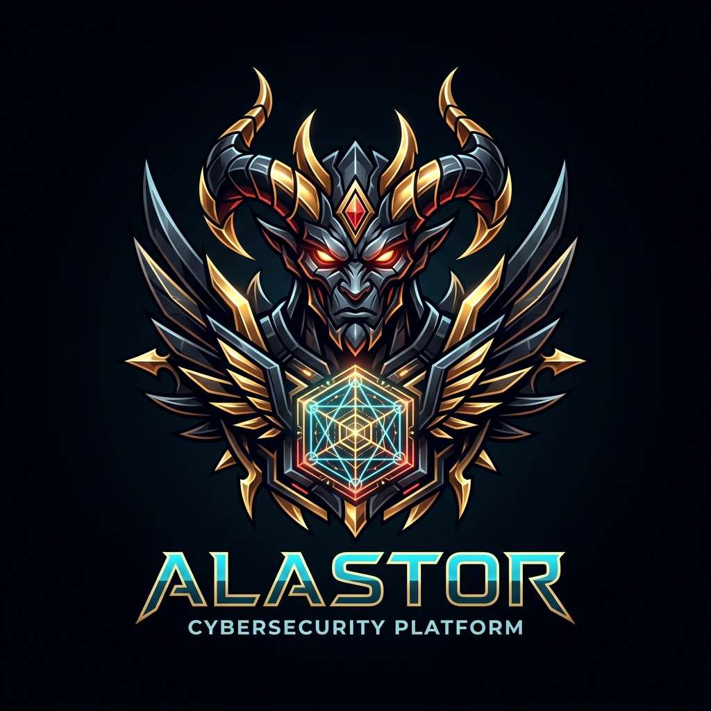
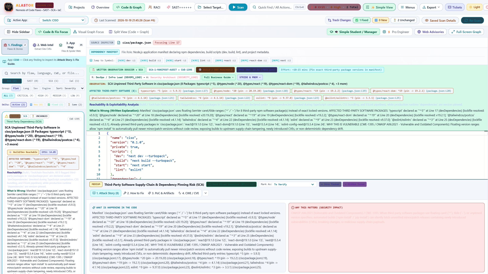
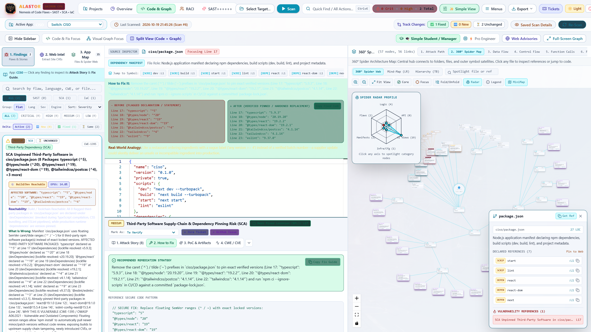
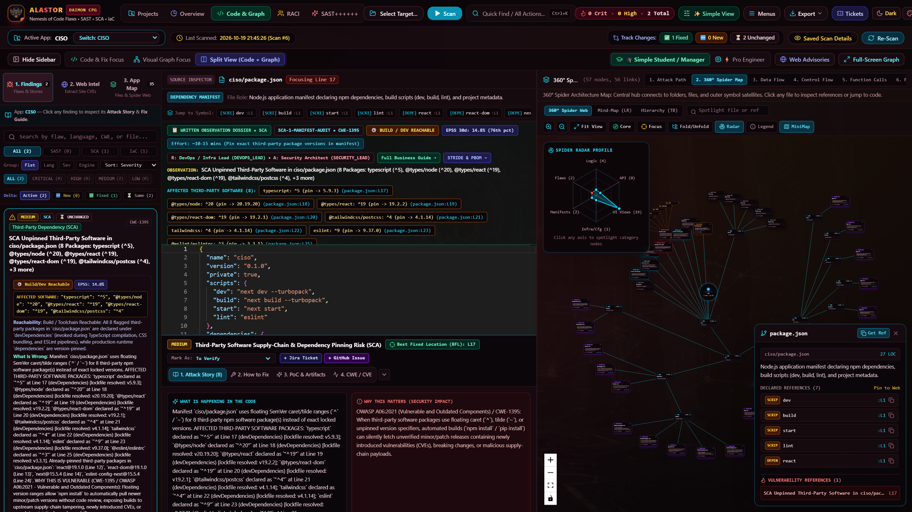
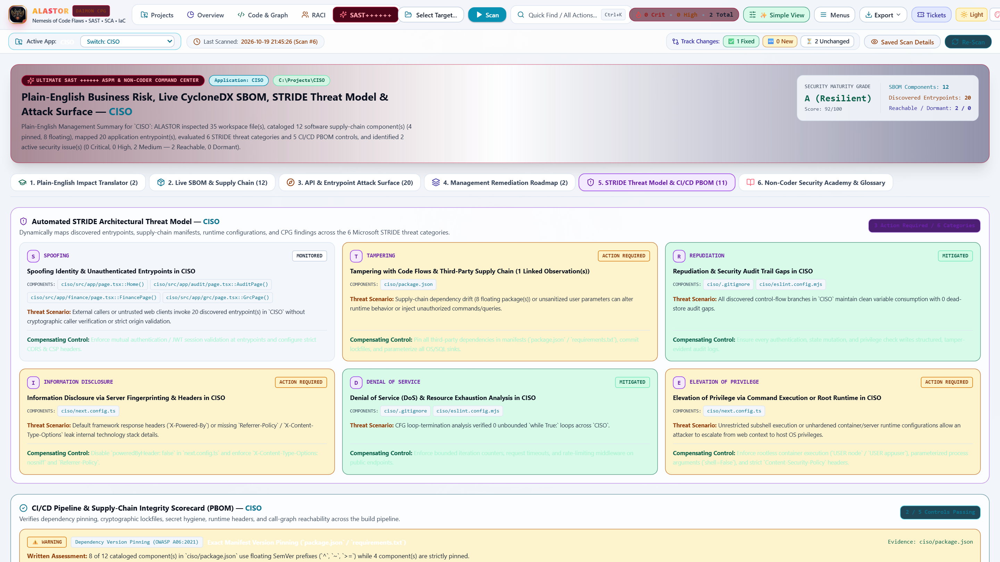
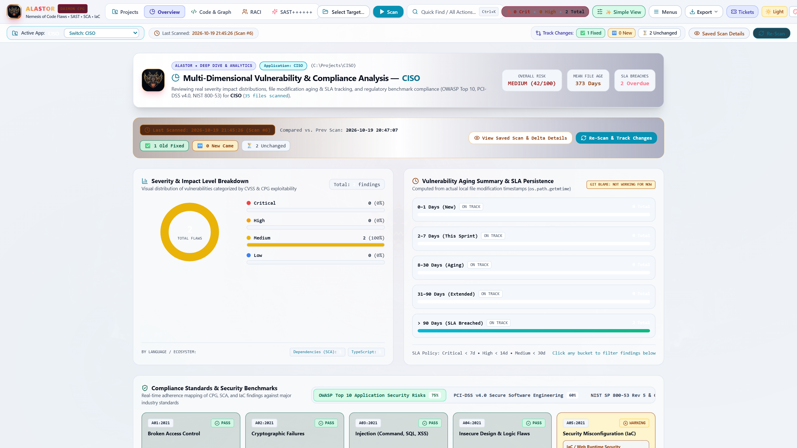
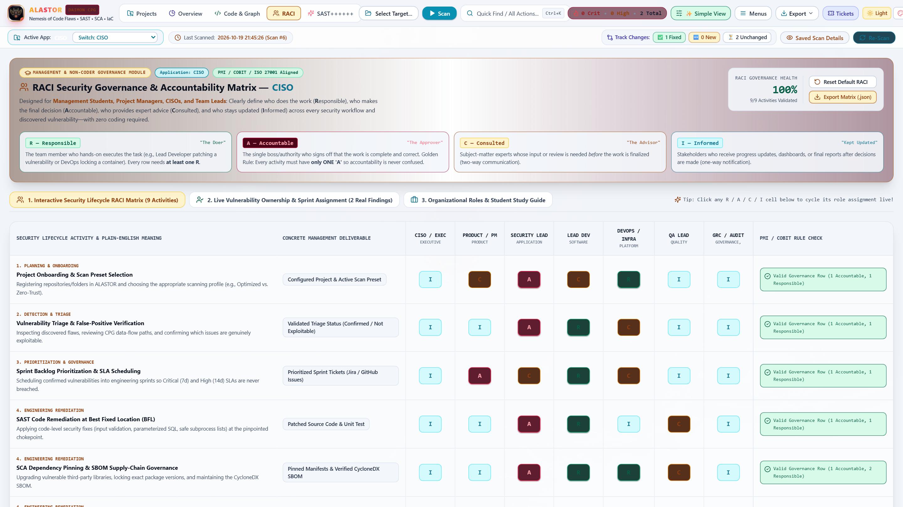
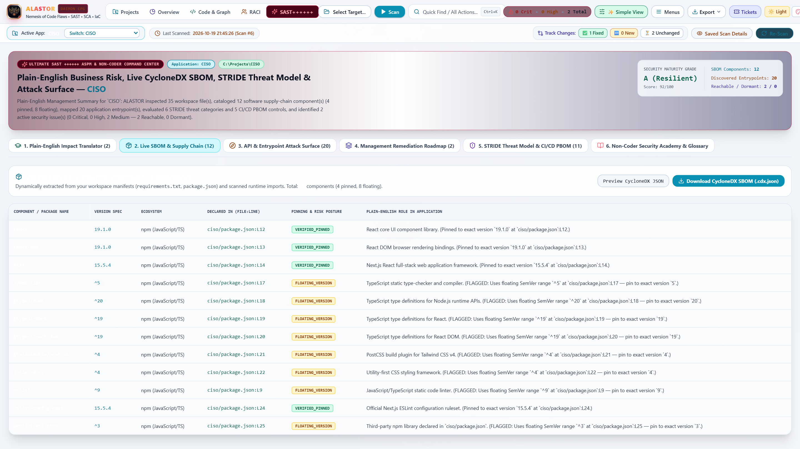

<div align="center">

# ALASTOR (`Ἀλάστωρ`) — Deterministic Code Property Graph (CPG), SAST, SCA, IaC & ASPM Security Platform



**Open-Source Deterministic Code Property Graph (Tree-Sitter AST + CFG + DFG over Neo4j) • Unified SAST, SCA & IaC • Call-Graph Reachability • EPSS v4 • Side-by-Side Remediation Diffs • Automated STRIDE Threat Modeling • CycloneDX v1.5 SBOM & CI/CD PBOM • Interactive PMI/COBIT RACI Governance**

[](./LICENSE)
[-emerald.svg)](./verify_harness.py)
[](./backend/main.py)
[](./backend/engine/enterprise_manager.py)

[**📖 Full Master Product Guide & Standard Operating Procedure (SOP)**](./docs/ALASTOR_Master_SOP_and_Product_Guide.md) • [**🔬 Contributing Guide for Security Researchers**](./CONTRIBUTING.md) • [**🛡️ Security Policy**](./SECURITY.md)

</div>

---

## 🔥 Overview

Named after **Alastor (`Ἀλάστωρ`)**, the relentless Greek mythological spirit of retribution who hunts down hidden corruptions, **ALASTOR** is a next-generation, 100% local-first **Code Property Graph (CPG) & Application Security Posture Management (ASPM)** platform built for **Security Researchers, AppSec Engineers, Developers, and CISOs**.

Unlike regex-based scanners that flood teams with false positives and cryptic rule IDs, ALASTOR compiles source code into a unified **Abstract Syntax Tree (AST)**, **Control-Flow Graph (CFG)**, and **Data-Flow Graph (DFG)** inside **Neo4j + APOC**, and pairs every finding with a complete **Written Observation Dossier**, **Call-Graph Reachability Proof**, **EPSS v4 30-Day Exploit Probability**, and a **Side-by-Side Before (`-`) vs. After (`+`) Code Diff**.



---

## ✨ Key Capabilities

1. **Deterministic Code Property Graph (CPG) Engine (`AST + CFG + DFG`)**
   - Multi-language **Tree-Sitter** parser (`Python`, `TypeScript`, `JavaScript`, `React/Next.js`, `JSON/YAML/Dockerfile`) backed by **Neo4j + APOC**.
   - Detects inter-procedural taint vulnerabilities (`RULE-1-TAINT`), dormant zero-day gadgets (`RULE-2-ORPHAN`), dead stores (`RULE-3-DEADSTORE`), non-terminating loops (`RULE-4-INFINITE-LOOP`), and unreachable code (`RULE-5-UNREACHABLE`) with **0% false positives on sanitized flows**.
2. **Always-Visible Written Observation Dossier & Side-by-Side Code Diff**
   - Every SAST, SCA, and IaC finding explicitly lists affected third-party packages/lines, lockfile-resolved versions, *What Is Wrong*, *Why It Matters*, a *Real-World Analogy*, and a **Side-by-Side Before (`-`) vs. After (`+`) Remediation Code Diff** with 1-click copy.
3. **Call-Graph Reachability & EPSS v4 Exploitability Prioritization**
   - Classifies every finding as `🎯 RUNTIME REACHABLE`, `⚙️ BUILD / DEV REACHABLE`, or `💤 DORMANT / UNREACHABLE` with a written reachability proof alongside **30-Day EPSS Exploit Probability** and percentile ranking.
4. **Saved Scan Snapshots & Continuous Track Changes Mode**
   - Persists scan snapshots with `Last Scanned` timestamps so users can inspect historical findings immediately without rescanning every time, and computes automatic **Track Changes Deltas** (`✅ Old Fixed`, `🆕 New Came`, `⏳ Unchanged`) across rescans.
5. **Automated Microsoft STRIDE Threat Model, CycloneDX v1.5 SBOM & CI/CD PBOM**
   - Dynamically maps application entrypoints, manifests, and findings across all **6 STRIDE Threat Categories** (`S`, `T`, `R`, `I`, `D`, `E`), generates a live **CycloneDX v1.5 SBOM**, and audits **5 CI/CD Pipeline Bill of Materials (PBOM)** controls.
6. **Interactive PMI / COBIT RACI Governance Matrix**
   - Live `7 Roles × 9 Security Lifecycle Activities` RACI matrix with automated Golden Rule validation (`100% Governance Health Score`).
7. **Adaptive Dual-Mode UI (`Simple Clean View` vs. `Pro Detailed View` + 6 Light/Dark Mythic Themes)**
   - Switch effortlessly between **Simple View** (clutter-free workflow) and **Pro View** (full desktop menus & query inspector), and toggle between **Olympian Daylight (Light Mode)** and **Alastor Infernal (Dark Mythic Mode)**.

---

## 🖼️ Platform Gallery

### 1. Side-by-Side Before (`-`) vs. After (`+`) Code Diff & 360° Architecture Spider Map


### 2. Dark Mythic Theme (`Alastor Infernal`) — Split Code & CPG View


### 3. Automated Microsoft STRIDE Threat Model & CI/CD Pipeline BOM (PBOM)


### 4. Overview & Deep-Dive Analytics (Severity, SLA Aging & OWASP / PCI-DSS / NIST Compliance)


### 5. Interactive RACI Security Governance & Accountability Matrix


### 6. Live CycloneDX v1.5 SBOM & Supply-Chain Inspector


---

## 🚀 Quick Start

### Prerequisites
- **Docker Desktop** (for Neo4j 5 + APOC graph database)
- **Python 3.11+**
- **Node.js 18+ & npm**

### 1. Start Neo4j + APOC
```bash
docker compose up -d neo4j
```

### 2. Start the FastAPI CPG & ASPM Backend (`http://127.0.0.1:8000`)
```bash
python -m venv .venv
# Windows PowerShell:
.\.venv\Scripts\Activate.ps1
pip install -r backend/requirements.txt

cd backend
python -m uvicorn main:app --host 127.0.0.1 --port 8000
```

### 3. Start the Next.js Frontend (`http://localhost:3000`)
```bash
cd frontend
npm ci
npm run build
npm run start
```
Then open **`http://localhost:3000`** in your browser.

---

## 🧪 Running the 17-Assertion Autonomous Verification Suite

ALASTOR includes an end-to-end verification harness ([`verify_harness.py`](./verify_harness.py)) that tests Neo4j APOC, all CPG rules, multi-site advisory extraction, BFL, RACI, SBOM, STRIDE, PBOM, SARIF v2.1.0 export, Track Changes, and performs a **full self-audit of `cpg-sast-platform` asserting 0 unpatched findings**:

```bash
.\.venv\Scripts\python.exe verify_harness.py
```

---

## 📚 Full Documentation & Standard Operating Procedure (SOP)

See [**`docs/ALASTOR_Master_SOP_and_Product_Guide.md`**](./docs/ALASTOR_Master_SOP_and_Product_Guide.md) for the complete competitive benchmark, architectural reference, and 7-part step-by-step operator manual.

---

## 🤝 Contributing for Security Researchers

We warmly invite security researchers to contribute new CPG taint queries, language parsers, reachability rules, and autofix templates! See [**`CONTRIBUTING.md`**](./CONTRIBUTING.md) to get started.
