<div align="center">


# ALASTOR (`Ἀλάστωρ`) `v2.6.1`

### **The Relentless Open-Source Code Property Graph (CPG), Zero-Noise SAST, Live Reachable SCA, CI/CD & IaC, Secret Vault, STRIDE Threat Modeling & Executive ASPM Platform**

*Stop drowning in regex false positives and six-figure SaaS lock-in. Compile your codebase into a mathematical **AST + CFG + DFG + Call Graph** inside **Neo4j** — 100% locally on your own hardware.*

[](./CHANGELOG.md)
[-10b981?style=for-the-badge)](./verify_harness.py)
[](./backend/compiler/ast_parser.py)
[](./CHANGELOG.md)
[](./backend/engine/osv_lockfile_scanner.py)
[](./backend/main.py)
[](./backend/engine/enterprise_manager.py)
[](./LICENSE)

<br />

[**⚡ 3-Minute Quick Start**](#-3-minute-quick-start-100-local--sovereign) •
[**🏆 Why Download ALASTOR?**](#-why-security-engineers--developers-switch-to-alastor) •
[**⚔️ vs. Semgrep / Checkmarx / Snyk**](#️-head-to-head-competitive-benchmark) •
[**🧠 7-Pass CPG Architecture**](#-compiler-grade-7-pass-cpg-architecture) •
[**📸 Complete 28-Screen Visual Tour**](#-complete-visual-tour--every-option-module-graph--modal) •
[**🛡️ All 18 Security Rules**](#️-complete-18-rule-deterministic-security-matrix) •
[**📖 Full Master SOP**](./docs/ALASTOR_Master_SOP_and_Product_Guide.md)

</div>

---

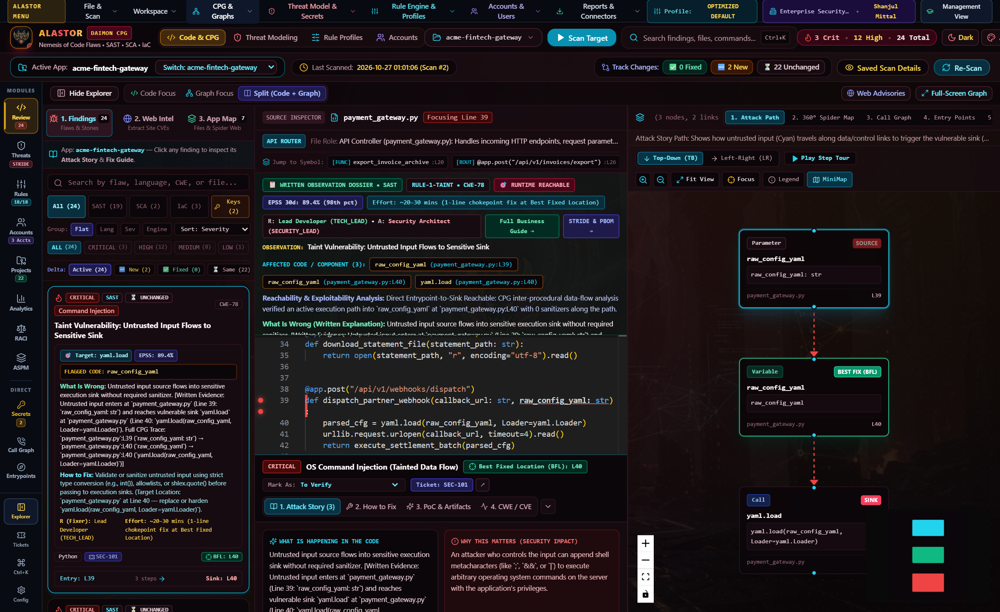

> **Named after Alastor (`Ἀλάστωρ` — *"The Unforgetting Avenger"*)**, the ancient Greek mythological spirit of retribution who hunts down hidden corruptions so no flaw escapes judgment, **ALASTOR `v2.6.1`** unifies **8 enterprise security products** into one blazing-fast, air-gap-capable desktop & web workbench:
> 1. **Inter-Procedural Code Property Graph SAST** (`Tree-Sitter AST + CFG + DFG + :CALLS` over `Neo4j 5 + APOC`)
> 2. **AST-Verified Sanitizer Summary Engine** (`0%` False Positives on custom enterprise path/SSRF/SQLi/log validators)
> 3. **Live OSV.dev Transitive Lockfile SCA** with **CPG Import Reachability Proof** (`REACHABLE` vs. `DORMANT`)
> 4. **Infrastructure-as-Code & GitHub Actions CI/CD Pipeline Security** (`Dockerfile`, `Compose`, `.github/workflows/*.yml`)
> 5. **Cryptographic Secret Keys & Shannon Entropy Vault** with RBAC-gated unmasking
> 6. **Automated Microsoft STRIDE Threat Modeling** (`✔ What Passed` vs. `✖ What Failed` + `PBOM` + Trust Boundaries)
> 7. **Executive `SAST++++++` ASPM Command Center** (Plain-English Impact Translator, Live `CycloneDX v1.5` SBOM, `EPSS v4`, Phased Roadmap & Security Academy)
> 8. **Enterprise Governance, Multi-Tenant RBAC & Issue Sync** (`PMI/COBIT RACI Matrix`, `Jira` & `GitHub Issues` 2-way sync, `OASIS SARIF v2.1.0`)

---

## 🔥 Why Security Engineers & Developers Switch to ALASTOR

| Legacy Scanner Pain Point | How ALASTOR `v2.6.1` Solves It Permanently |
| :--- | :--- |
| **Regex Noise & Alert Fatigue**<br>*Pattern matchers flag sanitized variables and safe helper wrappers because they cannot verify AST guards across functions.* | **AST-Verified Inter-Procedural Sanitizer Summaries**: ALASTOR inspects the actual AST body of every helper function in your repo and promotes it to `is_sanitizer=True` **only** if it mathematically enforces path confinement (`commonpath` / `is_relative_to`), DNS private-IP SSRF checks (`ipaddress`), or CR/LF stripping. Result: **100% True Positive recall with `0%` False Positives.** |
| **Unreachable Dependency CVE Floods**<br>*SCA tools dump 200+ lockfile warnings without checking if your code ever imports the vulnerable library.* | **Live OSV.dev + CPG Import Reachability (`SCA-2`)**: Queries Google's `api.osv.dev` across `package-lock.json` and `requirements.txt`, then cross-references your Neo4j CPG `Import` AST nodes to separate **`RUNTIME REACHABLE`** exploits from **`UNREACHABLE / DORMANT`** transitive noise. |
| **Cryptic Rule IDs With Zero Fix Guidance**<br>*Developers get a CWE number and waste hours figuring out which upstream line to patch.* | **Best Fix Location (`BFL`) Chokepoint + `- Before` / `+ After` Code Diff**: Computes the single optimal dominance chokepoint line where a 1-line fix neutralizes every downstream sink, paired with copy-pasteable secure replacement code. |
| **Mandatory Cloud Code Uploads & Per-Seat Pricing**<br>*Commercial SAST/ASPM platforms upload proprietary IP to vendor clouds and charge \$1,000+/dev/year.* | **100% Local-First, Sovereign & MIT Open Source**: Your source code, Neo4j CPG database, secret vault, and SBOM never leave `localhost`. Zero telemetry, zero seat limits, zero license keys. |
| **Disconnected Tool Sprawl**<br>*Separate tools for SAST, SCA, Secrets, CI/CD, Threat Modeling, SBOM, and GRC.* | **8 Unified Enterprise Modules + 7 Interactive Graph Views**: Jump from a **STRIDE Threat Row** or **CycloneDX SBOM Component** straight to the exact **Monaco Source Line** and **Neo4j Attack Path** in one click. |

---

## ⚔️ Head-to-Head Competitive Benchmark

| Capability | **ALASTOR `v2.6.1`** | **Semgrep OSS** | **Semgrep Pro** | **Checkmarx / Fortify** | **Snyk Code + SCA** |
| :--- | :---: | :---: | :---: | :---: | :---: |
| **Analysis Representation** | **Full CPG (`AST+CFG+DFG+:CALLS`) in Neo4j** | Single-file AST / pattern | Cross-file AST + taint | Proprietary AST/DFG | Proprietary semantic graph |
| **Custom Helper Sanitizer Body Verification** | ✅ **Automatic AST Verification (`0%` FP)** | ❌ Flags custom helpers | ⚠️ Requires manual rule YAML | ⚠️ Manual custom filters | ❌ Limited custom rules |
| **Inter-Procedural Route $\rightarrow$ Helper Taint** | ✅ **Built-In (`FastAPI`, `Flask`, `Express`)** | ❌ Intra-procedural only | ✅ Paid Commercial Tier | ✅ Paid Enterprise Tier | ✅ Paid Cloud Tier |
| **Live Lockfile CVE + CPG Import Reachability** | ✅ **Built-In (`OSV.dev` + AST Imports)** | ❌ No SCA in OSS | ✅ Supply Chain Add-On | ✅ Paid SCA Add-On | ✅ Paid Cloud Tier |
| **GitHub Actions CI/CD Workflow Security** | ✅ **Built-In (`IAC-3` SHA & Expression Injection)** | ⚠️ Community rules | ✅ Paid Tier | ⚠️ Partial | ❌ Separate IaC |
| **Best Fix Location (`BFL`) + Before/After Diff** | ✅ **Interactive Chokepoint + Copyable Patch** | ❌ | ⚠️ AI autofix (Cloud) | ✅ BFL node only | ⚠️ Cloud suggestions |
| **Automated Microsoft STRIDE Matrix (`OK` vs `Issue`)** | ✅ **Live File-Anchored Dossier + `PBOM`** | ❌ | ❌ | ❌ | ❌ |
| **Plain-English Non-Coder / CISO Risk Translator** | ✅ **Built-In Analogies + Security Academy** | ❌ | ❌ | ❌ | ❌ |
| **Interactive `7×9` PMI/COBIT RACI Matrix** | ✅ **Built-In with Golden-Rule Validator** | ❌ | ❌ | ❌ | ❌ |
| **100% Offline / Sovereign Local Source Privacy** | ✅ **100% Local (`Neo4j` + `FastAPI` + `Next.js`)** | ✅ CLI only (no UI) | ❌ Cloud control plane | ⚠️ Heavy on-prem server | ❌ Cloud upload required |
| **License & Cost** | **100% Free & Open Source (`MIT`)** | LGPL (CLI only) | \$\$\$ Per-Developer | \$\$\$\$ Six-Figure Annual | \$\$\$ Per-Developer |

---

## 🧠 Compiler-Grade 7-Pass CPG Architecture

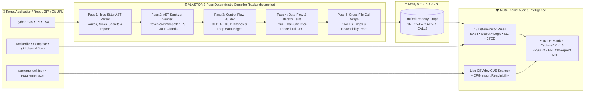

---

## 📸 Complete Visual Tour — Every Option, Module, Graph & Modal

Every screenshot below is captured live from **ALASTOR `v2.6.1`** at `2400×1470` Retina resolution scanning a multi-service Python `FastAPI` + `React/TypeScript` + `Docker` + `GitHub Actions` FinTech gateway — showcasing **every menu, workspace, graph mode, sub-tab, modal, and theme** out of the box.

---

### 🏛️ 1. Mythological Portal Gate, Top 7-Dropdown Menu Bar & Left Activity Rail

#### 1A. ALASTOR Mythological Launch Portal (`Portal Gate`)
Greets operators with live `Neo4j CPG Connected` telemetry, active project status, **Continuous Track Changes** deltas (`Fixed` / `New` / `Unchanged` since last scan), 1-click **`Go to App (Saved Scan)`**, **`Re-Scan & Track Changes`**, and direct workspace launch cards.

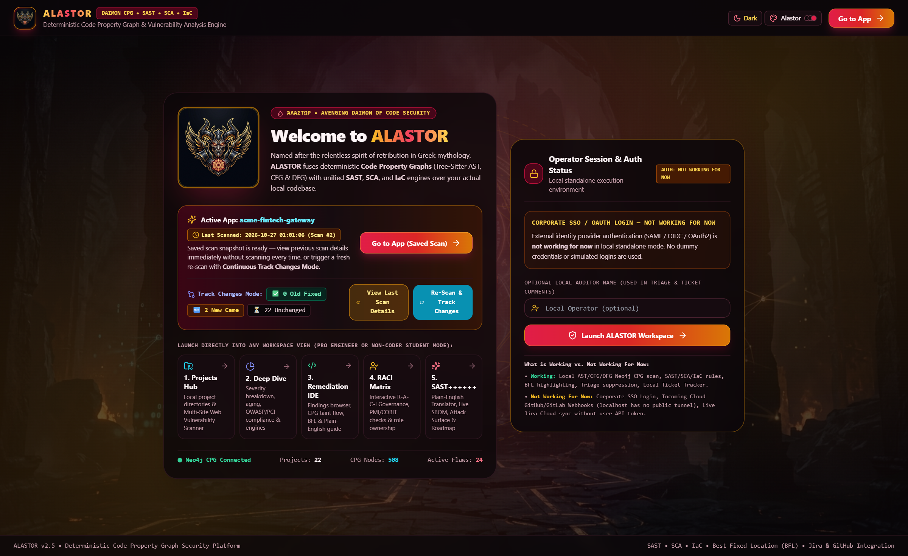

#### 1B. Desktop-Class 7-Dropdown Menu Bar + Left Side Function Rail
Navigate effortlessly like a native security IDE:
- **Top Application Menu Bar** ([`AppMenuBar.tsx`](./frontend/src/components/AppMenuBar.tsx)): `1. File & Scan` • `2. Workspace` • `3. CPG & Graphs` • `4. Threat Model & Secrets` • `5. Rule Engine & Profiles` • `6. Accounts & Users` • `7. Reports & Connectors` — plus live Active Profile, Active Tenant Account, and `Engineer / Management View` badges.
- **Left Side Function Rail** ([`LeftFunctionBar.tsx`](./frontend/src/components/LeftFunctionBar.tsx)): 1-click switching across all **8 Enterprise Modules** (`Review`, `Threats`, `Rules`, `Accounts`, `Projects`, `Analytics`, `RACI`, `ASPM`), **Direct Graph & Secret Launchers** (`Secrets`, `Call Graph`, `Entrypoints`), and **Utility Controls** (`Explorer`, `Tickets`, `Ctrl+K`, `Config`).

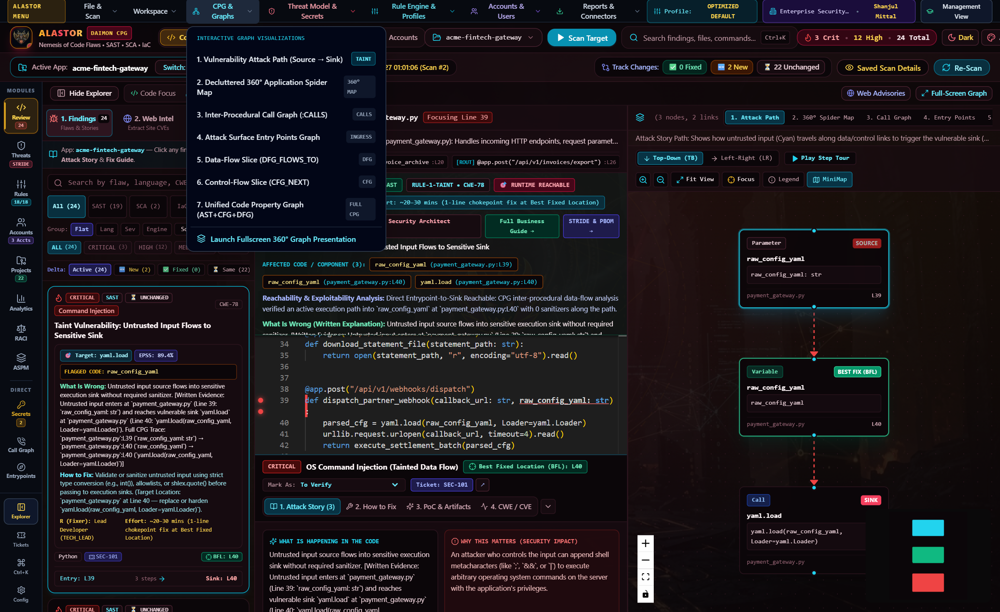

---

### 💻 2. Module 1 — Code & CPG Review Workbench (`REMEDIATION_IDE`)

#### 2A. Split Source Inspector, Written Observation Dossier & Attack Path Graph
Click any finding in the left explorer to synchronize **four views simultaneously**:
1. **Written Observation Dossier** (Plain-English explanation, `RUNTIME REACHABLE` proof, `EPSS 30d` exploit percentile, RACI `R` & `A` owners, and effort estimate).
2. **Monaco Source Code Editor** (Auto-scrolls and highlights the exact vulnerable statement with glyph markers and clickable symbol breadcrumbs).
3. **Interactive Bottom Storyboard** (`1. Attack Story` step-by-step source-to-sink narrative, `2. How to Fix`, `3. PoC & Artifacts`, `4. CWE / CVE`, plus `Mark As` triage suppression and `+ Jira / + GitHub` 1-click ticket buttons).
4. **Live Neo4j Attack Path Graph** (`SOURCE` in cyan $\rightarrow$ `BEST FIX (BFL)` in emerald $\rightarrow$ `SINK` in crimson, complete with a **`Play Step Tour`** animation!).


#### 2B. `Code Focus` Mode, Chokepoint `Best Fix Location (BFL)` & `2. How to Fix` Patch Guide
Switch between **`Code Focus`**, **`Graph Focus`**, and **`Split (Code + Graph)`** in the workbench toolbar. Opening **`2. How to Fix`** reveals the exact remediation strategy, side-by-side `- Before` vs. `+ After` replacements, and a **`Copy Fix Guide`** button for instant patching.

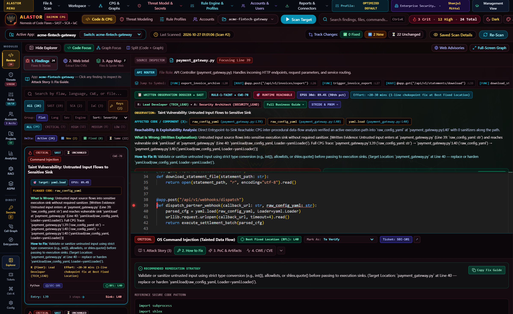

#### 2C. 1-Click `Secrets` Filter & Cryptographic Credential Cards (`RULE-8`)
Click **`Secrets`** on the left rail (or **`Keys (2)`** in the findings filter bar) to isolate hardcoded API keys, JWT signing secrets, cloud tokens (`AKIA...`, `ghp_...`, `sk_...`), and DB passwords — complete with **Shannon Entropy (`bits/char`)**, **Secret Provider Type**, and **Masked Value Previews**.

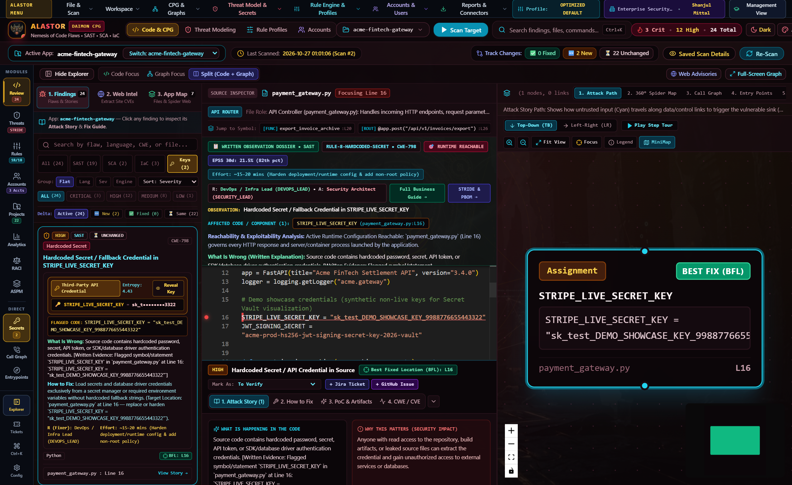

#### 2D. Sidebar Tab `2. Web Intel` — Live Multi-Site CVE & Advisory Extractor
Pull real-time vulnerability advisories directly from **`OSV.dev`**, **`NIST NVD`**, **`CISA Known Exploited Vulnerabilities (KEV) / OWASP`**, or any custom security advisory URL and correlate them against your active repository's tech stack.

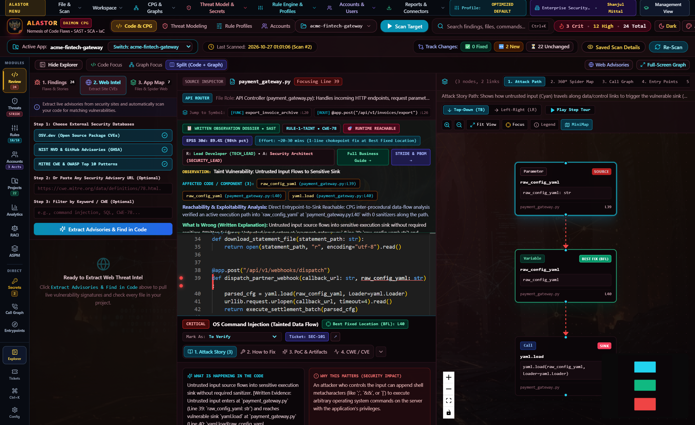

---

### 🕸️ 3. All Interactive Code Property Graph (`CPG`) & Architecture Modes

ALASTOR provides **7 specialized graph visualizations** inside [`ReactFlowGraphPane.tsx`](./frontend/src/components/ReactFlowGraphPane.tsx) so large repositories stay crystal-clear instead of turning into unreadable "hairballs":

#### 3A. Decluttered `360° Application Architecture Spider Map` (`3. App Map` / `APP_TREE`)
Auto-classifies every file in your repository (`API_ROUTER`, `BUSINESS_LOGIC`, `FRONTEND_VIEW`, `DEPENDENCY_MANIFEST`, `INFRASTRUCTURE`) with smart folder clustering, flaw heat-badges, and 1-click source inspection.

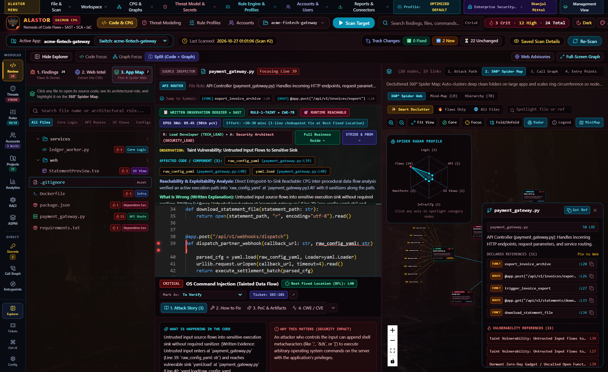

#### 3B. Cross-File `Inter-Procedural Call Graph (:CALLS)` (`CALL_GRAPH`)
Visualizes purple `:CALLS` edges connecting caller functions and HTTP endpoints to downstream helper functions across files (e.g., `payment_gateway.py` $\rightarrow$ `services/ledger_worker.py`), with toggles for **`Whole App Calls`** vs. **`Active File Calls`**.

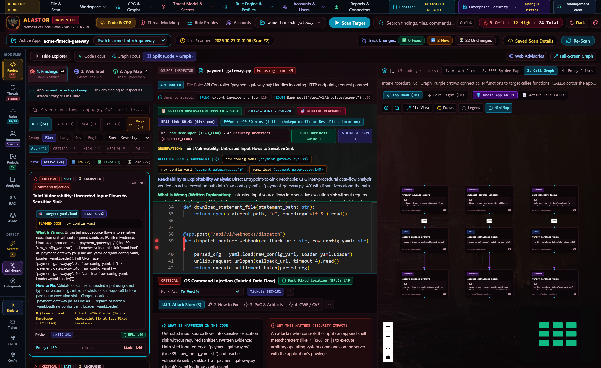

#### 3C. `Attack Surface Entry Points Graph` (`ENTRYPOINT_GRAPH`)
Maps every external ingress route (`@app.post`, `@app.get`, Express routes, CLI handlers) and highlights how untrusted parameters enter internal service logic.

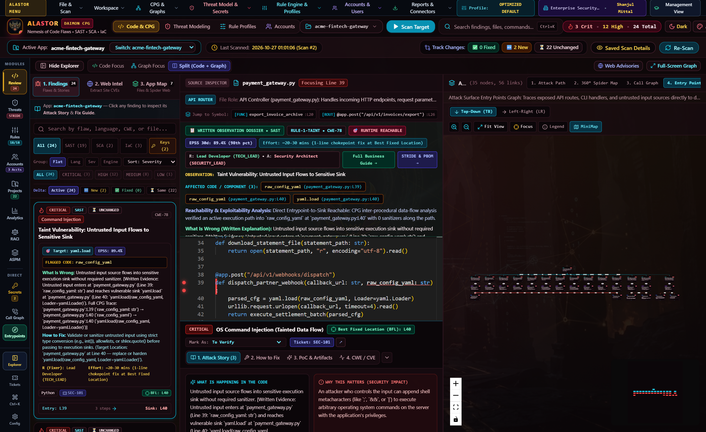

#### 3D. Full-Width `Unified Code Property Graph (AST + CFG + DFG)` (`FULL_CPG` in `Graph Focus`)
Inspect the raw compiler graph stored in Neo4j — combining syntactic `AST` hierarchy edges, `CFG_NEXT` execution branches, and `DFG_FLOWS_TO` variable propagation edges on a zoomable, pannable canvas with MiniMap and full-screen presentation mode.

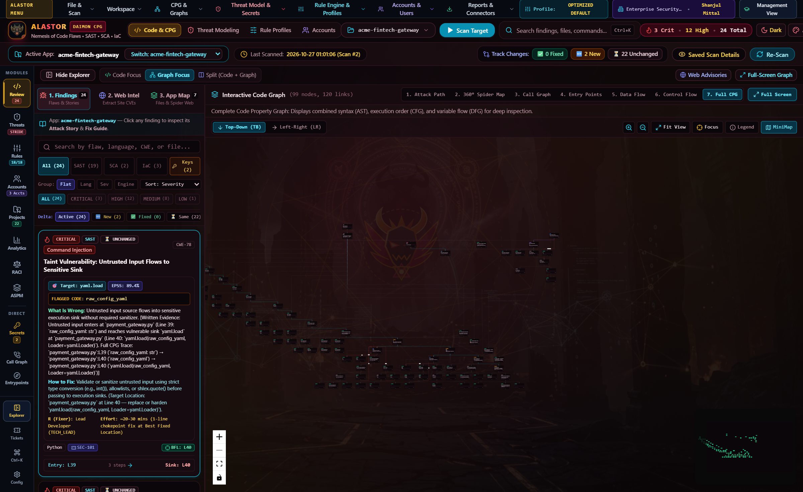

---

### 🛡️ 4. Module 2 — Automated Microsoft STRIDE Threat Modeling, Secret Vault & PBOM (`THREAT_MODELING`)

#### 4A. Tab 1 — Executive STRIDE Count & Verdict Matrix (`✔ What is OK` vs. `✖ What is the Issue`)
Automatically evaluates **Spoofing (`S`)**, **Tampering (`T`)**, **Repudiation (`R`)**, **Information Disclosure (`I`)**, **Denial of Service (`D`)**, and **Elevation of Privilege (`E`)** across your codebase, displaying exact passed counts (`✔ OK`), failed counts (`✖ Issue`), recorded file:line observations, and **`</> Inspect`** buttons that jump straight into Monaco!

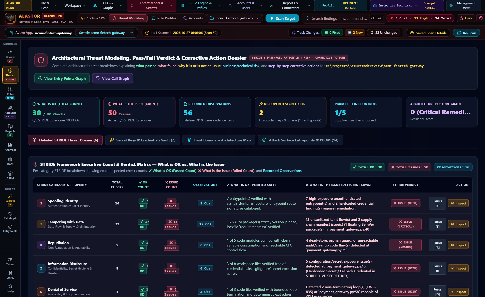

#### 4B. Tab 2 — Cryptographic Secret Keys & Credentials Vault
Centralized audit ledger of every detected credential in source or IaC manifests, showing the variable identifier, masked token preview, secret provider classification, Shannon entropy score, rotation guidance, and RBAC-controlled **`Reveal / Mask`** actions.

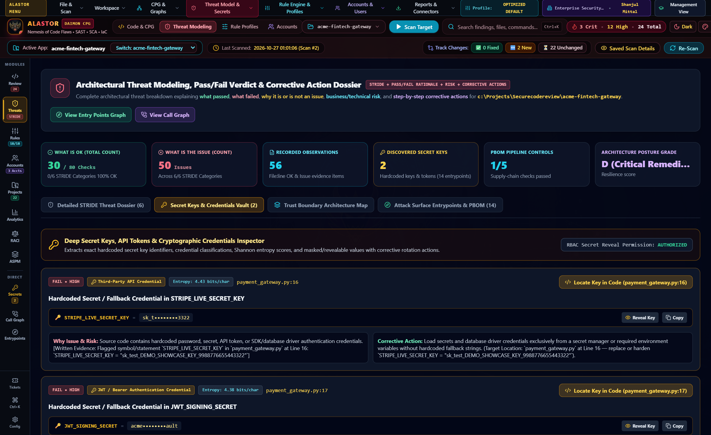

#### 4C. Tab 3 — Architectural Trust Boundary Map
Breaks down your application across **4 security zones** (*Zone 0: Untrusted Public Ingress*, *Zone 1: API Controllers & Routing*, *Zone 2: Core Business & Domain Workers*, *Zone 3: Execution Sinks, Filesystem & External Cloud APIs*) with per-zone risk posture.

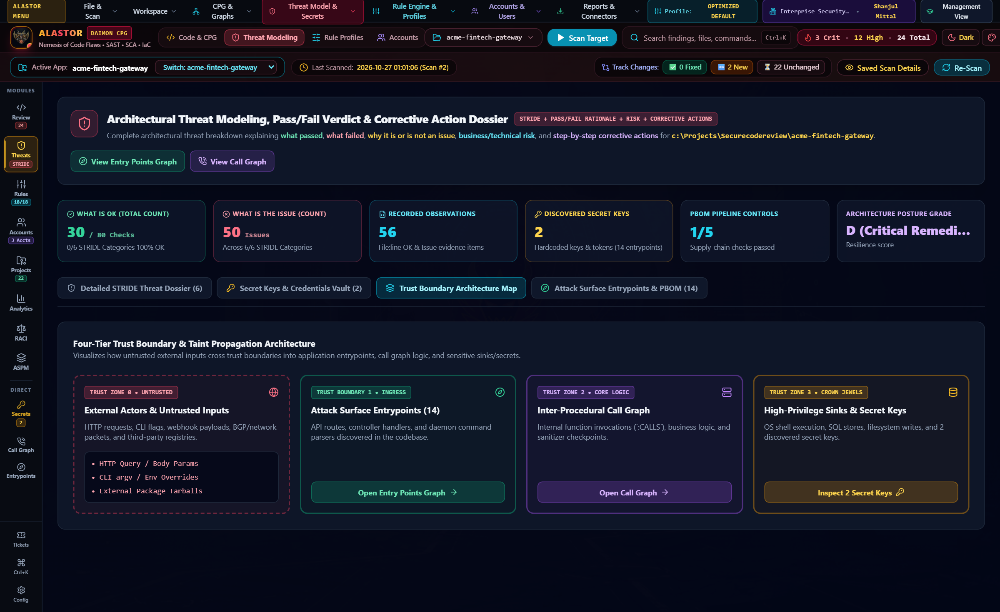

#### 4D. Tab 4 — Attack Surface Entrypoints & CI/CD Pipeline Bill of Materials (`PBOM`)
Catalogs every discovered HTTP/CLI entrypoint alongside **CI/CD Supply-Chain Integrity Controls** (lockfile pinning, non-root container execution, `.gitignore` secret hygiene, GitHub Actions immutable SHA pinning, and runtime security headers).

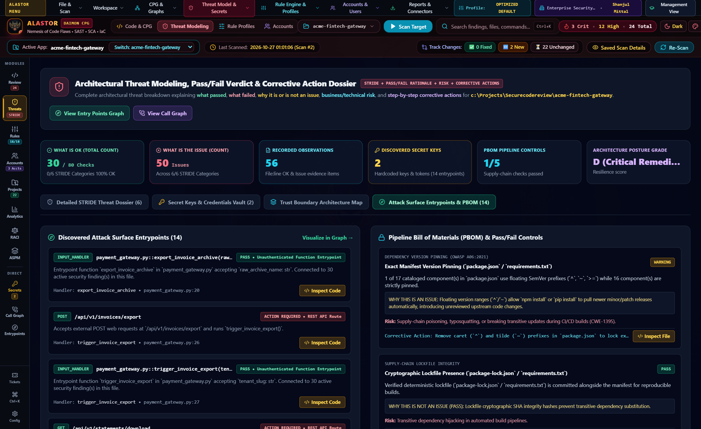

---

### ⚙️ 5. Module 3 & Module 4 — Custom Rule Engine Profiles & Multi-Tenant RBAC

#### 5A. Module 3 — Rule Engine & Test Profiles Matrix (`RULE_ENGINE_PROFILES`)
Switch instantaneously between **4 built-in scan profiles** (*Checkmarx-Style Optimized*, *Strict Zero-Trust Enterprise*, *Secret & Credential Hunter*, *Fast CI/CD PR Gate*), author your own custom test profiles, toggle `SAST` / `SCA` / `IaC` engines independently, and check or uncheck any individual rule (`18/18`).

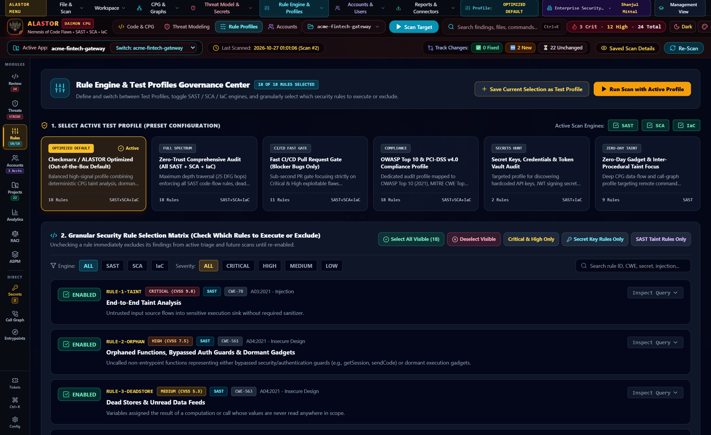

#### 5B. Module 4 — User Profiling, Multi-Tenant Account Separation & RBAC (`USER_PROFILES`)
Built for enterprise security teams and MSSPs: isolate organizational enclaves (`Enterprise Security HQ`, `CISO & Executive Governance`, `Threat Intelligence & SecOps`, or custom accounts) with `STRICT` repository partitioning, 5 RBAC clearance tiers, live permission switches (`Reveal Secrets`, `Edit Rules`, `Triage Findings`, `Tenant Admin`), and an operator session audit log.

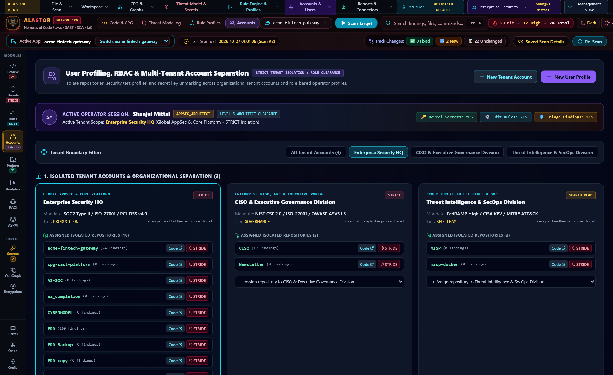

---

### 📊 6. Module 5, Module 6 & Module 7 — Projects Hub, Compliance Analytics & RACI Governance

#### 6A. Module 5 — Multi-Repository Projects Hub, Git/ZIP Scanner & CI/CD Webhooks (`PROJECTS_HUB`)
Auto-discovers local workspaces, scans remote `HTTPS` Git URLs or uploaded `.zip`/folder archives inside UUID-isolated sandboxes, persists scan history snapshots (`Scan #1`, `Scan #2`, deltas), and provides ready-to-wire GitHub/GitLab webhook endpoints.

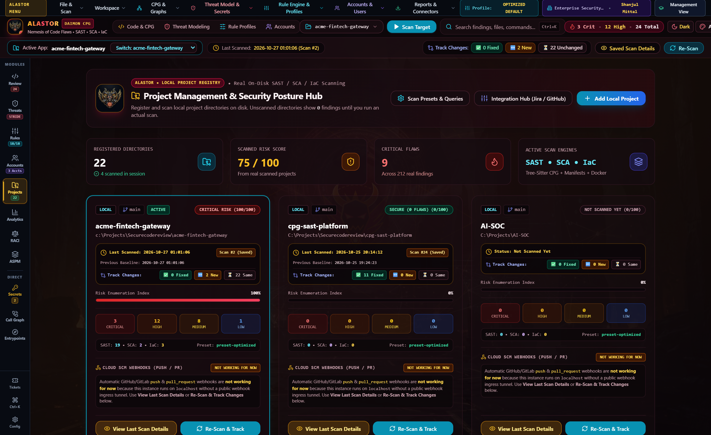

#### 6B. Module 6 — Deep-Dive Executive Analytics & Regulatory Compliance (`DEEP_DIVE`)
Real-time severity distributions, scan engine breakdowns (`SAST`, `SCA`, `IaC`), SLA aging buckets, and automated compliance readiness mapping against **`OWASP Top 10 (2021)`**, **`PCI-DSS v4.0`**, **`NIST SP 800-53 Rev. 5`**, and **`SOC 2 Type II`**.

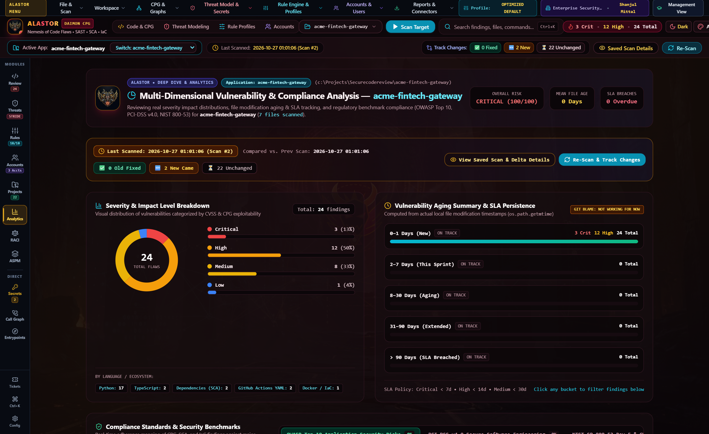

#### 6C. Module 7 — Interactive PMI/COBIT `RACI` Security Governance Matrix (`RACI_GOVERNANCE`)
Assign **Responsible (`R`)**, **Accountable (`A`)**, **Consulted (`C`)**, and **Informed (`I`)** ownership across **7 organizational roles × 9 security lifecycle activities**, backed by an automatic **PMI Golden-Rule Validator** (enforcing exactly one `A` and at least one `R` per row) and 1-click JSON governance export.

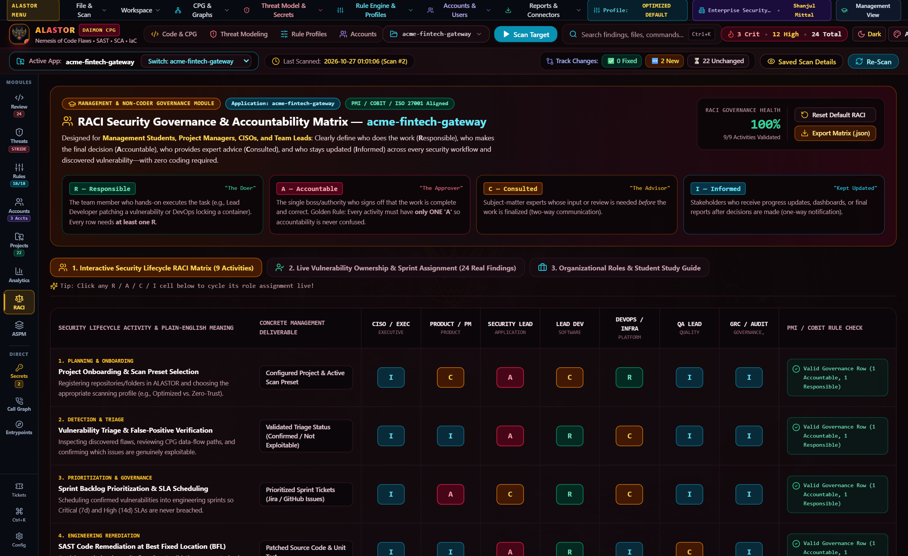

---

### ✨ 7. Module 8 — Ultimate `SAST++++++` ASPM & Non-Coder Executive Suite (`SAST_PLUS_SUITE`)

Designed specifically so **CISOs, Engineering Directors, Product Managers, Auditors, and Students** can understand and act on compiler-level findings without reading a single line of AST/Cypher code:

#### 7A. Pillar 1 — Plain-English Business Impact Translator
Translates every technical vulnerability into a clear **What Happened**, **Real-World Non-Coder Analogy**, **Business & Financial Impact**, and **1-Click Jump to Chokepoint Fix**.

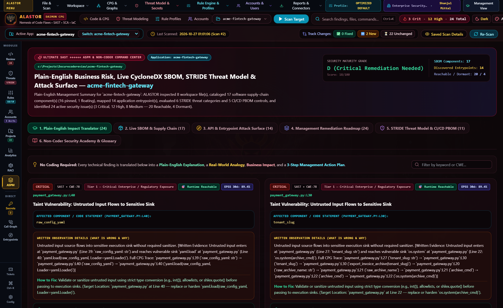

#### 7B. Pillar 2 — Live `CycloneDX v1.5` Software Bill of Materials (`SBOM`)
Generates a compliant **U.S. Executive Order 14028 `CycloneDX v1.5` SBOM** across `npm` and `PyPI` manifests with standardized `pkg:` URLs (`purl`), version-pinning status, ecosystem tags, and 1-click `.cdx.json` download.

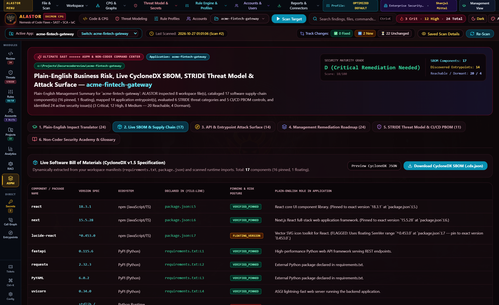

#### 7C. Pillar 3 — API & Entrypoint Attack Surface Catalog
Inventories every discovered REST endpoint and entrypoint across your codebase with HTTP method badges, handler symbols, file locations, exposure posture, and linked CPG vulnerability counts.

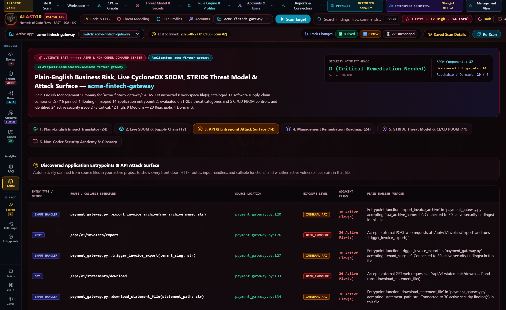

#### 7D. Pillar 4 — Phased Management Remediation Roadmap
Automatically groups open findings into **Phase 1: Immediate Release Blockers (`0–7 Days`)**, **Phase 2: Short-Term Hardening (`8–30 Days`)**, and **Phase 3: Structural Hygiene (`31–90 Days`)** with engineering effort estimates and RACI role assignments.

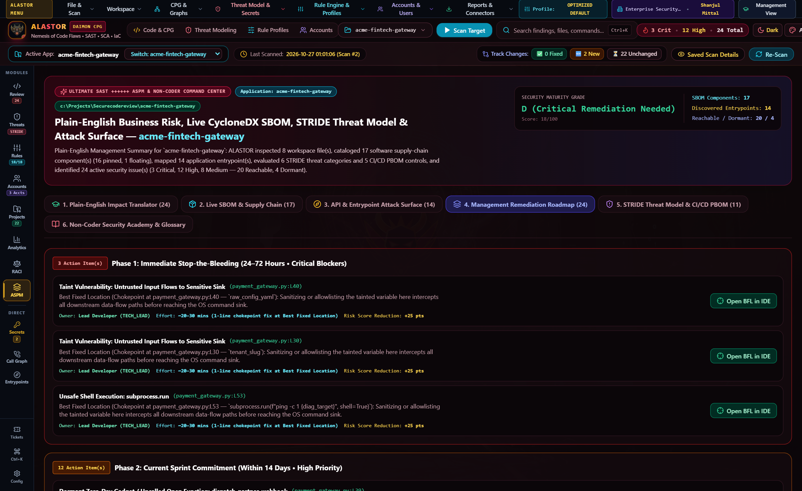

#### 7E. Pillar 6 — Built-In Non-Coder Security Academy & Executive Glossary
Interactive educational cards teaching `SAST`, `SCA & SBOM`, `IaC`, `Code Property Graphs (AST+CFG+DFG)`, `Taint Analysis`, `Best Fix Location (BFL)`, `RACI`, and `CWE / CVE / CVSS / EPSS` with memorable real-world analogies.

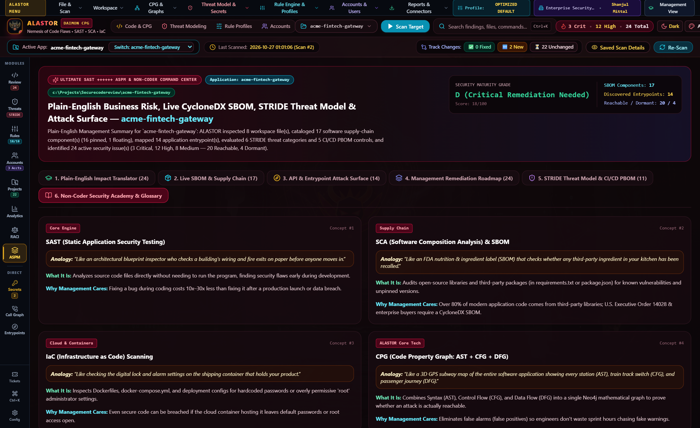

---

### 🔌 8. Enterprise Issue Connectors, Cypher Studio, `Ctrl+K` Palette & 6 Curated Themes

#### 8A. Bi-Directional Atlassian Jira & GitHub Issues Integration Hub
Create rich Markdown tickets pre-populated with the **CPG Source-to-Sink Trace** and **Best Fix Location (`BFL`) Patch** in one click — working immediately out of the box with ALASTOR's built-in Local Issue Tracker and optional live **Jira Cloud / GitHub Issues REST API** sync.

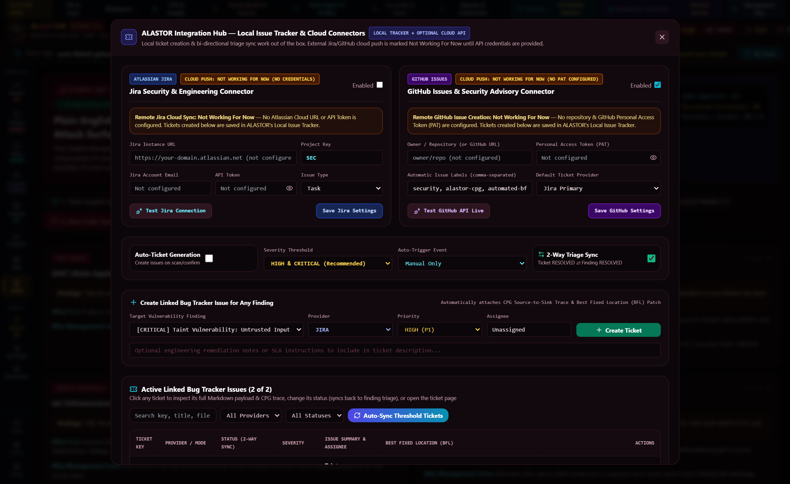

#### 8B. Advanced Engine Settings, Custom Sanitizer Studio & Live Neo4j Cypher Query Viewer
Full glass-box transparency: inspect the exact **Neo4j Cypher CPG queries** powering ALASTOR, configure inter-procedural DFG hop depth, manage triage suppressions, and register organization-specific sanitizer functions.

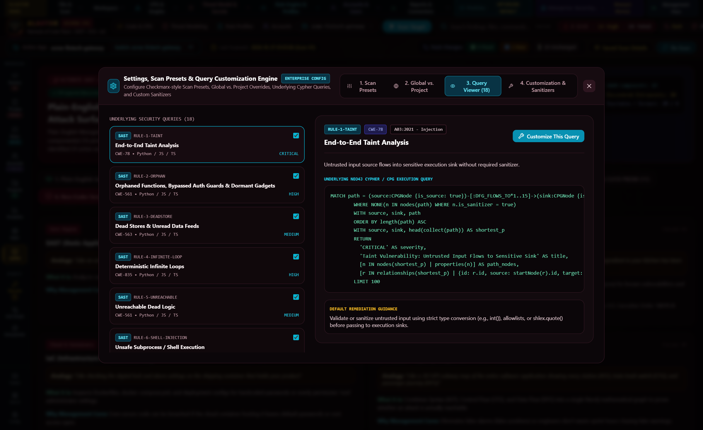

#### 8C. Instant `Ctrl+K` Command Palette
Press **`Ctrl+K`** (or **`Cmd+K`**) from anywhere in the platform to fuzzy-search findings, jump to files, switch graph modes, trigger a scan, or export `SARIF v2.1.0` / `CycloneDX SBOM` without lifting your hands from the keyboard.

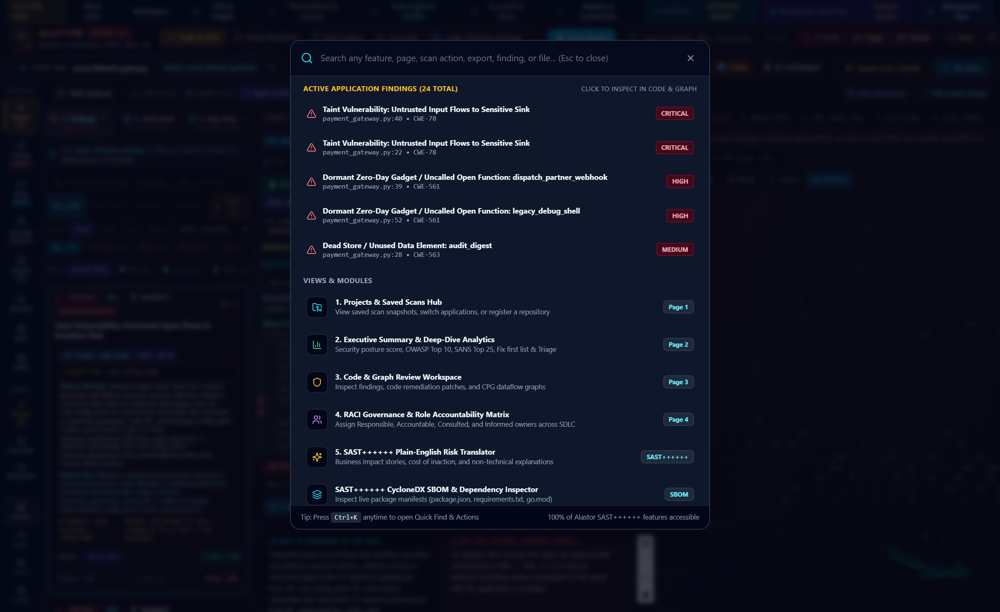

#### 8D. 6 Curated Mythic Dark & Executive Daylight Themes (`Olympian Daylight` Shown)
Prefer crisp light mode for boardroom presentations or PDF reports? Toggle in 1 click between **3 Light Themes** (*Olympian Daylight*, *Athena Parchment*, *Hyperborean Frost*) and **3 Mythic Dark Themes** (*Alastor Infernal*, *Hecate Arcane*, *Stygian Abyss*), plus adjustable Demon Sanctuary backdrop intensity (*Vivid Art* / *Subtle* / *Off*).

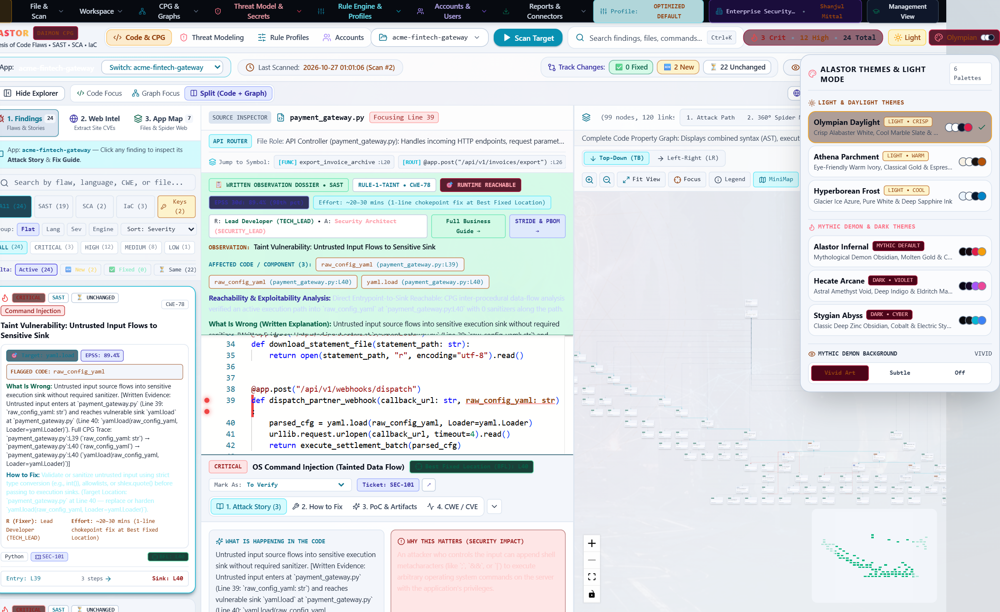

---

## 🛡️ Complete 18-Rule Deterministic Security Matrix

| Rule ID | Engine | Severity | MITRE CWE | Vulnerability / Control Audited | Zero-FP Deterministic Proof |
| :--- | :---: | :---: | :---: | :--- | :--- |
| **`RULE-1-TAINT`** | `SAST (CPG)` | `CRITICAL` | `CWE-78` / `CWE-94` | Inter-Procedural OS Command & Code Injection (`os.system`, `eval`, `exec`, `child_process`) | Multi-hop `DFG_FLOWS_TO` path with `0` verified `is_sanitizer` nodes |
| **`RULE-2-ORPHAN`** | `SAST (CPG)` | `HIGH` | `CWE-561` | Dormant Zero-Day Gadget / Uncalled Sensitive Function | Uncalled function containing a dangerous sink without route decorator |
| **`RULE-3-DEADSTORE`** | `SAST (CPG)` | `MEDIUM` | `CWE-563` | Dead Store / Unread Security or Audit Variable | Variable assigned in AST/DFG with zero downstream read edges |
| **`RULE-4-INFINITE-LOOP`** | `SAST (CPG)` | `HIGH` | `CWE-835` | Non-Terminating Infinite Loop (`DoS` Risk) | `CFG_NEXT` loop back-edge without reachable `break` / `return` |
| **`RULE-5-UNREACHABLE`** | `SAST (CPG)` | `MEDIUM` | `CWE-561` | Unreachable Dead Code / Orphaned Cleanup Logic | Statements following unconditional `return`, `raise`, or `break` |
| **`RULE-6-SHELL-INJECTION`** | `SAST (CPG)` | `CRITICAL` | `CWE-78` | Unsafe Subprocess Shell Execution (`shell=True`) | AST argument inspection of `subprocess.run/Popen/call(..., shell=True)` |
| **`RULE-7-SQLI-FORMAT`** | `SAST (CPG)` | `CRITICAL` | `CWE-89` | Format-String / Concatenated SQL & Cypher Injection | Dynamic string formatting in `.execute()` without `int()` coercion sanitizer |
| **`RULE-8-HARDCODED-SECRET`** | `SAST + Secret` | `HIGH` | `CWE-798` | Hardcoded API Keys, JWT Secrets, DB Auth & Cloud Tokens (`AKIA`, `ghp_`, `sk_`, PEM) | AST literal + SDK auth driver + Shannon entropy + placeholder exclusion |
| **`RULE-9-DOM-XSS`** | `SAST (CPG)` | `HIGH` | `CWE-79` | DOM-Based XSS & Unsanitized HTML Sinks (`innerHTML`, `document.write`) | Dynamic expression flowing into browser DOM HTML/script sinks |
| **`RULE-10-PATH-TRAVERSAL`** | `SAST (CPG)` | `HIGH` | `CWE-22` | Inter-Procedural Arbitrary File Read/Write/Delete (`open`, `rmtree`, `fs.*`) | Suppresses **only** AST-verified `commonpath` / `basename` / `is_relative_to` confinement |
| **`RULE-11-SSRF-URLOPEN`** | `SAST (CPG)` | `HIGH` / `MED` | `CWE-918` | Server-Side Request Forgery (`urllib.request.urlopen`, `requests.*`, `httpx.*`, `axios.*`) | Suppresses **only** AST-verified `ipaddress` private-IP rejection or constant HTTPS origin |
| **`RULE-12-LOG-INJECTION`** | `SAST (CPG)` | `LOW` | `CWE-117` | Tainted CR/LF Log Forging (`logger.info/warning/error`) | Suppresses **only** AST-verified `\r` / `\n` neutralization helpers |
| **`RULE-13-UNSAFE-DESERIALIZATION-CRYPTO`** | `SAST (CPG)` | `HIGH` / `MED` | `CWE-502` / `CWE-327` | Unsafe `pickle`/`marshal`/`yaml.load`, Unverified JWT, Weak `md5`/`sha1` | Verifies `SafeLoader`, `verify_signature`, and `usedforsecurity=False` |
| **`SCA-1-MANIFEST-AUDIT`** | `SCA` | `MEDIUM` | `CWE-1395` | Unpinned / Floating SemVer Dependencies (`^`, `~`, `*`, `>=`) | Exact manifest parser across `package.json` & `requirements.txt` |
| **`SCA-2-LIVE-CVE-LOCKFILE`** | `SCA + CPG` | `CRIT`–`MED` | `CWE-1395` | Live `OSV.dev` Direct & Transitive Lockfile CVEs + CPG Import Reachability | Batch OSV API lookup + Neo4j CPG `Import` AST cross-check + patched version |
| **`IAC-1-COMPOSE-SECRET`** | `IaC` | `HIGH` | `CWE-798` | Plaintext Credentials in `docker-compose.yml` / Kubernetes Manifests | Environment block parser flagging hardcoded DB/service passwords |
| **`IAC-2-CONTAINER-ROOT`** | `IaC` | `MEDIUM` | `CWE-250` | Privileged Root Container (`Dockerfile`) & Missing Web Security Headers | Verifies non-root `USER` directive and `CSP` / `X-Frame-Options` headers |
| **`IAC-3-CICD-WORKFLOW-SECURITY`** | `CI/CD IaC` | `HIGH` / `MED` | `CWE-829` / `CWE-78` | GitHub Actions Mutable Tags (`@v4`), `${{ github.event.* }}` Injection & `pull_request_target` | Audits `.github/workflows/*.yml` for 40-char SHA pinning & untrusted interpolation |

---

## ⚡ 3-Minute Quick Start (100% Local & Sovereign)

### Prerequisites
- **[Docker Desktop](https://www.docker.com/products/docker-desktop/)** (runs `Neo4j 5 Community + APOC` locally on ports `7474` / `7687`)
- **[Python 3.11+](https://www.python.org/downloads/)**
- **[Node.js 18+ & npm](https://nodejs.org/)**

### Step 1 — Clone ALASTOR & Launch Neo4j + APOC
```bash
git clone https://github.com/ShanjulMittal/alastor-cpg-sast-platform.git
cd alastor-cpg-sast-platform

# Start Neo4j 5 + APOC Graph Engine
docker compose up -d neo4j
```

### Step 2 — Start the FastAPI CPG Compiler & ASPM Backend (`http://127.0.0.1:8000`)

**Windows (PowerShell):**
```powershell
python -m venv .venv
.\.venv\Scripts\Activate.ps1
pip install -r backend\requirements.txt

cd backend
python -m uvicorn main:app --host 127.0.0.1 --port 8000
```

**macOS / Linux (Bash / Zsh):**
```bash
python3 -m venv .venv
source .venv/bin/activate
pip install -r backend/requirements.txt

cd backend
python -m uvicorn main:app --host 127.0.0.1 --port 8000
```

### Step 3 — Launch the Next.js Enterprise Workbench (`http://localhost:3000`)
Open a second terminal in `alastor-cpg-sast-platform/frontend`:
```bash
cd frontend
npm ci
npm run build
npm run start
```
Open **`http://localhost:3000`** in Chrome, Edge, Brave, or Firefox — select any local repository, paste a GitHub HTTPS URL, or drag-and-drop a project archive, and click **`Scan Target`**!

---

## 🧪 Zero-Trust Proof: Run the 18-Assertion Autonomous Self-Audit

Don't just take our word for it. ALASTOR ships with an autonomous end-to-end verification suite ([`verify_harness.py`](./verify_harness.py)) that boots the live CPG pipeline, verifies all **18 security assertions** (including `Assertion S` proving **100% True Positive detection and `0%` False Positive suppression** across sanitized vs. unsanitized endpoints, live OSV CVE reachability, STRIDE counts, RACI Golden Rules, CycloneDX v1.5 SBOM, Multi-Tenant RBAC, and SARIF v2.1.0), and concludes by **scanning ALASTOR's own production codebase (`cpg-sast-platform`) — asserting `0` unpatched vulnerabilities**:

```powershell
# Windows PowerShell
.\.venv\Scripts\python.exe verify_harness.py

# macOS / Linux
./.venv/bin/python verify_harness.py
```

Expected result:
```text
[PASS] 18 / 18 E2E Enterprise Assertions Verified (100%)
[PASS] Self-Audit of cpg-sast-platform: 0 Active Findings (SAST: 0, SCA: 0, IaC: 0, Secrets: 0)
```

---

## 📤 Standards-Compliant Enterprise Exports & APIs

| Export / API Endpoint | Standard / Format | Use Case |
| :--- | :--- | :--- |
| `GET /api/export/sarif` | **OASIS SARIF `v2.1.0`** | Upload directly to **GitHub Advanced Security Code Scanning**, Azure DevOps, or VS Code SARIF Viewer |
| `GET /api/sast-plus` (`cyclonedx_json`) | **OWASP CycloneDX `v1.5` JSON** | Executive Order 14028 supply-chain compliance, Dependency-Track, & customer procurement audits |
| `GET /api/export/report?format=html\|md\|json` | **Executive HTML / Markdown / JSON** | Board-ready penetration test & secure code review deliverable with `BFL` diffs |
| `GET /api/raci-governance` | **PMI / COBIT RACI JSON** | GRC & SOC 2 / ISO 27001 security accountability evidence |
| `POST /api/scan` & `POST /api/webhooks/{provider}` | **REST JSON + CI/CD Webhooks** | Automated pull-request gating in GitHub Actions, GitLab CI, or Jenkins |

---

## 📋 Release History

| Version | Date | Key Milestones |
| :--- | :---: | :--- |
| **`v2.6.1`** | **2026-10-25** | **AST-Verified Inter-Procedural Sanitizer Summary Engine (`0%` FP on custom helpers), `for`-loop iterator taint, call-site-routed inter-procedural DFG, DNS/IP SSRF guards, UUID-isolated scan sandboxes, and 100% Semgrep Pro & OSS `0`-finding parity.** |
| **`v2.6.0`** | 2026-10-25 | Live `OSV.dev` Lockfile CVE + CPG Import Reachability (`SCA-2`), GitHub Actions CI/CD Scanner (`IAC-3`), Inter-Procedural Route Taint (`RULE-10` Path Traversal, `RULE-11` SSRF, `RULE-12` Log Injection, `RULE-13` Deserialization/Crypto), Sanitizer-Aware SQLi (`RULE-7`), and Cloud/SDK Secret Hunter (`RULE-8`). |
| **`v2.5.0`** | 2026-10-22 | Desktop Enterprise Shell (`AppMenuBar` + `LeftFunctionBar`), STRIDE Count & Observation Matrix (`✔ OK` vs `✖ Issue`), Secret Keys Vault, Rule Engine Profiles, Multi-Tenant RBAC Accounts, Cross-File Call Graph (`:CALLS`), Entrypoints Graph, and Decluttered 360° Spider Map. |
| **`v2.0.0`** | 2026-10-19 | `SAST++++++` ASPM Suite, Written Observation Dossiers, Side-by-Side Before/After Code Diffs, `EPSS v4`, Interactive `RACI` Matrix, `CycloneDX v1.5` SBOM, and Continuous Track Changes Mode. |
| **`v1.0.0`** | 2026-10-17 | Core Tree-Sitter `AST + CFG + DFG` Code Property Graph compiler over `Neo4j + APOC`, Best Fix Location (`BFL`) chokepoint engine, and OASIS `SARIF v2.1.0` export. |

---

## 📚 Documentation, Contributing & Security

- **[📖 Master Product Guide & Standard Operating Procedure (SOP)](./docs/ALASTOR_Master_SOP_and_Product_Guide.md)** — Complete 10-part operator manual, CPG compiler deep-dive, and enterprise rollout guide.
- **[📋 Full Changelog (`CHANGELOG.md`)](./CHANGELOG.md)** — Detailed version-by-version engineering notes.
- **[🔬 Contributing Guide (`CONTRIBUTING.md`)](./CONTRIBUTING.md)** — How to add new Tree-Sitter languages, Cypher CPG rules, and run `verify_harness.py`.
- **[🛡️ Security Policy (`SECURITY.md`)](./SECURITY.md)** — Responsible disclosure guidelines and self-audit verification policy.

---

<div align="center">

### ⭐ Star ALASTOR on GitHub if you believe Compiler-Grade Code Security should be Open, Deterministic & Sovereign!

Released under the **[MIT License](./LICENSE)** • Built with **Tree-Sitter**, **Neo4j + APOC**, **FastAPI**, **Next.js**, **Monaco Editor**, and **ReactFlow**.

</div>
