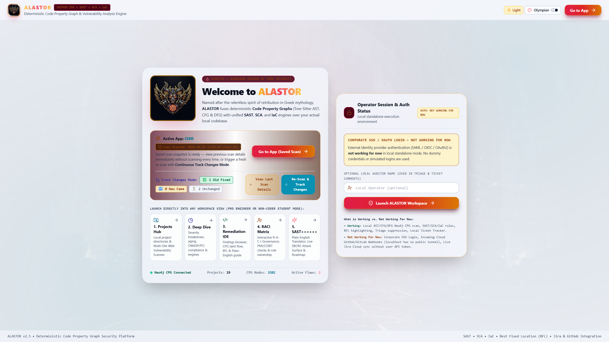
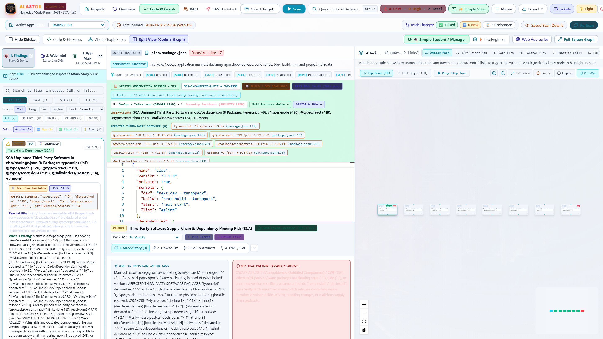
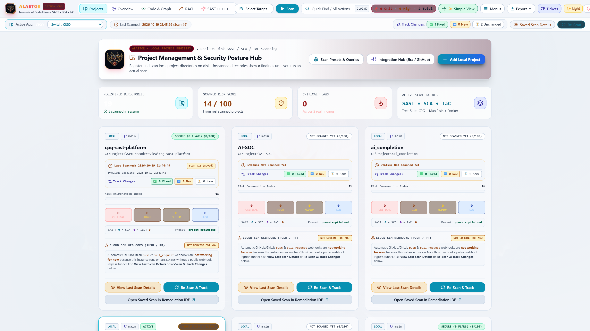
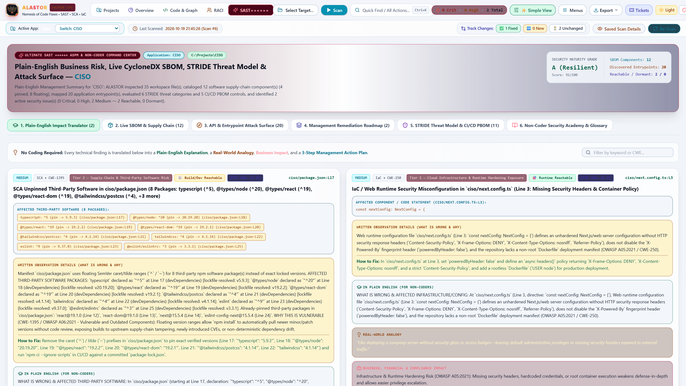

# ALASTOR (`Ἀλάστωρ`) — Enterprise Product Guide, Feature Catalog & Master Standard Operating Procedure (SOP)

**Deterministic Code Property Graph (CPG) • Unified SAST, SCA & IaC • Call-Graph Reachability • EPSS v4 • STRIDE Threat Modeling • CI/CD PBOM • PMI/COBIT RACI Governance**


> [!IMPORTANT]
> **Dual-Purpose Executive & Operator Document**:
> 1. **Part I & II (Executive Pitch & Competitive Differentiation)**: Designed for CISOs, VPs of Engineering, Enterprise Architects, and Procurement Leaders evaluating why ALASTOR outperforms legacy static analyzers and fragmented cloud scanners.
> 2. **Part III, IV & V (Complete Feature Reference & Master SOP)**: A step-by-step Standard Operating Procedure enabling Security Engineers, Developers, and Non-Coder Managers/Students to master every workspace, workflow, and API in under 15 minutes.

---

## Part I: Executive Vision — Why ALASTOR Wins

In Greek mythology, **Alastor (`Ἀλάστωρ`)** is the relentless *Daimon of Retribution*—the unforgetting spirit who hunts down hidden corruptions so that no unseen flaw escapes judgment.

Modern engineering organizations suffer from three systemic failures in Application Security (AppSec):
1. **Alert Fatigue & False-Positive Flood**: Regex-based SAST scanners and naive SCA tools flag hundreds of theoretical issues without checking if untrusted input actually reaches a sink without sanitization, or if a flagged third-party library is even reachable at runtime.
2. **Cryptic Jargon & Zero Written Context**: Traditional scanners output terse rule IDs (e.g., `CWE-1395: Vulnerable Component`) without naming the exact third-party packages, line numbers, lockfile-resolved versions, business impact, or copy-pasteable code replacements.
3. **Siloed Tools Across Personas**: Engineers live in IDEs and call graphs; CISOs and Program Managers live in compliance frameworks (`OWASP Top 10`, `PCI-DSS v4.0`, `NIST 800-53`), `RACI` accountability matrices, and `STRIDE` threat models. No single local-first platform bridged both worlds—until **ALASTOR**.

### The ALASTOR Core Value Proposition

| Business Outcome | How ALASTOR Delivers It |
| :--- | :--- |
| **Mathematical Zero-Noise Precision** | Compiles source code via **Tree-Sitter** into a unified **Code Property Graph (AST + CFG + DFG)** inside **Neo4j + APOC**, proving inter-procedural source-to-sink exploitability and filtering out sanitized flows automatically. |
| **100% Written Clarity on Every Finding** | Every SAST, SCA, and IaC observation includes a full **Written Observation Dossier**: exact affected packages/lines, *What Is Wrong*, *Why It Matters*, a *Real-World Non-Coder Analogy*, and a **Side-by-Side Before (`-`) vs. After (`+`) Code Diff** with 1-click copy. |
| **Instant Saved Scans & Continuous Track Changes** | Never wait for redundant scans. ALASTOR persists full scan snapshots with `Last Scanned` timestamps and automatically computes **Track Changes Deltas** (`✅ Old Fixed`, `🆕 New Came`, `⏳ Unchanged`) across every rescan. |
| **Dual-Persona Adaptive UI (`Simple View` vs. `Pro View`)** | Switch seamlessly between **Simple Clean View** (clutter-free workflow with plain-English student/manager guidance) and **Pro Detailed View** (full desktop menus, Cypher/Tree-Sitter query inspector, and multi-engine controls) with zero feature loss. |
| **100% Local-First Sovereignty** | Runs entirely on your local workstation or private network (`FastAPI` + `Neo4j` + `Next.js`) with **zero source code exfiltration** to external cloud vendors and **zero synthetic/demo data pollution**. |

---

## Part II: Competitive Benchmark — ALASTOR vs. Legacy & Cloud AppSec Tools

We benchmarked ALASTOR against leading industry tools (**Checkmarx**, **Snyk**, **Semgrep Supply Chain**, **Endor Labs**, **Wiz Code**, **Apiiro**, and **GitHub Advanced Security**) and unified their best capabilities into one cohesive platform:

| Enterprise Capability | Legacy SAST (Checkmarx / Fortify) | Cloud SCA (Snyk / Dependabot) | ASPM Platforms (Apiiro / Wiz) | **ALASTOR (`SAST++++++`)** |
| :--- | :---: | :---: | :---: | :---: |
| **True AST + CFG + DFG Code Property Graph (Neo4j)** | Partial (Proprietary) | ❌ No | ❌ No | ✅ **Yes (Open Cypher + Tree-Sitter)** |
| **Best Fix Location (BFL) Chokepoint Calculation** | ✅ Yes | ❌ No | ❌ No | ✅ **Yes (Dominator Node Chokepoint)** |
| **Call-Graph & Toolchain Reachability (`REACHABLE` vs. `DORMANT`)** | ❌ No | Partial | ✅ Yes | ✅ **Yes (Written Reachability Proof)** |
| **EPSS v4 (30-Day Exploit Probability & Percentile) + CISA KEV** | ❌ No | ✅ Yes | ✅ Yes | ✅ **Yes (Built into Every Card & Table)** |
| **Side-by-Side Before (`-`) vs. After (`+`) Code Diff & 1-Click Copy** | ❌ No | Partial | ❌ No | ✅ **Yes (Exact Lockfile & Header Patches)** |
| **Continuous Track Changes (`Fixed` / `New` / `Unchanged` Delta)** | Partial | Partial | ✅ Yes | ✅ **Yes (Persistent Snapshot History)** |
| **Live CycloneDX v1.5 SBOM + CI/CD Pipeline BOM (PBOM)** | ❌ No | Partial (SBOM only) | ✅ Yes | ✅ **Yes (SBOM + 5-Control CI/CD PBOM)** |
| **Automated Microsoft STRIDE Architectural Threat Model** | ❌ No | ❌ No | ✅ Yes | ✅ **Yes (6 STRIDE Categories Mapped Live)** |
| **Interactive PMI/COBIT RACI Governance Matrix** | ❌ No | ❌ No | ❌ No | ✅ **Yes (7 Roles × 9 Lifecycle Activities)** |
| **Non-Coder Plain-English Translator & Real-World Analogies** | ❌ No | ❌ No | ❌ No | ✅ **Yes (Dedicated Student/Manager Mode)** |
| **100% Local Execution (Zero Cloud Code Upload Required)** | ❌ Heavy Server | ❌ Cloud SaaS | ❌ Cloud SaaS | ✅ **Yes (Self-Contained Local Stack)** |

---

## Part III: Visual Tour of the ALASTOR Platform (Live Screenshots)

Explore all 11 live screens captured directly from the running ALASTOR platform auditing the real `C:\Projects\CISO` application:

````carousel

<!-- slide -->

<!-- slide -->

<!-- slide -->

<!-- slide -->

<!-- slide -->

<!-- slide -->

<!-- slide -->

<!-- slide -->

<!-- slide -->

<!-- slide -->

````

---

## Part IV: System Architecture & Complete Feature Catalog

```mermaid
flowchart LR
    subgraph Input["1. Target Ingestion & Saved Snapshots"]
        A["Local Folder / Repo / File / Snippet"]
        B["Live Web Advisories (OSV, NVD, CWE, OWASP)"]
    end

    subgraph Engine["2. Deterministic CPG & Unified Scan Engines"]
        C["Tree-Sitter Multi-Language Parser (AST + CFG + DFG)"]
        D["Neo4j + APOC Graph Database"]
        E["SAST Engine (Taint, Orphans, Dead Stores, Loops)"]
        F["SCA Engine (Manifests, Lockfiles, Pinning, CVEs)"]
        G["IaC & Runtime Engine (Containers, Next.js/Web Headers)"]
    end

    subgraph Enrichment["3. ASPM & Executive Intelligence Enrichment"]
        H["Best Fix Location (BFL) + Before/After Code Diff"]
        I["Call-Graph Reachability + EPSS v4 30d Scoring"]
        J["Plain-English Translator + Real-World Analogies"]
        K["STRIDE Threat Model + CycloneDX SBOM + CI/CD PBOM"]
        L["PMI/COBIT RACI Matrix + Track Changes Delta"]
    end

    subgraph Workspaces["4. 5-Module Adaptive UI & Exports"]
        M["1. Projects Hub | 2. Overview | 3. Code & Graph | 4. RACI | 5. SAST++++++"]
        N["Exports: Markdown, JSON, SARIF v2.1.0, CycloneDX v1.5, Jira/GitHub Tickets"]
    end

    A --> C
    B --> F
    C --> D
    D --> E
    A --> F
    A --> G
    E --> H
    F --> H
    G --> H
    H --> I
    I --> J
    J --> K
    K --> L
    L --> M
    M --> N
```



### Complete Feature Matrix by Module

#### Module 0: Global Context, Navigation & Adaptive UX
- **Persistent Active Application Under Review Banner**: Displayed across all 5 workspaces so you never lose track of which application is being discussed. Shows:
  - Application Name badge (e.g., `CISO`) and full filesystem path (`C:\Projects\CISO`)
  - Instant **Switch Application Dropdown** to jump between registered projects
  - **Last Scanned Timestamp & Scan Counter** (`Last Scanned: 2026-10-19 21:45:26 (Scan #6)`)
  - **Track Changes Delta Pills** (`✅ 1 Fixed`, `🆕 0 New`, `⏳ 2 Unchanged`)
  - **Saved Scan Details Drawer** button (view full historical diff without rescanning) and **1-Click Re-Scan** button
- **Simple View vs. Pro View Density Toggle (`✨ Simple View` / `🎛️ Pro View`)**:
  - **Simple Clean View (Default)**: Hides complex top menu ribbons, simplifies the target selector to a single `Select Target...` button, defaults to `Code & Fix Focus`, and keeps the Written Observation Dossier front-and-center.
  - **Pro Detailed View**: Expands the full multi-dropdown `SAST++++++ Desktop Menu Bar`, quick-settings ribbon, inline path/URL input bar, and split CPG graph controls.
- **Audience Persona Switcher (`🎓 Simple Student / Manager` vs. `⚡ Pro Engineer`)**:
  - Tailors descriptions between non-coder analogies/executive action steps and low-level AST/CFG/DFG technical traces.
- **6 Curated Light & Dark Mythological Themes**:
  - **Light Themes**: *Olympian Daylight* (Default crisp white/alabaster), *Athena Parchment* (warm ivory), *Hyperborean Frost* (cool azure).
  - **Dark/Mythic Themes**: *Alastor Infernal* (obsidian, molten gold & crimson), *Hecate Arcane* (amethyst void), *Stygian Abyss* (cyber zinc & cyan).
- **Global Command Palette (`Ctrl+K` / `Cmd+K`)**: Instant keyboard navigation to any workspace, scan preset, theme, export format, or finding.

#### Module 1: Projects & Saved Scans Hub (`PROJECTS_HUB`)
- **Zero Demo/Synthetic Clutter**: Automatically discovers real local repositories in `C:\Projects` (e.g., `CISO`, `cpg-sast-platform`, `MISP`, `NewsLetter`) and calculates live risk scores (`0–100`) and risk levels (`CRITICAL`, `HIGH`, `MEDIUM`, `LOW`).
- **Saved Scan Snapshot Loader**: Click **Open Saved Scan** on any previously scanned project to load its cached findings and metrics instantaneously without re-running the scanner.
- **Multi-Site Web & URL Vulnerability Scanner**: Extracts live advisories from **Google OSV.dev**, **NIST NVD**, **CISA KEV / OWASP Top 10**, and custom URLs (e.g., `https://cwe.mitre.org/...`) and cross-matches them against your codebase.

#### Module 2: Overview & Deep-Dive Analytics (`DEEP_DIVE`)
- **Executive "What To Fix First" Action Plan**: Ranks top remediation priorities with effort estimates, RACI owners, and 1-click jump to code.
- **Multi-Dimensional Vulnerability Breakdown**: Interactive severity donut (`Critical`, `High`, `Medium`, `Low`), language/ecosystem distribution, and **SLA Aging Buckets** (`0–1 Days`, `2–7 Days`, `8–30 Days`, `31–90 Days`, `>90 Days SLA Breached`) computed from real file modification timestamps (`os.path.getmtime`).
- **Real-Time Compliance Framework Readiness**: Maps findings automatically against **OWASP Top 10 (2021)**, **PCI-DSS v4.0**, **NIST SP 800-53 Rev 5**, and **SOC 2 Type II**.
- **Unified Scan Engine Manager Table (`SAST` + `SCA` + `IaC`)**: Filterable table showing every observation with its affected component list, **Reachability badge**, **EPSS 30-day probability**, written explanation preview, BFL line, and triage status.

#### Module 3: Code & Graph Review IDE (`REMEDIATION_IDE`)
- **3 Flexible Layout Modes**:
  1. `Code & Fix Focus` (full-width source code + Written Observation Dossier)
  2. `Visual Graph Focus` (full-width interactive CPG & 360° Architecture Spider Map)
  3. `Split View (Code + Graph)` (side-by-side synchronized code and graph)
- **Flaw Explorer Sidebar**:
  - Group findings by **Flat List**, **Language**, **Severity**, or **Scan Engine (`SAST`, `SCA`, `IaC`)**.
  - Filter by **Track Changes Delta** (`Active`, `🆕 New`, `✅ Fixed`, `⏳ Same`).
  - Every card displays the **Reachability Badge**, **EPSS 30d Score**, **Affected Third-Party Software / Code Callout**, **Reachability Explanation**, and **What Is Wrong** summary directly on the card.
- **Always-Visible Written Observation Dossier**:
  - Positioned directly above the Monaco source editor so you never have to hunt through tabs to understand a finding.
  - Lists every affected third-party package or code node as clickable pills (e.g., `typescript: ^5 (pin -> 5.9.3) (package.json:L17)`) that jump the editor straight to that line.
  - Displays **Reachability & Exploitability Analysis**, **What Is Wrong (Written Explanation)**, **How to Fix It**, **Real-World Analogy**, **Business Impact**, and **Side-by-Side Before (`-`) vs. After (`+`) Remediation Code Diff** with a **1-Click Copy Fixed Code** button.
- **Best Fix Location (BFL) & Triage Workflow**:
  - Highlights the mathematical **Best Fix Location** line in emerald inside Monaco Editor.
  - Supports instant status triage (`To Verify`, `Confirmed`, `Not Exploitable`, `Proposed Not Exploitable`) with mandatory audit reasoning and 1-click **Jira / GitHub Issue** ticket creation.
- **6-Mode Interactive Graph Canvas**:
  1. `1. Attack Path` (Source $\rightarrow$ Sanitizer/Propagation $\rightarrow$ Sink taint story with step-by-step playback tour)
  2. `2. 360° Spider Map` (Interactive application architecture web, Mind-Map LR, Hierarchy TB, and Spider Radar Profile)
  3. `3. Data Flow (DFG)`
  4. `4. Control Flow (CFG)`
  5. `5. Function Calls (CG)`
  6. `6. Full CPG`

#### Module 4: Interactive RACI Security Governance Matrix (`RACI_GOVERNANCE`)
- **PMI / COBIT / ISO 27001 Governance Engine**:
  - Maps **7 Organizational Roles** (`CISO / Exec`, `Product / PM`, `Security Lead`, `Lead Dev`, `DevOps / Infra`, `QA Lead`, `GRC / Audit`) across **9 Security Lifecycle Activities**.
  - Click any cell to cycle `R` (Responsible), `A` (Accountable), `C` (Consulted), or `I` (Informed) live.
  - Automatically validates the Golden Rules of Governance (every activity has **exactly one `A`** and **at least one `R`**) and computes a real-time **Governance Health Score (`100%`)**.
  - Includes a **Live Vulnerability Ownership & Sprint Assignment** tab and a **Student & Manager Study Guide**.

#### Module 5: SAST++++++ ASPM & Non-Coder Command Center (`SAST_PLUS_SUITE`)
- **Pillar 1 — Plain-English Business Risk & Impact Translator**: Translates every technical finding into executive summaries, real-world analogies, business risks, RACI owners, and numbered management action checklists.
- **Pillar 2 — Live CycloneDX v1.5 SBOM & Supply-Chain Inspector**: Parses real workspace manifests (`package.json`, `package-lock.json`, `requirements.txt`, source imports) to catalog every component, version pinning status (`Pinned` vs. `Floating ^/~`), license tier, and 1-click `CycloneDX v1.5 JSON` download.
- **Pillar 3 — API & Entrypoint Attack Surface Discovery**: Automatically discovers HTTP routes, Next.js pages, CLI entrypoints, and auth-guard postures across the active codebase.
- **Pillar 4 — Prioritized Management Remediation Roadmap**: Groups findings into **Phase 1 (Immediate <72h)**, **Phase 2 (Current Sprint <14d)**, and **Phase 3 (Architectural Hardening <30d)**.
- **Pillar 5 — Automated Microsoft STRIDE Threat Model & CI/CD Pipeline BOM (PBOM)**:
  - Evaluates all 6 Microsoft STRIDE categories (`Spoofing`, `Tampering`, `Repudiation`, `Information Disclosure`, `Denial of Service`, `Elevation of Privilege`) against discovered files, manifests, and findings.
  - Audits 5 CI/CD PBOM supply-chain controls (`Dependency Version Pinning`, `Cryptographic Lockfile Presence`, `Secret & Credential Hygiene`, `Runtime & Container Hardening`, and `Call-Graph Reachability Prioritization`).
- **Pillar 6 — Non-Coder Security Academy & Interactive Glossary**: Built-in educational cards explaining `SAST`, `SCA`, `IaC`, `CPG`, `Taint Analysis`, `BFL`, `SBOM`, `RACI`, `CWE`, and `CVSS` with real-world metaphors.

---

## Part V: Master Standard Operating Procedure (SOP) — Step-by-Step User Manual

Follow these 7 standard operating procedures to master every workflow in ALASTOR.

---

### SOP 1: Launching ALASTOR & Reviewing a Saved Scan (Zero-Wait Startup)


1. **Open the Platform**: Navigate to `http://localhost:3000` in your browser (with FastAPI running on `http://127.0.0.1:8000` and Neo4j running on `bolt://localhost:7687`).
2. **Check the Active Application & Last Scanned Banner**:
   - In the **Active Application Under Review** banner at the top (or on the Portal Gate screen via `Menus` $\rightarrow$ `Workspace` $\rightarrow$ `Return to Alastor Portal Screen`), confirm the active application name (e.g., `CISO`), its path (`C:\Projects\CISO`), and the `Last Scanned` timestamp.
3. **Inspect Without Rescanning**:
   - Because ALASTOR persists scan snapshots in `.alastor_scan_history.json`, you **do not** need to rescan every time you open the app.
   - Click **Saved Scan Details** in the top banner to open the **Track Changes & Scan History Drawer**, showing:
     - `✅ Fixed Issues` (vulnerabilities from the previous scan that have been resolved)
     - `🆕 Newly Introduced Issues` (new flaws introduced since the prior scan)
     - `⏳ Unchanged Active Issues` (existing flaws still awaiting remediation)
4. **Switch Between Applications**:
   - Use the **`Switch: <App Name>`** dropdown on the left side of the Active Application Banner (or open the `1. Projects` tab) to switch between `CISO`, `cpg-sast-platform`, `MISP`, `NewsLetter`, or `synthetic_test_target`.

---

### SOP 2: Scanning a New Local Application, File, Code Snippet, or Web URL


1. **Click `Select Target...` in the Top Bar**:
   - Opens the **Visual Target Browser Modal** with 4 tabs:
     - **Tab 1 — `Local Folder`**: Browse any drive or directory on your machine (or click **Open Native Windows Folder Dialog**) and click **Scan This Folder**.
     - **Tab 2 — `Single File`**: Pick any individual `.py`, `.ts`, `.tsx`, `.js`, `.json`, or `.yaml` file to audit in isolation.
     - **Tab 3 — `URL / Git Repo`**: Paste a public Git repository URL or advisory web page URL to clone/extract and scan.
     - **Tab 4 — `Upload / Paste Snippet`**: Upload local files from disk or paste a raw code snippet directly into the browser for instant CPG taint & AST analysis.
2. **Trigger a Rescan with Track Changes**:
   - When auditing an existing project after making code edits, click the **`Re-Scan`** button on the right side of the Active Application Banner.
   - ALASTOR compares the new scan against the prior snapshot and updates the `✅ Fixed`, `🆕 New`, and `⏳ Unchanged` counters automatically.

---

### SOP 3: Reviewing Observations & Applying Fixes in `Code & Graph` (`REMEDIATION_IDE`)


> [!TIP]
> **Answering "What Is Wrong?" and "Which Third-Party Software Is Affected?" in 1 Second**:
> Whenever you click any finding in the left sidebar, look at the **Written Observation Dossier** banner directly above the source code editor. It always writes out in full prose:
> 1. Every affected third-party package, version specifier, line number, and lockfile-resolved version.
> 2. Whether the flaw is **Runtime Reachable (`🎯 RUNTIME REACHABLE`)**, **Build/Dev Reachable (`⚙️ BUILD / DEV REACHABLE`)**, or **Dormant (`💤 DORMANT / UNREACHABLE`)**, plus its **30-Day EPSS Exploit Probability**.
> 3. The exact **Side-by-Side Before (`-`) vs. After (`+`) Remediation Code Diff**.


1. **Select a Finding in the Left Sidebar (`1. Findings`)**:
   - Filter by engine (`All`, `SAST`, `SCA`, `IaC`), severity (`CRITICAL`, `HIGH`, `MEDIUM`, `LOW`), or Track Changes Delta (`Active`, `New`, `Fixed`, `Same`).
2. **Read the Written Observation Dossier (Top of Code Pane)**:
   - Click any yellow **Affected Third-Party Software / Component** pill (e.g., `typescript: ^5 (pin -> 5.9.3) (package.json:L17)`) to jump the Monaco Editor directly to that line.
   - Scroll down slightly inside the Written Observation Dossier to view the **Side-by-Side Before (`-`) vs. After (`+`) Remediation Code Diff**.
   - Click **`Copy Fixed Code`** in the green `+ AFTER` box to copy the exact pinned dependencies or hardened configuration block to your clipboard.
3. **Explore the Interactive Graph (`Split View` or `Visual Graph Focus`)**:
   - Click **`Split View (Code + Graph)`** in the sub-toolbar to view the code alongside the graph canvas.
   - Switch between **`1. Attack Path`** (step-by-step taint trace with the **`Play Step Tour`** button) and **`2. 360° Spider Map`** (complete architectural spider web of all application files, manifests, UI views, and vulnerability satellites).
4. **Triage & Create Sprint Tickets**:
   - In the bottom drawer bar, update **`Mark As:`** (`To Verify` $\rightarrow$ `Confirmed` or `Not Exploitable`) or click **`+ Jira Ticket`** / **`+ GitHub Issue`** to generate a tracked engineering ticket pre-populated with the BFL line and code diff.

---

### SOP 4: Executive Posture, SLA Aging & Compliance Audit (`Overview` / `DEEP_DIVE`)


1. Click **`Overview`** in the top workspace switcher.
2. **Review Top-Line Risk & SLA Posture**:
   - Inspect the **Overall Risk Score**, **Mean File Age**, and **SLA Breaches** counter in the header card.
3. **Check the "What To Fix First" Executive Action Plan**:
   - Each card summarizes the business risk in plain English, lists the `RACI Responsible` and `Accountable` roles, shows the estimated fix effort (e.g., `~10–15 mins`), and provides a **`View & Fix in Code →`** button.
4. **Verify Regulatory Compliance Readiness**:
   - Scroll to **Compliance Standards & Security Benchmarks** to inspect pass/warning status across **OWASP Top 10 (2021)**, **PCI-DSS v4.0**, **NIST SP 800-53 Rev 5**, and **SOC 2 Type II**.
5. **Filter the Unified Scan Engine Manager Table**:
   - Scroll to the bottom table to filter across `SAST`, `SCA`, and `IaC` engines, inspect **Reachability** and **EPSS** badges side-by-side, and click **`Inspect & Remediate`** on any row.

---

### SOP 5: Managing Organizational Accountability (`RACI` Governance Matrix)


1. Click **`RACI`** in the top workspace switcher.
2. **Understand the 4 Role Badges**:
   - **`R` — Responsible ("The Doer")**: Executes the task hands-on (e.g., Lead Developer or DevOps Lead).
   - **`A` — Accountable ("The Approver")**: Single final authority who signs off on completion (Golden Rule: **exactly one `A` per row**).
   - **`C` — Consulted ("The Advisor")**: Subject-matter expert consulted before decisions are finalized.
   - **`I` — Informed ("Kept Updated")**: Leadership or audit stakeholders notified of outcomes.
3. **Customize Role Assignments Live**:
   - Click any `R / A / C / I` cell in Tab 1 (**`1. Interactive Security Lifecycle RACI Matrix`**) to cycle its assignment.
   - Watch the **PMI / COBIT Rule Check** column and **RACI Governance Health (`100%`)** indicator validate your governance structure in real time.
4. **Review Finding-Level Ownership**:
   - Click Tab 2 (**`2. Live Vulnerability Ownership & Sprint Assignment`**) to see which specific roles own each active finding in the current application.
   - Click **`Export Matrix (.json)`** to save the governance charter for ISO 27001 / SOC 2 auditors.

---

### SOP 6: Mastering the `SAST++++++` Suite (Risk Translator, Live SBOM, Attack Surface, STRIDE & CI/CD PBOM)

````carousel

<!-- slide -->

<!-- slide -->

````

1. Click **`SAST++++++`** in the top workspace switcher.
2. **Pillar 1 (`1. Plain-English Impact Translator`)**:
   - Read non-technical executive translations, real-world analogies, business impact statements, and step-by-step management checklists for every finding.
3. **Pillar 2 (`2. Live SBOM & Supply Chain`)**:
   - Filter discovered third-party packages by ecosystem (`npm`, `pypi`) or pinning status (`Pinned` vs. `Floating ^/~`).
   - Click **`Download CycloneDX v1.5 SBOM (.cdx.json)`** in the header when customers or regulators request a formal Software Bill of Materials.
4. **Pillar 3 (`3. API & Entrypoint Attack Surface`)**:
   - Review all discovered web routes, UI pages, and API handlers along with their exposure level (`PUBLIC_WEB`, `API_ENDPOINT`, `CLI_ENTRYPOINT`).
5. **Pillar 4 (`4. Management Remediation Roadmap`)**:
   - Track phased sprint remediation across Phase 1 (`Immediate <72h`), Phase 2 (`Current Sprint <14d`), and Phase 3 (`Hardening <30d`).
6. **Pillar 5 (`5. STRIDE Threat Model & CI/CD PBOM`)**:
   - Review the **Automated Microsoft STRIDE Architectural Threat Model** across `Spoofing`, `Tampering`, `Repudiation`, `Information Disclosure`, `Denial of Service`, and `Elevation of Privilege`, complete with affected workspace files and compensating controls.
   - Audit the **CI/CD Pipeline & Supply-Chain Integrity Scorecard (PBOM)** covering manifest version pinning, lockfile integrity, secret hygiene, runtime hardening, and call-graph reachability.
7. **Pillar 6 (`6. Non-Coder Security Academy & Glossary`)**:
   - Use as a self-paced training reference for onboarding new team members, interns, or management students.

---

### SOP 7: Exporting Audit Reports (`Markdown`, `JSON`, `SARIF v2.1.0`) & Customizing Rules

1. **Export Unified Audit Reports**:
   - Click **`Export`** in the top-right bar and choose:
     - **Markdown Audit Report (`.md`)**: Executive summary, compliance scorecard, and full written finding dossiers ready for PDF conversion or stakeholder distribution.
     - **JSON Full Data (`.json`)**: Machine-readable findings, metrics, and advisories for custom dashboards.
     - **GitHub / IDE SARIF v2.1.0 (`.sarif.json`)**: OASIS standard payload enriched with `codeFlows` (taint paths), automated `fixes` (Before/After replacements), `reachability_status`, and `epss_score` for direct upload to GitHub Advanced Security or VS Code SARIF Viewer.
2. **Customize Scan Presets, Queries & Sanitizers**:
   - Click the **Gear Icon (`Settings`)** in the top-right bar to switch between scan presets (`Checkmarx-Style Optimized`, `High-Sensitivity Zero-Trust`, `Fast CI/CD PR Gate`, `OWASP Top 10 Compliance`), inspect active Cypher/AST rules in the **Query Viewer**, or register **Custom Sanitizers** (e.g., `shlex.quote` for `CWE-78`).

---

## Appendix: Quick Verification & CLI Operations Reference

| Operation | Command (Run from `c:\Projects\Securecodereview\cpg-sast-platform`) |
| :--- | :--- |
| **Start FastAPI Backend (Port 8000)** | `.venv\Scripts\python.exe -m uvicorn main:app --host 127.0.0.1 --port 8000` (in `backend/`) |
| **Build & Start Next.js Frontend (Port 3000)** | `npm run build && npm run start` (in `frontend/`) |
| **Run Full 17-Assertion E2E Verification Suite** | `.venv\Scripts\python.exe verify_harness.py` |
| **Trigger Scan via REST API** | `POST http://127.0.0.1:8000/api/scan` with `{"target_path": "C:\\Projects\\CISO"}` |
| **Download SARIF v2.1.0 Report via API** | `GET http://127.0.0.1:8000/api/export/report?format=sarif` |
