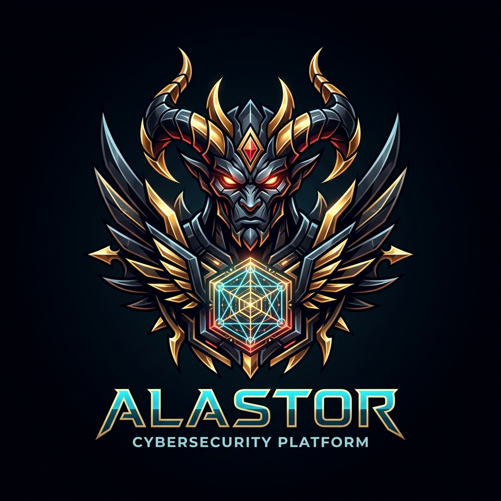
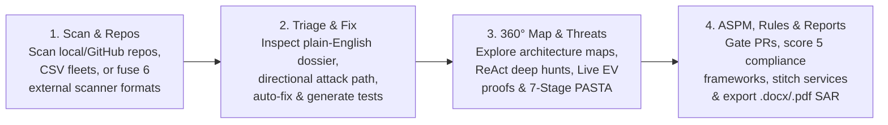
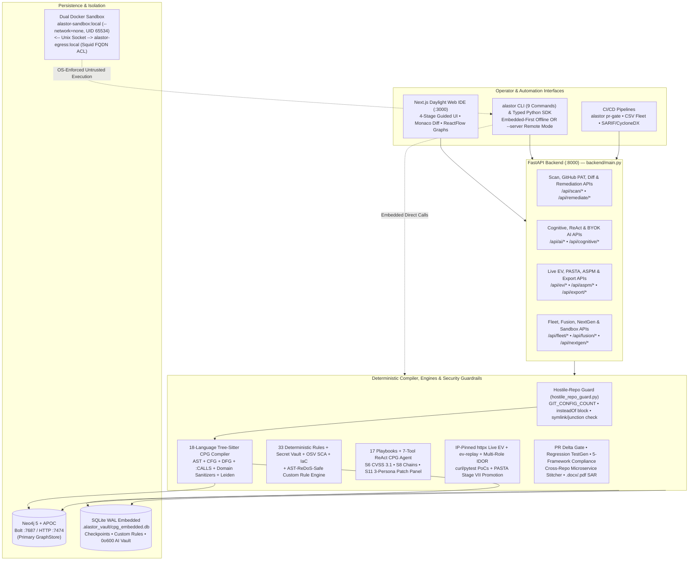
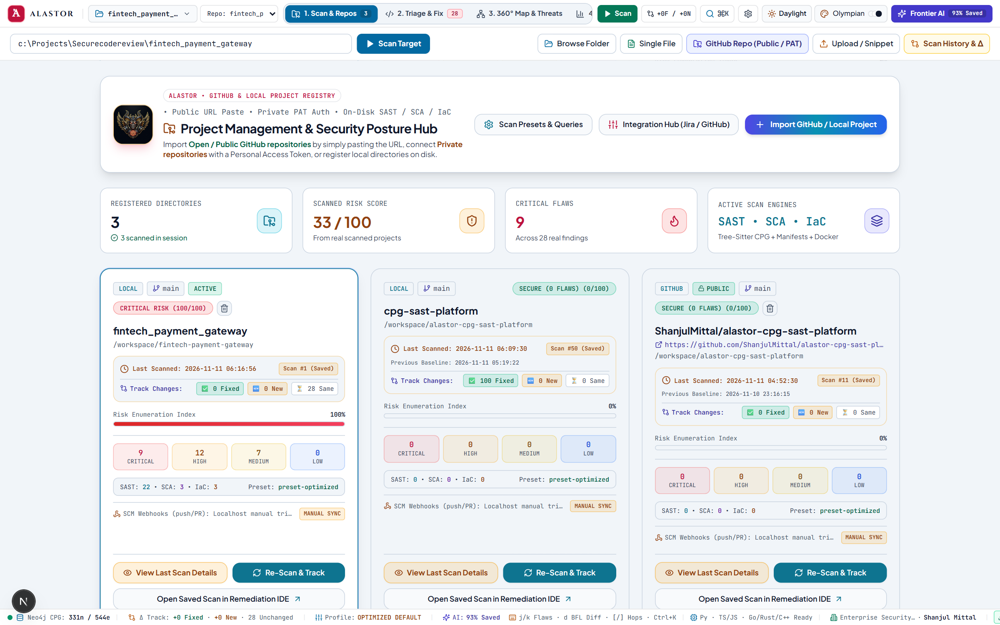
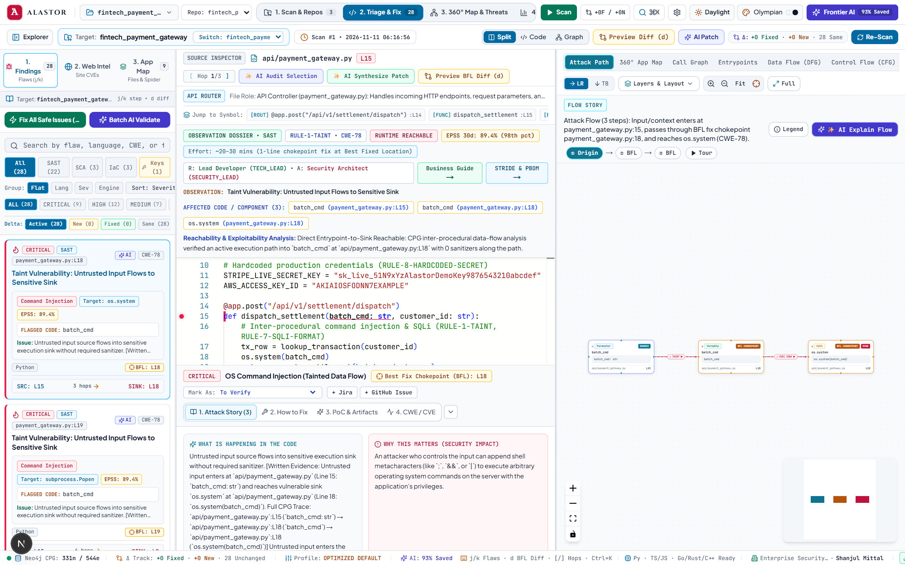
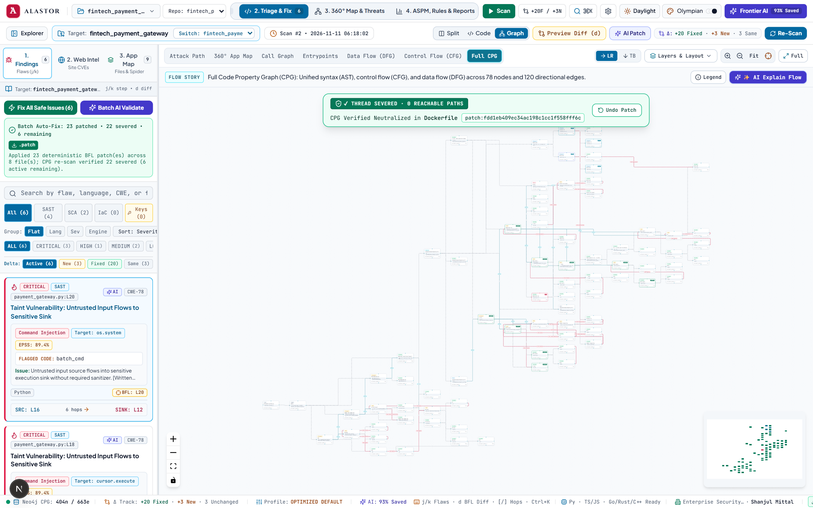

# ALASTOR (`Ἀλάστωρ`) `v5.1.0` — Master Standard Operating Procedure (SOP) & Complete Application Handbook

> **Document Classification:** Enterprise Product Guide & Operational SOP
> **Application Version:** `v5.1.0` (All 5 Pillars + Multi-Turn ReAct CPG Agent & Dual Docker Egress-Proxy Sandbox)
> **Audience:** Dual-Audience Handbook — **Non-Technical Stakeholders** (Executives, CISOs, Product/Release Managers, Auditors) **& Technical Operators** (Software Developers, AppSec Engineers, Security Architects, DevSecOps/Platform Teams)
> **Last Updated:** 2026-11-23

<div align="center">
  
</div>

---

## 🧭 How to Read This Document (Audience Quick-Navigation)

This SOP is structured so **anyone—from a non-technical executive to a principal security engineer—can understand, operate, and govern ALASTOR completely from a single document.**

| If your role is… | Start with these sections | What you will master |
| :--- | :--- | :--- |
| **Executive / CISO / VP Engineering / Product Manager** | **[Part 1 (Non-Technical Guide)](#part-1--non-technical-plain-english-guide)** → **[SOP-11 (Go-Live & SAR Dossiers)](#sop-11-stage-3--7-stage-pasta-threat-modeling-go-live-release-gates-waivers--wordpdf-sar-dossiers)** → **[Part 4.4 (Governance & SLAs)](#44-recommended-enterprise-remediation-slas--governance-cadence)** | What ALASTOR does in plain English, how Go-Live gates protect releases, how to read `.docx`/`.pdf` SAR dossiers, compliance posture, and RACI ownership. |
| **Compliance Officer / Internal or External Auditor** | **[Part 1.5 (Reading Executive Outputs)](#15-how-to-read-alastors-executive-outputs)** → **[SOP-11 (PASTA & SAR)](#sop-11-stage-3--7-stage-pasta-threat-modeling-go-live-release-gates-waivers--wordpdf-sar-dossiers)** → **[SOP-13 (5-Framework Compliance)](#sop-13-stage-4--5-framework-compliance-autopilot-redos-safe-custom-rule-studio--microservice-attack-graph-stitching)** | How ALASTOR maps code evidence & live exploit proofs directly to PCI-DSS 4.0, SOC 2, ISO 27001, HIPAA, OWASP ASVS 5.0, CycloneDX SBOM, and auditable waivers. |
| **Software Developer** | **[Part 1.1](#11-what-is-alastor-the-plain-english-mental-model)** → **[SOP-01](#sop-01-installation-environment-readiness--first-launch)** → **[SOP-02](#sop-02-stage-1--scanning-local-folders-github-repositories--running-0-scope-estimates)** → **[SOP-05](#sop-05-stage-2--security-triage-directional-cpg-inspection--one-click-batch-auto-fix)** → **[SOP-07](#sop-07-stage-2--generating-ast-verified-security-regression-unit-tests)** → **[SOP-12](#sop-12-stage-4--enforcing-pr-delta-security-gates-alastor-pr-gate)** | How to scan code, read directional attack paths, apply AST-verified fixes with SHA-256 undo, generate security regression tests, and pass PR security gates. |
| **AppSec Engineer / Security Architect** | **[Part 2 (Technical Architecture)](#part-2--technical-architecture--engine-deep-dive)** → **[SOP-04](#sop-04-stage-1--universal-6-format-external-scanner-fusion)** → **[SOP-06](#sop-06-stage-2--byok-frontier-ai-copilot-s11-3-persona-patch-panel--iterative-react-auto-patcher)** → **[SOP-08](#sop-08-stage-3--360-architecture-spider-maps-call-graphs-blast-radius--4-zone-trust-boundaries)** → **[SOP-09](#sop-09-stage-3--17-lens-cognitive-hunts-multi-turn-react-cpg-agent-s6-verifier--s8-exploit-chains)** → **[SOP-10](#sop-10-stage-3--ip-pinned-live-exploit-verification-ev-multi-role-idor--post-fix-ev-replay)** → **[SOP-13](#sop-13-stage-4--5-framework-compliance-autopilot-redos-safe-custom-rule-studio--microservice-attack-graph-stitching)** | 18-language CPG internals, 33+ rules, 17 playbooks, ReAct CPG agent, S6/S8/S11 verification, IP-pinned Live EV + `ev-replay`, custom ReDoS-safe rules, and multi-repo microservice stitching. |
| **DevSecOps / Platform / Security Operations Engineer** | **[Part 2.6](#26-hostile-repo-isolation--os-enforced-dual-docker-egress-proxy-sandbox)** → **[Part 2.7](#27-complete-cli-typed-python-sdk--rest-api-reference)** → **[SOP-03](#sop-03-stage-1--multi-repo-csv-fleet-runs-sqlite-checkpoints---resume--vault-gc)** → **[SOP-12](#sop-12-stage-4--enforcing-pr-delta-security-gates-alastor-pr-gate)** → **[SOP-14](#sop-14-security-operations--scanning-untrusted-repositories-inside-the-dual-docker-egress-proxy-sandbox)** | Zero-Docker vs. Neo4j deployment, 9-command offline CLI, Python SDK, CI/CD PR gates, CSV fleet scans, `--resume` checkpoints, and Dual Docker Egress-Proxy sandboxing. |

---

# Part 1 — Non-Technical Plain-English Guide

*(For Executives, CISOs, Product Managers, Compliance Auditors, and Non-Coding Stakeholders)*

## 1.1 What Is ALASTOR? (The Plain-English Mental Model)

Software applications are built from thousands of lines of code across many files, third-party open-source libraries, cloud configuration files, and API endpoints. A single mistake—such as forgetting to validate user input before querying a database, accidentally committing an API key, or letting User A view User B's bank record—can expose customer data or allow an attacker to take control of a server.

**Think of ALASTOR as an automated, mathematical building inspector, architectural surveyor, and live safety tester combined into one self-hosted studio:**

1. **Instead of guessing with keyword search, ALASTOR builds a complete 3D blueprint of the software (a "Code Property Graph").**
   - Simple scanners flag scary words like `execute()` even when the code is completely safe.
   - ALASTOR reads **18 programming languages** the way a compiler does. It traces where untrusted internet input enters the application, checks whether security guards ("sanitizers") actually neutralize the danger, and proves mathematically whether dangerous input can reach a sensitive target (like a database, operating system shell, or file system).
2. **ALASTOR shows every problem as a clear visual story—not a wall of raw code.**
   - Every security issue is displayed with numbered directional arrows (`① Origin ──▶ ② Best Fix Location ──▶ ③ Impact`), a plain-English **Flow Story Bar**, and a **Business Impact Translator** explaining what could go wrong in everyday business language.
3. **ALASTOR can safely verify whether a live staging API is truly exploitable—and re-verify after it is fixed.**
   - Using non-destructive **Live Exploit Verification (`EV`)**, ALASTOR sends carefully controlled test probes to a local or staging server to prove whether an attacker can actually exploit a bug. Once developers apply a fix, **Post-Fix `ev-replay`** re-runs the exact probe to certify **`FIXED_VERIFIED`** with audit evidence.
4. **ALASTOR repairs issues safely and proves the fix worked.**
   - Developers can apply verified single-file or multi-file fixes with one click (backed by automatic undo checkpoints), generate automated security unit tests so the bug can never return, and verify patches through an adversarial 3-reviewer validation panel.
5. **ALASTOR produces board-ready compliance, threat modeling, and Go-Live approval dossiers.**
   - Product managers, CISOs, and auditors get **7-Stage PASTA Threat Models**, **Go-Live Release Gate decisions** (`GO_LIVE_APPROVED`, `CONDITIONAL_GO_LIVE`, or `NO_GO_HOLD_RELEASE`), **5-Framework Compliance Scorecards** (PCI-DSS 4.0, SOC 2, ISO 27001, HIPAA, OWASP ASVS 5.0), **Software Bills of Materials (SBOMs)**, and one-click **Word (`.docx`) and PDF (`.pdf`) Security Assessment Reports (SAR)**.
6. **100% Sovereign & Private (`$0` Core Operation).**
   - ALASTOR runs completely on your own laptop, private server, or CI pipeline. Your source code never has to leave your network. All core scanning, verification, graphing, compliance, and reporting work at **`$0` AI cost**; connecting an AI provider (Gemini, OpenAI, Claude, or local Ollama) is completely optional.

---

## 1.2 Business Problems Solved & Key Outcomes

| Everyday Enterprise Challenge | How ALASTOR Solves It |
| :--- | :--- |
| **"Developers ignore security alerts because 80% are false alarms."** | ALASTOR traces actual data flow across files, recognizes real security sanitizers, applies 6 deterministic false-positive exclusion rules (`S6`), and separates newly introduced PR bugs from legacy backlog (`PR Delta Gate`). |
| **"We don't know if a critical vulnerability is actually exploitable in our running app."** | Built-in **Live Exploit Verification (`EV`)** tests local/staging endpoints non-destructively, confirms real runtime exploitability, promotes confirmed exploits to mandatory Go-Live blockers, and re-tests after patching (`ev-replay`). |
| **"Audit season takes weeks of manual spreadsheet assembly."** | **Continuous Compliance Autopilot** maps live code and runtime evidence automatically to **PCI-DSS 4.0, SOC 2, ISO 27001, HIPAA, and OWASP ASVS 5.0**, and exports formatted **Word (`.docx`) / PDF (`.pdf`) SAR Go-Live Dossiers** and **CycloneDX v1.5 SBOMs** in seconds. |
| **"Our source code is regulated and cannot be sent to third-party SaaS clouds."** | Runs 100% locally with zero mandatory cloud upload. Even optional AI features can run on local **Ollama / vLLM** or inside an OS-enforced **Dual Docker Egress-Proxy Sandbox** that blocks unauthorized outbound internet access. |
| **"We already run Semgrep, CodeQL, Trivy, Gitleaks, or Checkov across different teams."** | **Universal 6-Format Scanner Fusion** ingests reports from all 6 tools onto ALASTOR's single Code Property Graph so leaders see one unified, corroborated risk view instead of 6 disconnected dashboards. |
| **"How do we track security across 50 microservices instead of one repo at a time?"** | **CSV Fleet Batch Runner** scans portfolios grouped by business application, and the **Cross-Repo Microservice Attack-Graph Stitcher** connects attack paths jumping across service boundaries. |

---

## 1.3 End-to-End Application Security Lifecycle in ALASTOR

ALASTOR organizes all work into **4 intuitive sequential stages** in its high-contrast **Daylight Web Studio** (and mirrors the exact same lifecycle in its CLI, Python SDK, and CI/CD pipelines):



---

## 1.4 Roles & Responsibilities (Who Uses Which Parts of ALASTOR?)

| Role | Primary Stages Used | Core Responsibilities in ALASTOR |
| :--- | :--- | :--- |
| **Software Developer** | Stage 1, Stage 2, Stage 4 (`PR Gate`) | Run scans locally or in PR CI (`alastor pr-gate`), inspect directional attack paths in Monaco Editor, apply verified BFL/Batch fixes, generate automated regression unit tests, and confirm `ev-replay` passes. |
| **AppSec Engineer / Security Reviewer** | Stage 2, Stage 3, Stage 4 | Validate complex findings with 17-lens Cognitive Playbooks & Multi-Turn ReAct CPG Hunts, verify exploitability via IP-pinned Live EV, author ReDoS-safe custom rules, audit microservice attack chains, and review S11 patches. |
| **Product / Release Manager** | Stage 3 (`PASTA`), Stage 4 (`Executive Posture` & `Exports`) | Review the **Go-Live Release Gate**, track SLA remediation roadmaps, coordinate cross-team RACI assignments, and document time-bound risk waivers if conditional launch is requested. |
| **CISO / Risk Officer** | Stage 3 (`PASTA`), Stage 4 (`Compliance` & `SAR Export`) | Review Executive Risk Posture, approve or reject Go-Live waivers, inspect cross-application Fleet Rollups, and sign off on exported **Word (`.docx`) / PDF (`.pdf`) SAR Go-Live Dossiers**. |
| **Compliance / Internal Auditor** | Stage 4 (`Compliance Autopilot`, `SBOM`, `Exports`) | Inspect control-level Pass/Fail/Warning evidence across PCI-DSS 4.0, SOC 2, ISO 27001, HIPAA, and OWASP ASVS 5.0; archive CycloneDX SBOMs, SARIF exports, and timestamped SAR dossiers. |
| **DevSecOps / Platform Engineer** | CLI / SDK / Docker Sandbox / CI/CD | Deploy ALASTOR (Embedded SQLite or Neo4j), enforce `alastor pr-gate` in CI/CD, schedule CSV Fleet scans with `--resume` checkpoints, fuse Trivy/CodeQL/Semgrep reports, and run untrusted repos inside the Dual Docker Egress Sandbox. |

---

## 1.5 How to Read ALASTOR's Executive Outputs

### A. Go-Live Release Gate Verdicts (PASTA Stage VII & SAR Dossier)
Every release evaluated in ALASTOR receives one of three unmistakable governance decisions:

| Gate Verdict | Meaning in Plain English | Required Business Action |
| :--- | :--- | :--- |
| **`GO_LIVE_APPROVED`** | Zero unmitigated Critical/High blockers and zero confirmed runtime exploits remain. | Safe to deploy to production; archive the exported SAR dossier as release evidence. |
| **`CONDITIONAL_GO_LIVE`** | Medium/Low residual risks exist (or approved time-bound executive waivers cover non-blocking items). | Deployment allowed with tracked remediation SLA dates and named RACI owners. |
| **`NO_GO_HOLD_RELEASE`** | One or more **Mandatory Pre-Go-Live Blockers** exist (e.g., a **Live EV `RUNTIME_EXPLOIT_CONFIRMED`** vulnerability, an unmitigated Critical injection/RCE path, or an active exposed production secret). | **Hold production deployment** until developers patch the blocker and ALASTOR confirms CPG severance and/or `ev-replay` = `FIXED_VERIFIED`. |

### B. Live Exploit Verification (`EV`) Status Badges
- **`DRY_RUN_PLAN`:** Safe preview showing exact HTTP probes ALASTOR *would* send—zero live network traffic sent yet.
- **`RUNTIME_EXPLOIT_CONFIRMED`:** A live non-destructive probe proved the running app is exploitable right now. Automatically escalates to a **PASTA Stage VII Mandatory Blocker**.
- **`FIXED_VERIFIED` (`ev-replay`):** After the developer applied a fix, ALASTOR re-ran the exact exploit probe and confirmed the vulnerability is closed.
- **`STILL_VULNERABLE` (`ev-replay`):** The re-test proved the patch did not close the vulnerability; release remains blocked.

### C. PR Delta Security Classifications
When a developer opens a Pull Request, ALASTOR separates code changes cleanly so teams are never blamed for years-old technical debt:
- **`NEWLY_INTRODUCED`:** Vulnerability introduced directly on lines added/edited by this Pull Request (blocks merge).
- **`MODIFIED_CONTEXT`:** Existing vulnerability sitting within a 1-hop CPG call/data-flow neighbor of changed code (flagged for review).
- **`PRE_EXISTING`:** Unchanged legacy issue elsewhere in the repository (tracked in backlog, does not unfairly fail the PR).

### D. Native Executive Exports
1. **Word (`.docx`) & PDF (`.pdf`) SAR Go-Live Dossier:** Full board-ready Security Assessment Report containing Executive Summary, Go-Live Gate status, PASTA 7-Stage findings, Live EV runtime proofs, Compliance Scorecard, and Phased Remediation Roadmap.
2. **Executive HTML (`.html`) & RFC-4180 CSV (`.csv`):** Shareable offline standalone light-mode report and spreadsheet for BI dashboards/Excel.
3. **CycloneDX `v1.5` SBOM (`.json`):** Standard Software Bill of Materials required by federal/enterprise supply-chain mandates (e.g., EO 14028).
4. **OASIS SARIF `v2.1.0` (`.sarif.json`):** Industry standard for uploading alerts into GitHub Advanced Security, Azure DevOps, or GitLab.

---

## 1.6 Plain-English Glossary of Security & ALASTOR Terms

| Term | Plain-English Explanation |
| :--- | :--- |
| **AST / CFG / DFG** | **Abstract Syntax Tree** (code grammar), **Control Flow Graph** (execution order, `if`/`else`, loops), and **Data Flow Graph** (how values move from variable to variable). |
| **CPG (Code Property Graph)** | A single unified mathematical graph combining AST + CFG + DFG + Cross-File Function Calls (`:CALLS`). This is ALASTOR's core brain. |
| **BFL (Best Fix Location)** | The single most effective line of code where adding one security control breaks the maximum number of attack paths at once. |
| **SAST / SCA / IaC** | **SAST** scans your own source code; **SCA** scans third-party open-source packages (`requirements.txt`, `package.json`, lockfiles); **IaC** scans Docker, Kubernetes, and CI/CD configuration files. |
| **Sanitizer** | A verified piece of code that cleans or restricts untrusted input (for example, checking that a file path stays inside an allowed folder before opening it). |
| **CWE / CVE / CVSS / EPSS** | **CWE** = category of software weakness (e.g., `CWE-89` SQL Injection); **CVE** = specific published flaw in a known package; **CVSS 3.1** = severity score (`0.0–10.0`); **EPSS** = probability a CVE will be exploited in the wild. |
| **IDOR / BOLA** | *Insecure Direct Object Reference / Broken Object Level Authorization* — when User A changes an ID in a URL (e.g., `/orders/102`) and accesses User B's private data. |
| **SSRF / SQLi / XSS** | **SSRF** = tricking a server into calling internal URLs; **SQLi** = injecting database commands via input; **XSS** = injecting malicious JavaScript into a user's browser. |
| **STRIDE & PASTA** | Industry threat-modeling frameworks. **STRIDE** classifies technical threat types (Spoofing, Tampering, Repudiation, Info Disclosure, DoS, Elevation of Privilege). **PASTA** is a 7-stage risk-centric process linking technical threats to business impact and Go-Live decisions. |
| **SAR (Security Assessment Report)** | Formal audit document summarizing security test scope, findings, runtime proofs, compliance status, and Go-Live recommendation. |
| **SBOM / PBOM** | **Software Bill of Materials** (inventory of all third-party libraries) and **Pipeline Bill of Materials** (inventory of CI/CD build workflows and permissions). |
| **BYOK (Bring Your Own Key)** | Optional capability to plug in your organization's own AI API key (Gemini, OpenAI, Claude, or self-hosted Ollama/vLLM) stored locally in a restricted `0o600` vault. |
| **ReAct Agent** | *Reasoning + Acting* AI loop where an agent inspects code step-by-step using strictly read-only CPG tools rather than guessing in one blind shot. |
| **Dual Docker Egress Sandbox** | Running the scanner inside an isolated container with **zero direct internet access (`--network=none`)**, optionally routing only approved HTTPS LLM domains through a separate non-root Squid firewall container. |

---

# Part 2 — Technical Architecture & Engine Deep-Dive

*(For Developers, AppSec Engineers, Security Architects, and DevSecOps / Platform Teams)*

## 2.1 System Architecture & Component Topology

ALASTOR `v5.1.0` uses a decoupled **FastAPI Python Engine (`:8000`)** + **Next.js WCAG AA Daylight Studio (`:3000`)** + **Dual `GraphStore` (`Neo4j 5 APOC` OR Zero-Docker `SQLite WAL`)** + **Offline-First 9-Command CLI / Typed Python SDK** + **Dual Docker Egress-Proxy Sandbox**:



### Repository Directory Layout

| Path | Technical Responsibility |
| :--- | :--- |
| `backend/compiler/` | 18-language `language_registry.py`, Tree-Sitter `scanner.py` (Hostile-Repo Scope Walker), `cpg_builder.py`, `app_tree.py` (360° cross-file imports/calls), and `sanitizer_tracker.py`. |
| `backend/database/` | `graph_store.py` (Dual `Neo4j APOC` + Zero-Docker `SQLite WAL`), `neo4j_client.py`, `checkpoint_store.py` (SQLite WAL stage checkpoints with SHA-256 tamper rejection & host scan provenance). |
| `backend/engine/` | Core engines: `polyglot_rules.py`, `secret_validator_engine.py`, `api_operations_engine.py`, `community_detector.py` (Leiden), `security_playbooks.py` (17 lenses), `agentic_react_loop.py` (Multi-Turn ReAct CPG Agent), `adversarial_verifier.py` (S6), `exploit_chain_engine.py` (S8), `remediation_patcher.py` (Batch + S11 3-Persona Panel), `exploit_verification_engine.py` (IP-pinned Live EV + `ev-replay`), `pasta_threat_engine.py`, `sar_report_generator.py` (`.docx`/`.pdf`), `hostile_repo_guard.py`, `scanner_fusion_engine.py` (6 formats), `fleet_runner.py`, `pr_delta_gate.py`, `security_test_generator.py`, `compliance_and_rules_engine.py`, `microservice_stitcher.py`, `sandbox_orchestrator.py`, and `frontier_ai_engine.py`. |
| `backend/alastor_cli.py` & `alastor_sdk.py` | 9-command embedded-first CLI (`setup`, `doctor`, `estimate`, `scan`, `pr-gate`, `remediate`, `validate`, `ev-replay`, `gc`) and typed Python SDK. |
| `frontend/src/` | Next.js WCAG AA Daylight Studio: `StudioCommandHeader.tsx`, `FlawExplorerSidebar.tsx`, `MonacoCodePane.tsx`, `ReactFlowGraphPane.tsx`, `FleetCommandWorkbench.tsx`, `CognitiveSecurityWorkbench.tsx`, `LiveExploitVerificationConsole.tsx`, `PastaThreatWorkbench.tsx`, `NextGenAppSecStudio.tsx`, `FrontierAiCopilotDrawer.tsx`, `ExecutiveAspmWorkspace.tsx`. |
| `docker/sandbox/` | Hardened non-root (`UID 65534`) `Dockerfile` (`alastor-sandbox:local`), `egress.Dockerfile` (`alastor-egress:local`), and `ca/` custom enterprise CA bundle mount (private keys rejected at build time). |
| `backend/tests/` | Automated `pytest` suite (`533` tests covering all 5 Pillars + `v5.1.0` ReAct & Dual Docker Sandbox). |

---

## 2.2 Dual `GraphStore` (`Neo4j 5 APOC` + Zero-Docker `SQLite WAL`)

ALASTOR abstracts all graph persistence behind `backend/database/graph_store.py`:
- **Primary Mode (`NEO4J_APOC`):** Connects to Neo4j 5 (`bolt://127.0.0.1:7687`) using `O(1)` `UNWIND` batch ingestion and APOC path traversals. Ideal for large monorepos and interactive Cypher querying in Stage 4.
- **Zero-Docker Fallback (`EMBEDDED_SQLITE_WAL`):** When Neo4j is unreachable or omitted (laptops, air-gapped networks, GitHub Actions, Docker sandboxes), ALASTOR automatically initializes `.alastor_vault/cpg_embedded.db` with `PRAGMA journal_mode=WAL` and indexed adjacency tables storing identical `CodeNode`, `AST_CHILD`, `CFG_NEXT`, `DFG_FLOWS_TO`, and `CALLS` relationships.
- **Leiden Community Detection (`community_detector.py`):** Computes deterministic architectural clusters (`COMMUNITY_MAP`) over the graph regardless of whether Neo4j or SQLite WAL is active.

---

## 2.3 18-Language Polyglot CPG Compiler & 33+ Rule Matrix

### Supported Languages (Zero JVM — `tree-sitter==0.26.1` + `tree-sitter-language-pack==0.13.0`)
`Python` • `JavaScript` • `TypeScript` • `TSX` • `Java` • `Go` • `Rust` • `C` • `C++` • `C#` • `PHP` • `Ruby` • `Kotlin` • `Swift` • `Scala` • `Dart` • `Solidity` • `SQL`

### Compilation Passes
1. **Pass 0 — Hostile-Repo Scope Walk:** Applies `.gitignore`, skips vendored/build trees, refuses `.env*`, key files, `.git/`, hostile agent instruction files (`AGENTS.md`, `CLAUDE.md`, `.cursorrules`, etc. inside untrusted targets), and rejects escaping symlinks/NTFS junctions.
2. **Pass 1 — AST Extraction:** Parses syntax trees for functions, classes, routes, imports, literals, and sinks across all 18 languages.
3. **Pass 2 — CFG & DFG Construction:** Builds control-flow branches/loops (`CFG_NEXT`) and intra/inter-procedural taint propagation (`DFG_FLOWS_TO`), including `for`-loop iterators and route parameter taint.
4. **Pass 3 — Cross-File Call Graph (`:CALLS`) & Domain-Aware Sanitizer Summarization:** Summarizes helper functions to verify whether an AST body genuinely sanitizes the specific vulnerability domain (e.g., `os.path.commonpath` sanitizes Path Traversal, **not** SQL Injection).
5. **Pass 4 — Rule Evaluation, BFL Chokepoint Scoring & Leiden Clustering:** Executes all deterministic rules, SCA, IaC, Secret scanning, and ranks Best Fix Locations.

### Deterministic Rule Families
- **`RULE-1`–`RULE-16` (Core CPG SAST):** Inter-procedural command/code injection, orphan gadgets, dead stores, infinite loops, unreachable code, `shell=True`, formatted SQL/Cypher injection, hardcoded secrets, DOM XSS, path traversal, SSRF, log injection, unsafe deserialization/weak crypto, SSTI/eval, XXE/TLS bypass, weak PRNG/open redirect.
- **`RULE-22`–`RULE-33` (Polyglot Pack):** Cross-language rules covering Java/Kotlin/Scala (`ProcessBuilder`, JDBC, JNDI/deserialization, XXE), Go (`exec.Command`, `database/sql` concat, `html/template` unsafe), Rust (`unsafe` FFI/raw pointers, command injection), C/C++ (`strcpy`/`gets`/`system`/format strings), C# (`SqlCommand`, `BinaryFormatter`), PHP (`eval`/`unserialize`/SQLi), Ruby (`Kernel.eval`/`Marshal.load`), Swift/Dart mobile sinks, Solidity (`delegatecall`, reentrancy, `tx.origin`), and raw SQL DDL/DML hazards.
- **`SCA-1`–`SCA-2`:** Unpinned manifest SemVer (`package.json`, `requirements.txt`) + live **OSV.dev** lockfile CVE lookup cross-checked against CPG `Import` reachability.
- **`IAC-1`–`IAC-3`:** `docker-compose`/K8s plaintext secrets, root `Dockerfile` containers & missing web headers, GitHub Actions mutable `@v4` tags, `${{ github.event.* }}` script injection, and `pull_request_target` risks.
- **`COG-1`–`COG-5` & `EV-*`:** Deterministic cognitive baseline patterns + 6 live non-destructive HTTP probe families.

---

## 2.4 Cognitive Security Engine (`17 Playbooks`, `v5.1` ReAct CPG Agent, `S6`, `S8` & `S11`)

1. **Prompt-Injection & Secret Scrubbing Perimeter:** Before any code enters a playbook or LLM prompt, ALASTOR strips embedded prompt-injection directives and runs centralized raw-secret + full-PEM redaction (`scrub_raw_secrets_text`).
2. **17 Specialist Playbooks & 6 Repo-Kind Auto-Baselines (`security_playbooks.py`):** Profiles the repository and executes targeted security lenses (AuthN/AuthZ, Multi-Tenant IDOR, Injection, File/Path Handling, SSRF, Crypto, Deserialization, Supply Chain, Secrets, Business Logic, Smart Contracts, etc.) with a `$0` deterministic baseline (`COG-1..5`) + CPG sibling sweeps.
3. **Multi-Turn ReAct CPG-Tool-Calling Agent (`agentic_react_loop.py`):**
   - Works with any configured BYOK provider via `FrontierAiEngine.dispatch_structured_json`, or automatically executes a **`$0` deterministic fallback trace** when no API key is configured.
   - Confined to **7 strictly read-only tools** operating only on `PolyglotScopeWalker` clean files:
     1. `list_repo_files`
     2. `read_code_slice` (capped at 120 lines per read)
     3. `search_code_regex` (AST-ReDoS validated before execution)
     4. `query_cpg_callers`
     5. `query_cpg_callees`
     6. `get_function_context`
     7. Terminal `submit_findings` (Hunt mode) / `submit_patch` (Patch mode)
   - Enforces max turn budgets, duplicate tool-call loop detection (`LOOP_DETECTED`), and file/line hallucination filtering.
4. **S6 Adversarial Verifier (`adversarial_verifier.py`):** Applies Exclusion Rules **A–F** (test/fixture isolation, unreachable dead code, verified domain sanitizer, constant-only sink, non-exploitable framework default, duplicate corroboration) and computes standardized **FIRST CVSS 3.1** vectors.
5. **S8 Multi-Hop Exploit Chain Engine (`exploit_chain_engine.py`):** Correlates entrypoints, auth flaws, and sinks across files into composite multi-step exploit chains.
6. **S11 Dual-Verified 3-Persona Patch Panel & Iterative S10→S11 Loop:** Validates every patch through: (a) AST syntax validation, (b) hostile-patch post-gate (blocks patches introducing new dangerous sinks or backdoors), (c) CPG taint-severance re-verification, and (d) 3 adversarial reviewer personas (*Security Architect*, *AppSec Reviewer*, *Reliability Engineer*). In ReAct patch mode, rejected patches receive structured S11 critique feedback and iterate up to 5 rounds.

---

## 2.5 Live Exploit Verification (`EV`), Post-Fix `ev-replay` & Guardrails

`backend/engine/exploit_verification_engine.py` provides safe, non-destructive runtime proof:
- **Target Discovery:** Zero-collection auto-extraction from ALASTOR's CPG (`api_operations_engine.py`) plus **OpenAPI 3.x**, **Swagger 2.0**, and **Postman v2.1** import.
- **Hard Security Boundaries (Fail-Closed):**
  - **DNS-Rebinding-Proof IP Pinning:** Resolves target hostname once, validates the IP against the policy, and pins the `httpx` connection to that exact IP.
  - **Loopback by Default:** Only `127.0.0.1` / `::1` targets are permitted unless the operator explicitly opts in to RFC1918/ULA staging networks.
  - **Permanent Hard Blocks:** Public internet IPs, cloud metadata endpoints (`169.254.169.254`, `fd00:ec2::254`, `metadata.google.internal`), cross-origin redirects, and ALASTOR's own backend port (`:8000`) are **always blocked**.
- **6 Non-Destructive Probe Families:** `EV-IDOR-BOLA` (with Multi-Role Authorization Matrix), `EV-SQLI-ERROR-DIFF`, `EV-XSS-REFLECTED-CANARY`, `EV-CORS-CREDENTIAL-REFLECT`, `EV-OPEN-REDIRECT`, and `EV-PATH-TRAVERSAL-HEADERS`.
- **Two-Step Safe Workflow:** Always supports zero-traffic `DRY_RUN_PLAN` first, then live execution, credential-free `curl`/`pytest` PoC generation, fail-closed post-fix `ev-replay` (`FIXED_VERIFIED` vs. `STILL_VULNERABLE`), and automatic **PASTA Stage VII Mandatory Blocker** promotion for any `RUNTIME_EXPLOIT_CONFIRMED` finding.

---

## 2.6 Hostile-Repo Isolation & OS-Enforced Dual Docker Egress-Proxy Sandbox

When scanning untrusted third-party or external repositories, ALASTOR enforces defense-in-depth at both the host and OS container layers:

1. **Hostile-Repo Isolation Guard (`hostile_repo_guard.py`):**
   - Executes all `git` subprocesses with `GIT_CONFIG_COUNT` overrides disabling `core.hooksPath` (`/dev/null`), `core.fsmonitor`, `diff.external`, and smudge/clean filters.
   - Fails closed if repo-local `.git/config` contains `url.*.insteadOf` credential-redirection directives.
   - Refuses to load target `.env` or runtime configuration files and cleans up workspaces safely against symlink/NTFS-junction escape attacks.
2. **OS-Enforced Dual Docker Egress-Proxy Sandbox (`docker/sandbox/` + `sandbox_orchestrator.py`):**
   - **Scanner Container (`alastor-sandbox:local`):** Multi-stage `python:3.12-slim` image, rejects any private keys (`*.key`, `PRIVATE KEY`) inside `docker/sandbox/ca/` at image build time, strips all setuid/setgid bits, runs non-root (`USER 65534:65534`), enforces `--network=none` and `--read-only` root filesystem, and pins `GIT_CONFIG_COUNT=4` + `safe.directory /workspace`.
   - **Egress Proxy Sidecar (`alastor-egress:local`):** Hardened `ubuntu:24.04` image running non-root (`USER 65534:65534`) `squid` + `socat` over a shared Unix socket directory.
   - **Two Egress Modes:**
     - `egress="none"` (Default): Single container with `--network=none` — zero outbound network possible (ideal for 100% `$0` deterministic scans).
     - `egress="mediated"`: Scanner still runs `--network=none`, bridging HTTPS traffic via Unix socket to `alastor-egress:local`, whose Squid config enforces a **deny-by-default `CONNECT :443` FQDN allowlist** (only approved LLM API hosts) plus an **anti-DNS-rebinding `acl blocked_dst dst` CIDR blocklist** covering loopback, RFC1918, link-local, metadata, and ULA ranges.
   - **Image Drift Detection:** `alastor doctor` and `GET /api/fleet/doctor` inspect local Docker image labels (`org.alastor.version`) and warn immediately if sandbox images are missing or out of sync with ALASTOR `5.1.0`.

---

## 2.7 Complete CLI, Typed Python SDK & REST API Reference

### A. 9-Command Offline-First `alastor` CLI (`backend/alastor_cli.py`)
| Command | Purpose |
| :--- | :--- |
| `alastor setup [--install-agents]` | `$0` environment readiness bootstrap and optional `AGENTS.md` security guardrails. |
| `alastor doctor [--json]` | Audits Python runtime, `18/18` Tree-Sitter parsers, GraphStore (`NEO4J` vs. `SQLITE_WAL`), hardened Git, and Docker sandbox image drift (`org.alastor.version`). |
| `alastor estimate --repo <path>` | `$0` pre-scan estimator reporting scannable files, LOC, language mix, duration, and optional AI token estimate. |
| `alastor scan --repo <path> [--resume] [--fusion-report ...] [--repo-file fleet.csv --group-by-app] [--sandbox --egress none\|mediated --allow-llm-host ...]` | Runs single-repo or CSV fleet scans, fuses 6 external scanner formats, persists SQLite WAL stage checkpoints, exports JSON/SARIF/Markdown, or plans sandboxed execution. |
| `alastor pr-gate --repo <path> --base <ref> --head <ref> [--out-md pr.md]` | Incremental PR/diff security gate classifying `NEWLY_INTRODUCED`, `MODIFIED_CONTEXT`, and `PRE_EXISTING` findings with CI exit codes. |
| `alastor remediate --repo <path> --mode report-only\|fix` | Generates verified patches (`report-only`) or applies disk fixes (`fix`, gated by host-produced checkpoint provenance). |
| `alastor validate --repo <path>` | Runs S6 Adversarial Verification (`CVSS 3.1`) and S8 Multi-Hop Exploit Chain correlation. |
| `alastor ev-replay --repo <path> --target-url <url>` | Replays recorded Live EV probes against a patched local/staging target to attest `FIXED_VERIFIED` vs. `STILL_VULNERABLE`. |
| `alastor gc --older-than-days <N> [--dry-run]` | Cleans expired checkpoints and temporary artifacts inside `.alastor_vault`. |

### B. Typed Python SDK (`backend/alastor_sdk.py`)
Exports typed helpers for programmatic automation: `doctor()`, `estimate()`, `scan(ScanOptions(...))`, `pr_gate()`, `remediate()`, `validate()`, `ev_replay()`, `fuse_reports()`, `agentic_hunt()`, `agentic_patch()`, and `build_sandbox_plan()`.

### C. REST API Endpoint Inventory (`http://127.0.0.1:8000`)
| Route Group | Key Endpoints |
| :--- | :--- |
| **Scan, GitHub & Diff** | `POST /api/scan`, `POST /api/github/verify-repo`, `POST /api/github/scan`, `GET /api/scan/status`, `GET /api/projects`, `GET /api/findings` |
| **Remediation & Undo** | `POST /api/remediate/preview`, `POST /api/remediate/apply`, `POST /api/remediate/undo`, `POST /api/remediate/batch-apply` |
| **BYOK Frontier AI** | `GET/POST /api/ai/config`, `POST /api/ai/test-connection`, `POST /api/ai/validate-findings`, `POST /api/ai/audit-code-selection`, `POST /api/ai/synthesize-patch`, `POST /api/ai/explain-graph` |
| **Cognitive & ReAct (`v5.1`)** | `POST /api/cognitive/hunt`, `/verify`, `/chains`, `/validate-patch`, `/agentic-hunt`, `/agentic-patch`, `GET /api/cognitive/playbooks` |
| **Live EV & `ev-replay`** | `POST /api/ev/plan`, `POST /api/ev/run`, `POST /api/ev/replay`, `GET /api/ev/replays`, `DELETE /api/ev/replays/{id}` |
| **Fleet, Fusion & Sandbox** | `GET /api/fleet/doctor`, `POST /api/fleet/estimate`, `POST /api/fleet/run`, `GET /api/fleet/checkpoints`, `POST /api/fleet/gc`, `POST /api/fleet/sandbox-plan`, `POST /api/fusion/import` |
| **Next-Gen AppSec (`v5`)** | `POST /api/nextgen/pr-gate`, `POST /api/nextgen/generate-test`, `POST /api/nextgen/compliance/evaluate`, `GET/POST/DELETE /api/nextgen/custom-rules`, `POST /api/nextgen/custom-rules/test`, `POST /api/nextgen/microservice-graph` |
| **PASTA, ASPM & Exports** | `GET/POST /api/aspm/pasta`, `GET /api/sast-plus`, `GET /api/export/sarif`, `GET /api/export/sar-report?format=docx\|pdf\|json`, `GET /api/export/html`, `GET /api/export/csv` |

---

# Part 3 — Step-by-Step Standard Operating Procedures (`SOP-01` to `SOP-14`)

## SOP-01: Installation, Environment Readiness & First Launch

**Objective:** Stand up ALASTOR `v5.1.0` locally (either Zero-Docker SQLite WAL mode or Neo4j 5 APOC mode) and verify 100% readiness.

1. **Clone the repository and create the Python environment:**
   ```bash
   git clone https://github.com/ShanjulMittal/alastor-cpg-sast-platform.git
   cd alastor-cpg-sast-platform
   python -m venv .venv
   source .venv/bin/activate          # Windows PowerShell: .\.venv\Scripts\Activate.ps1
   pip install -r backend/requirements.txt
   ```
2. **Choose your GraphStore mode:**
   - **Zero-Docker Embedded Mode (Fastest):** Do nothing extra — ALASTOR automatically activates embedded **SQLite WAL** (`.alastor_vault/cpg_embedded.db`).
   - **Neo4j 5 APOC Mode (Large Monorepos / Live Cypher Studio):**
     ```bash
     docker compose up -d neo4j
     ```
3. **Run System Doctor (`$0` readiness check):**
   ```bash
   cd backend
   python -m alastor_cli doctor --json
   ```
   Confirm `18/18` Tree-Sitter parsers report ready, hardened Git passes, and the active `GraphStore` (`NEO4J_APOC` or `EMBEDDED_SQLITE_WAL`) is healthy.
4. **Launch the Backend (`:8000`) and Daylight Web Studio (`:3000`):**
   ```bash
   # Terminal 1 (Backend)
   cd backend && python -m uvicorn main:app --host 127.0.0.1 --port 8000

   # Terminal 2 (Frontend)
   cd frontend && npm ci && npm run build && npm run start
   ```
5. Open **`http://localhost:3000`**. Verify the Daylight Launch Portal loads with live GraphStore telemetry.

---

## SOP-02: Stage 1 — Scanning Local Folders, GitHub Repositories & Running `$0` Scope Estimates

**Objective:** Preview repository scope at `$0` cost and execute a full 18-language CPG, SAST, Secret, OSV SCA, and IaC scan.

1. Click **`1. Scan & Repos`** in the top `44px` Guided 4-Stage Command Header.
2. **(Optional Pre-Flight `$0` Estimate):** Open **`Fleet Command, Checkpoints & Scanner Fusion`** → **`$0 Scope Estimator`**, enter the repository path, and click **`Estimate Scope`** to view scannable file counts, LOC, language mix, and expected runtime before scanning.
3. **Select your target type:**
   - **Local Folder / File:** Enter the local directory path in the Quick-Scan Bar and click **`Scan Target`**.
   - **Public GitHub Repository (No Token Required):** Click **`GitHub Repo (Public / PAT)`**, leave mode on **`Open / Public Repository (NO TOKEN)`**, paste `https://github.com/owner/repo` (or `owner/repo`), and click **`Clone & Scan Repo`**.
   - **Private GitHub / GitLab / Bitbucket Repository:** Switch to **`Private Repository (AUTH REQUIRED)`**, paste your Personal Access Token (`ghp_...` / `github_pat_...`), optionally toggle `.alastor_vault` local persistence, and click **`Authenticate, Clone & Scan`**. *(PATs are passed via ephemeral `GIT_CONFIG_*` HTTP headers and are never written into `.git/config`, clone URLs, or logs.)*
4. Monitor the live progress pill in the header until the scan finishes and automatically populates Stages 2, 3, and 4.

---

## SOP-03: Stage 1 — Multi-Repo CSV Fleet Runs, SQLite Checkpoints (`--resume`) & Vault `GC`

**Objective:** Audit an entire portfolio of repositories with crash-resumable checkpoints and application-group rollups.

1. Prepare a CSV manifest (e.g., `fleet.csv`) with columns `repo_path,app_group,branch` (local paths or Git URLs).
2. **Via Web UI:** In **Stage 1** → **`Fleet Command, Checkpoints & Scanner Fusion`** → **`CSV Fleet Runner`**, paste or upload your CSV manifest, toggle **`Group by Application`**, and click **`Run Fleet Audit`**.
3. **Via CLI:**
   ```bash
   cd backend
   python -m alastor_cli scan --repo-file fleet.csv --group-by-app --resume --out ./fleet_out
   ```
4. **Resuming an Interrupted Scan:** Open the **`SQLite WAL Checkpoints`** tab (or re-run with `--resume`). ALASTOR verifies SHA-256 integrity on every saved stage checkpoint and resumes from the last completed stage without repeating completed work.
5. **Vault Housekeeping (`GC`):** Periodically prune aged checkpoints and temp workspaces via the UI **`Vault GC`** panel or:
   ```bash
   python -m alastor_cli gc --older-than-days 30 --dry-run
   python -m alastor_cli gc --older-than-days 30
   ```

---

## SOP-04: Stage 1 — Universal 6-Format External Scanner Fusion

**Objective:** Ingest existing reports from **SARIF 2.1.0**, **CodeQL**, **Semgrep**, **Trivy**, **Gitleaks**, or **Checkov** onto ALASTOR's CPG for unified deduplication and multi-engine corroboration.

1. Run your ALASTOR scan (or ensure a workspace snapshot is loaded).
2. **Via Web UI:** In **Stage 1** → **`Fleet Command, Checkpoints & Scanner Fusion`** → **`6-Format Scanner Fusion`**, upload or paste any JSON/SARIF report. ALASTOR auto-detects the format, scrubs raw secrets (including Gitleaks payloads), maps each alert to its CPG `CodeNode`, and tags overlapping findings with `corroborated_by`.
3. **Via CLI:**
   ```bash
   python -m alastor_cli scan --repo /path/to/repo \
     --fusion-report semgrep.json \
     --fusion-report trivy.json \
     --fusion-report codeql.sarif
   ```
4. Inspect fused findings in Stage 2 (marked with multi-engine corroboration chips) and consolidated compliance counts in Stage 4.

---

## SOP-05: Stage 2 — Security Triage, Directional CPG Inspection & One-Click Batch Auto-Fix

**Objective:** Review deterministic findings, verify attack paths visually, apply safe AST-verified patches, and confirm CPG taint severance.

1. Switch to **`2. Triage & Fix`**.
2. **Navigate rapidly with keyboard shortcuts:**
   - Press **`j` / `k`** to move through findings in the `FlawExplorerSidebar`.
   - Press **`[` / `]`** to step through numbered directional attack-path hops (`① Origin ──▶ ② BFL Chokepoint ──▶ ③ Sink`) synced between the light **Monaco Code Inspector**, **Written Observation Dossier**, and **Directional Flow Graph + Flow Story Bar**.
3. **Single-Finding Live BFL Patch (`"Sever the Thread"`):**
   - Press **`d`** (or click **`Preview BFL Diff`**) to open the side-by-side light **Monaco `DiffEditor`**.
   - Review the exact Best Fix Location change, then click **`Apply Fix to Disk`**. ALASTOR verifies AST syntax, writes a SHA-256 backup inside `.alastor_patches`, and re-scans the CPG.
   - To revert at any time, click **`Undo Patch`** (restores the exact SHA-256 backup).
4. **One-Click Batch Auto-Fix (`"Fix All Safe Issues"`):**
   - Click **`Fix All Safe Issues (N)`** at the top of the Flaw Explorer (`POST /api/remediate/batch-apply`).
   - ALASTOR sorts non-overlapping deterministic fixes bottom-up (`target_line DESC`), validates Python `ast.parse` and JS/TS syntax before committing, rolls back atomically on any conflict, downloads a `git apply`-ready unified `.patch`, and displays the verified `severed_count` banner.

---

## SOP-06: Stage 2 — BYOK Frontier AI Copilot, S11 3-Persona Patch Panel & Iterative ReAct Auto-Patcher

**Objective:** Optionally connect your organization's AI provider (or local Ollama) for `90–95%` token-efficient validation, Monaco selection auditing, and S11-verified iterative patching.

1. Click **`✨ Frontier AI`** in the top-right header to open the Copilot Drawer, then select the **`BYOK Vault`** tab.
2. Choose **Google Gemini**, **OpenAI**, **Anthropic Claude**, or **OpenAI-Compatible / Local Ollama / vLLM** (e.g., `http://127.0.0.1:11434/v1`), enter credentials, click **`Test Connection`**, and save. Keys are isolated per `(provider, host)` in `.alastor_vault/ai_config.json` (`0o600`), masked in UI responses, and protected against SSRF.
3. **Batch TP/FP Validation:** Click **`Batch AI Validate`** in Stage 2 to validate up to 10 findings in a single compact `<= 40`-line CPG micro-slice prompt (watch real-time savings and `0`-token SHA-256 cache hits in the **Token Efficiency Meter**).
4. **Monaco Selection Audit:** Highlight any lines in Monaco and click **`✨ AI Audit Selection (LX–LY)`** to audit custom business logic immediately.
5. **S11 3-Persona Patch Panel & Iterative ReAct S10→S11 Auto-Patcher (`PATCH` tab):**
   - Click **`Run S11 3-Persona Validation`** to verify a candidate patch against AST syntax, hostile-patch post-gating, CPG taint severance, and 3 adversarial personas (*Security Architect*, *AppSec Reviewer*, *Reliability Engineer*).
   - Click **`Run Iterative ReAct Auto-Patcher`** to let ALASTOR's confined 7-tool ReAct agent inspect callers/callees and iteratively refine rejected patches for up to 5 rounds until S11 approves (works with BYOK or `$0` deterministic fallback).

---

## SOP-07: Stage 2 — Generating AST-Verified Security Regression Unit Tests

**Objective:** Lock every patched vulnerability permanently closed by generating deterministic security regression unit tests.

1. Select a finding in **Stage 2** and open **`✨ Frontier AI` Copilot Drawer → `PATCH` Tab** (or open **Stage 4 → `Next-Gen AppSec (v5)` → `Security Test Generator`**).
2. Choose the target framework (**`pytest`**, **`jest`**, **`vitest`**, or **`go test`**).
3. Click **`Generate Regression Test (Preview)`** to inspect the AST-verified test code asserting that the malicious payload is rejected or neutralized.
4. Click **`Write to tests/security/`** to persist the test safely inside the repository's security regression test suite and run your test runner (`pytest` / `npm test` / `go test`) in CI.

---

## SOP-08: Stage 3 — 360° Architecture Spider Maps, Call Graphs, Blast Radius & 4-Zone Trust Boundaries

**Objective:** Give architects, developers, and reviewers complete visual visibility into cross-file dependencies, blast radius, and trust boundaries.

1. Click **`3. 360° Map & Threats`** in the top header.
2. In **`360° Architecture & Call Flows`**:
   - Switch among **`360° App Map`**, **`Inter-Procedural Call Graph (:CALLS)`**, **`Attack Surface Entrypoints`**, **`DFG Only`**, **`CFG Only`**, **`Full CPG`**, and **`Leiden Communities`**.
   - Toggle **`Cross-File Flows`** to display directional purple **`IMPORTS ▶`** and blue **`CALLS ▶`** arcs.
   - Hover or click any node to lock its **BFS Upstream & Downstream Blast Radius** (seeing every entrypoint feeding into a module and every downstream sink it can reach).
3. Switch to **`Trust Boundaries, STRIDE & PBOM`**:
   - Inspect the interactive **4-Zone Directional Trust Boundary Map** (`Zone 1 External Ingress` → `Zone 2 Entrypoints` → `Zone 3 Validation & BFL` → `Zone 4 Critical Sinks & Secrets`). Red `UNSANITIZED ▶` arrows highlight missing controls; green `GUARDED ✓` arrows confirm verified sanitizers.
   - Click any node to jump straight to its source line in Stage 2.
   - Review the **Microsoft STRIDE Verdict Matrix**, **Secret Keys Vault**, and **CI/CD PBOM** tabs.

---

## SOP-09: Stage 3 — 17-Lens Cognitive Hunts, Multi-Turn ReAct CPG Agent, S6 Verifier & S8 Exploit Chains

**Objective:** Discover deep semantic and business-logic flaws beyond single-rule patterns, verify CVSS 3.1 exploitability, and map multi-hop exploit chains.

1. In **Stage 3** → **`Threat Modeling`** → **`Cognitive Hunt & Chains`** (`CognitiveSecurityWorkbench.tsx`):
2. **Standard 17-Lens Cognitive Hunt:** Review auto-selected playbooks for your repository profile (or customize lenses), choose `$0` Deterministic Mode or BYOK Mode, and click **`Run Cognitive Hunt`**.
3. **Multi-Turn ReAct CPG Deep Hunt (`v5.1.0`):**
   - Click **`Run Multi-Turn ReAct Deep Hunt`** (optionally set `max_turns` and toggle BYOK vs. `$0` fallback).
   - Inspect the **Auditable Tool-Call Trace** showing every confined read-only tool invocation (`list_repo_files`, `read_code_slice`, `search_code_regex`, `query_cpg_callers`, `query_cpg_callees`, `get_function_context`), confirming zero secret leaks, zero hallucinated paths, and loop-guard status.
4. **S6 Adversarial Verification & S8 Exploit Chains:**
   - Click **`Run S6 Adversarial Verify`** to filter false positives via Exclusion Rules A–F and assign **FIRST CVSS 3.1** vectors.
   - Click **`Synthesize S8 Exploit Chains`** to visualize how lower-severity findings chain together into high-impact end-to-end attacks.

---

## SOP-10: Stage 3 — IP-Pinned Live Exploit Verification (`EV`), Multi-Role IDOR & Post-Fix `ev-replay`

**Objective:** Non-destructively prove whether vulnerabilities are exploitable on a live local or staging instance, export safe PoCs, and certify fixes after patching.

> [!CAUTION]
> Only run Live EV against applications you own and are authorized to test (local dev servers on `127.0.0.1` or explicitly approved RFC1918 staging environments). ALASTOR permanently blocks public internet IPs, cloud metadata services, and ALASTOR's own `:8000` port.

1. Start your target application locally (e.g., `http://127.0.0.1:5000`) or on an authorized private staging host.
2. In **Stage 3** → **`Threat Modeling`** → **`Live EV & Replay Console`** (`LiveExploitVerificationConsole.tsx`):
   - Enter the target base URL. (For RFC1918 staging IPs, explicitly check **`Allow RFC1918 Staging Network`**.)
   - Use **Zero-Collection CPG Auto-Discovery** (default) or import an **OpenAPI 3.x / Swagger 2.0 / Postman v2.1** spec.
   - *(Optional Multi-Role IDOR/BOLA)* Provide test headers/tokens for two non-production test roles (e.g., `User A` and `User B`) to test cross-tenant authorization boundaries.
3. **Step 1 — Zero-Traffic Dry Run:** Click **`Generate DRY_RUN_PLAN`**. Inspect every planned non-destructive probe across all 6 families before any HTTP packet is sent.
4. **Step 2 — Armed Live Verification:** Click **`Execute Live EV Probes`**.
   - Any **`RUNTIME_EXPLOIT_CONFIRMED`** hit is highlighted immediately, generates runnable **credential-free `curl` & `pytest` PoCs**, and **auto-promotes into PASTA Stage VII as a Mandatory Pre-Go-Live Blocker**.
5. **Step 3 — Post-Fix `ev-replay` Certification:**
   - After developers patch the vulnerability and restart the target app, click **`Replay EV Probe`** (or run `python -m alastor_cli ev-replay --repo /path/to/repo --target-url http://127.0.0.1:5000`).
   - Confirm status transitions from `RUNTIME_EXPLOIT_CONFIRMED` to **`FIXED_VERIFIED`** to clear the Go-Live blocker.

---

## SOP-11: Stage 3 — 7-Stage PASTA Threat Modeling, Go-Live Release Gates, Waivers & Word/PDF SAR Dossiers

**Objective:** Conduct risk-centric threat modeling, enforce formal Go-Live governance, and generate board/auditor-ready Word (`.docx`) & PDF (`.pdf`) Security Assessment Reports.

1. In **Stage 3** → **`Threat Modeling`** → **`PASTA 7-Stage & Attack Trees`** (`PastaThreatWorkbench.tsx`):
2. **Stage I–II (Business Profile & Technical Scope):** Set Application Name, Data Classification (`Public`, `Internal`, `Confidential`, `Restricted / PCI / PHI`), Internet Exposure, and Regulatory Drivers.
3. **Stage III–VI (Decomposition, Threats, Vulnerabilities & Attack Trees):** Review automatically populated CPG entrypoints, trust zones, STRIDE mappings, S8 exploit chains, and interactive attack trees.
4. **Stage VII (Risk Analysis, Go-Live Release Gate & Auditable Waivers):**
   - Inspect the live **Go-Live Gate Verdict** (`GO_LIVE_APPROVED`, `CONDITIONAL_GO_LIVE`, or `NO_GO_HOLD_RELEASE`).
   - Review any **Mandatory Pre-Go-Live Blockers** (including auto-promoted `RUNTIME_EXPLOIT_CONFIRMED` Live EV findings).
   - If an authorized Risk Officer approves a time-bound exception for a non-critical item, record an **Auditable Waiver** with Approver Name, Business Justification, Compensating Control, and Expiry Date.
5. **Export Board-Ready SAR Dossier:** Click **`Export SAR (.docx)`** or **`Export SAR (.pdf)`** (also accessible under **Stage 4 → `5. Export Center`**) to download the complete formatted Security Assessment Report for release sign-off and audit archiving.

---

## SOP-12: Stage 4 — Enforcing PR Delta Security Gates (`alastor pr-gate`)

**Objective:** Block newly introduced security vulnerabilities at Pull Request time without failing builds over unrelated legacy debt.

1. **In the Web Studio:** Open **Stage 4 (`4. ASPM, Rules & Reports`)** → **`Next-Gen AppSec (v5)`** → **`PR Delta Gate`**, specify `base_ref` (e.g., `main`) and `head_ref` (e.g., `HEAD` or `WORKTREE`), set `fail_on` severity (`CRITICAL` or `HIGH`), and click **`Evaluate PR Gate`**. Copy the generated PR Review Markdown straight into GitHub/GitLab PR comments.
2. **In CI/CD Pipelines (GitHub Actions / GitLab CI / Jenkins):**
   ```bash
   cd backend
   python -m alastor_cli pr-gate \
     --repo /path/to/checkout \
     --base origin/main \
     --head HEAD \
     --fail-on HIGH \
     --out-md pr_security_review.md
   ```
3. **Gate Behavior:**
   - Exits non-zero if any **`NEWLY_INTRODUCED`** finding meets or exceeds `--fail-on`.
   - Highlights **`MODIFIED_CONTEXT`** (1-hop CPG neighbors of changed code) as advisory reviewer warnings.
   - Reports **`PRE_EXISTING`** findings separately without blocking unrelated feature PRs.

---

## SOP-13: Stage 4 — 5-Framework Compliance Autopilot, ReDoS-Safe Custom Rule Studio & Microservice Attack-Graph Stitching

**Objective:** Continuously audit compliance frameworks, codify internal security policies safely, and uncover cross-repository microservice attack paths.

1. Open **Stage 4 (`4. ASPM, Rules & Reports`)** → **`Next-Gen AppSec (v5)`** (`NextGenAppSecStudio.tsx`):
2. **5-Framework Compliance Autopilot (`Compliance` tab):**
   - Select **PCI-DSS 4.0**, **SOC 2**, **ISO/IEC 27001:2022**, **HIPAA**, or **OWASP ASVS 5.0** and click **`Evaluate Frameworks`**.
   - Inspect overall compliance score, control-by-control `PASS` / `WARNING` / `FAIL` status, mapped CPG/SCA/Secret/EV evidence, and export findings for auditors.
3. **AST-ReDoS-Safe Custom Rule Studio (`Custom Rules` tab):**
   - Define a new rule (`rule_id`, `title`, `severity`, `cwe`, target `languages`, `pattern` regex, and `remediation_hint`).
   - Test the rule live against sample code in the built-in sandbox. ALASTOR inspects the regex AST via Python `re._parser` and **blocks catastrophic backtracking (ReDoS)** patterns before saving to `.alastor_vault/custom_rules.json` (`0o600`).
4. **Cross-Repo Microservice Attack-Graph Stitcher (`Microservice Graph` tab):**
   - Provide 2 or more repository paths (e.g., `api-gateway`, `billing-service`, `auth-worker`).
   - Click **`Stitch Microservice Graph`**. ALASTOR matches outbound HTTP, gRPC, and Message Queue calls in upstream repos to inbound routes/consumers in downstream repos and renders the unified cross-service attack path interactively in ReactFlow.

---

## SOP-14: Security Operations — Scanning Untrusted Repositories Inside the Dual Docker Egress-Proxy Sandbox

**Objective:** Isolate untrusted, third-party, or M&A diligence repositories inside OS-enforced non-root (`UID 65534`) containers with zero direct internet access.

1. **Build both hardened images locally from the repository root:**
   ```bash
   docker build -f docker/sandbox/Dockerfile \
     --build-arg ALASTOR_IMAGE_VERSION=5.1.0 \
     -t alastor-sandbox:local .

   docker build -f docker/sandbox/egress.Dockerfile \
     --build-arg ALASTOR_IMAGE_VERSION=5.1.0 \
     -t alastor-egress:local .
   ```
   *(If your enterprise requires a custom corporate root CA certificate, place only public `.crt`/`.pem` certificates in `docker/sandbox/ca/`. Build-time checks automatically abort if any private key is detected.)*
2. **Verify image parity via Doctor:**
   ```bash
   cd backend
   python -m alastor_cli doctor --json
   ```
   Confirm both `alastor-sandbox:local` and `alastor-egress:local` are present with `org.alastor.version=5.1.0` (zero drift).
3. **Generate & Inspect Sandbox Execution Plans (CLI or Stage 1 → `Fleet Command` → `Dual Docker Sandbox`):**
   - **Air-Gapped `$0` Deterministic Mode (`--egress none`):**
     ```bash
     python -m alastor_cli scan --repo /path/to/untrusted-repo --sandbox --egress none --json
     ```
     Runs `alastor-sandbox:local` with `--network=none`, `--read-only`, `--cap-drop=ALL`, `USER 65534:65534`, and read-only target repo mount.
   - **Mediated BYOK LLM Mode (`--egress mediated`):**
     ```bash
     python -m alastor_cli scan --repo /path/to/untrusted-repo \
       --sandbox --egress mediated \
       --allow-llm-host api.openai.com \
       --json
     ```
     Keeps the scanner strictly on `--network=none`, bridging only approved HTTPS `CONNECT :443` requests over a shared Unix socket to `alastor-egress:local`, which enforces FQDN allowlisting and `blocked_dst` anti-DNS-rebinding CIDR filtering.

---

# Part 4 — Visual Walkthrough, Shortcuts, Troubleshooting & Governance

## 4.1 Visual Walkthrough of ALASTOR Daylight Studio

All screens render in high-contrast **WCAG AA (`>= 4.5:1`) Daylight** palettes (*Olympian Daylight*, *Athena Parchment*, *Hyperborean Frost*) designed for effortless readability in both engineering triage sessions and executive boardrooms.

| Studio View | Live Screenshot |
| :--- | :--- |
| **Launch Portal & Guided 4-Stage Command Header** |  |
| **Stage 1 — Multi-Repo Hub, Public/Private GitHub Import & Fleet Command** |  |
| **Stage 2 — Split Light Monaco Editor, Dossier & Directional Attack Path** |  |
| **Stage 2 — One-Click Batch Auto-Fix & Light Monaco BFL `DiffEditor`** |  |
| **BYOK Frontier AI Vault & CPG Micro-Slice Token Efficiency Meter** |  |
| **Stage 3 — 360° Architecture Spider Map (`IMPORTS ▶` & Blast Radius)** |  |
| **Stage 3 — Interactive 4-Zone Directional Trust Boundary Map** |  |
| **Stage 4 — Executive Compliance, CycloneDX SBOM & RACI Governance** |  |

---

## 4.2 Keyboard Shortcuts & Power-User Controls

| Shortcut / Control | Action |
| :--- | :--- |
| **`Ctrl+K`** (or **`⌘K`**) | Open the Global Command Omnibar to jump to any stage, finding, AI tool, or export format. |
| **`j` / `k`** | Move down / up through findings in Stage 2 (`FlawExplorerSidebar`). |
| **`[` / `]`** | Step backward / forward along numbered directional attack-path hops (`①` → `②` → `③`). |
| **`d`** | Toggle the side-by-side light **Monaco BFL `DiffEditor`** for the currently selected finding. |
| **Daylight Palette Switcher** | Switch instantly among *Olympian Daylight*, *Athena Parchment*, and *Hyperborean Frost* (all `>= 4.5:1` WCAG AA contrast). |

---

## 4.3 Operational Troubleshooting & FAQ

| Symptom / Question | Root Cause & Resolution |
| :--- | :--- |
| **"Neo4j isn't running — can I still use ALASTOR?"** | **Yes.** ALASTOR automatically falls back to **Zero-Docker Embedded SQLite WAL** (`.alastor_vault/cpg_embedded.db`) with full 18-language CPG analysis, rules, ReAct agent, Live EV, PASTA, and compliance support. Start `docker compose up -d neo4j` only when you want Neo4j APOC or custom Cypher queries. |
| **"Do I need an AI API key to run ALASTOR?"** | **No.** All 33 deterministic rules, Secret Vault, OSV SCA, IaC, `COG-1..5` playbooks, ReAct `$0` fallback, S6 Verifier, S8 Chains, Live EV, PASTA/SAR, PR Delta Gate, Regression TestGen, Compliance Autopilot, and Microservice Stitching operate at **`$0` AI cost**. |
| **"Live EV blocked my target URL."** | By design, Live EV only allows `127.0.0.1` / `::1` by default. For private staging servers (`10.x`, `172.16-31.x`, `192.168.x`), explicitly enable RFC1918 staging opt-in. Public IPs, cloud metadata IPs, cross-origin redirects, and port `:8000` are permanently blocked for safety. |
| **"`alastor doctor` reports Sandbox image drift or missing images."** | Rebuild `alastor-sandbox:local` and `alastor-egress:local` with `--build-arg ALASTOR_IMAGE_VERSION=5.1.0` per **[SOP-14](#sop-14-security-operations--scanning-untrusted-repositories-inside-the-dual-docker-egress-proxy-sandbox)**. |
| **"Custom Rule Studio rejected my regular expression."** | ALASTOR's `re._parser` AST analyzer detected nested quantifiers or catastrophic backtracking (ReDoS). Simplify unbounded nested repetition (e.g., replace `(a+)+` with a bounded literal or atomic character class) and re-test in the sandbox. |
| **"`alastor remediate --mode fix` refused to modify files."** | Disk writes require **host-produced scan provenance** in the SQLite WAL checkpoint (preventing untrusted/sandbox-forged scan artifacts from writing to host source files). Re-run the scan on the host or use `--mode report-only`. |

---

## 4.4 Recommended Enterprise Remediation SLAs & Governance Cadence

### Standard Severity SLAs
| Severity / Condition | Target Remediation SLA | Go-Live Gate Impact |
| :--- | :---: | :--- |
| **Live EV `RUNTIME_EXPLOIT_CONFIRMED`** | **24–72 Hours (Immediate)** | **Mandatory `NO_GO_HOLD_RELEASE` Blocker** until `ev-replay` certifies `FIXED_VERIFIED`. |
| **`CRITICAL` (CPG Injection, RCE, Exposed Active Secret)** | **7 Days** | **Blocks PR merge (`pr-gate`) & Production Go-Live.** |
| **`HIGH` (SSRF, Path Traversal, IDOR, Reachable High CVE)** | **14–30 Days** | Blocks PR merge for `NEWLY_INTRODUCED`; requires mitigation or time-bound CISO waiver for Go-Live. |
| **`MEDIUM` (Weak PRNG, Missing Headers, Floating SemVer)** | **60 Days** | Tracked in Phased Remediation Roadmap; eligible for `CONDITIONAL_GO_LIVE`. |
| **`LOW` (Log Injection, Dead Code / Hygiene)** | **90 Days** | Tracked in backlog sprint hygiene. |

### Recommended Operating Cadence
- **Every Pull Request:** Run `alastor pr-gate` in CI to block `NEWLY_INTRODUCED` Critical/High flaws and attach Markdown review comments automatically.
- **Weekly / Sprint Boundary:** Run CSV Fleet scans (`--repo-file`, `--group-by-app`, `--resume`) fused with any external Trivy/CodeQL/Semgrep reports; run `alastor gc` monthly for vault hygiene.
- **Every Production Release:** Execute **SOP-10** (Live EV + post-fix `ev-replay`) on staging and **SOP-11** (7-Stage PASTA Go-Live Gate + export signed **Word `.docx` / PDF `.pdf` SAR Dossier** & **CycloneDX v1.5 SBOM**).
- **Quarterly Audit & Governance Review:** Export **5-Framework Compliance Autopilot** scorecards (PCI-DSS 4.0, SOC 2, ISO 27001, HIPAA, OWASP ASVS 5.0), review expiring waivers, update RACI ownership, and refresh Docker sandbox images (`alastor doctor`).
