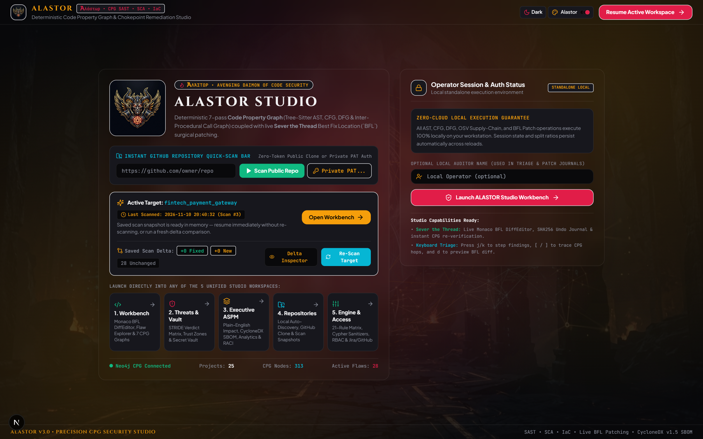
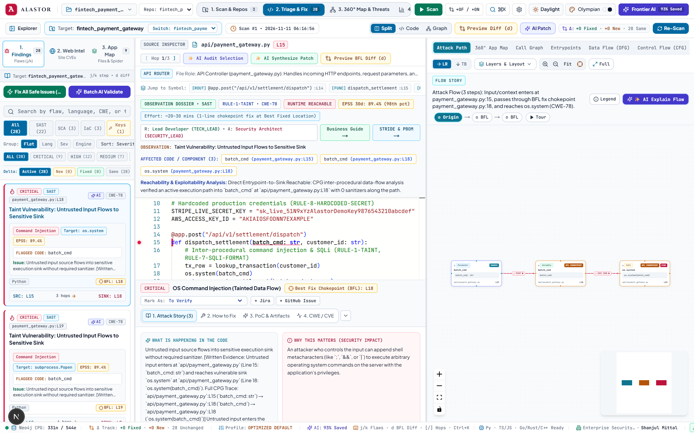
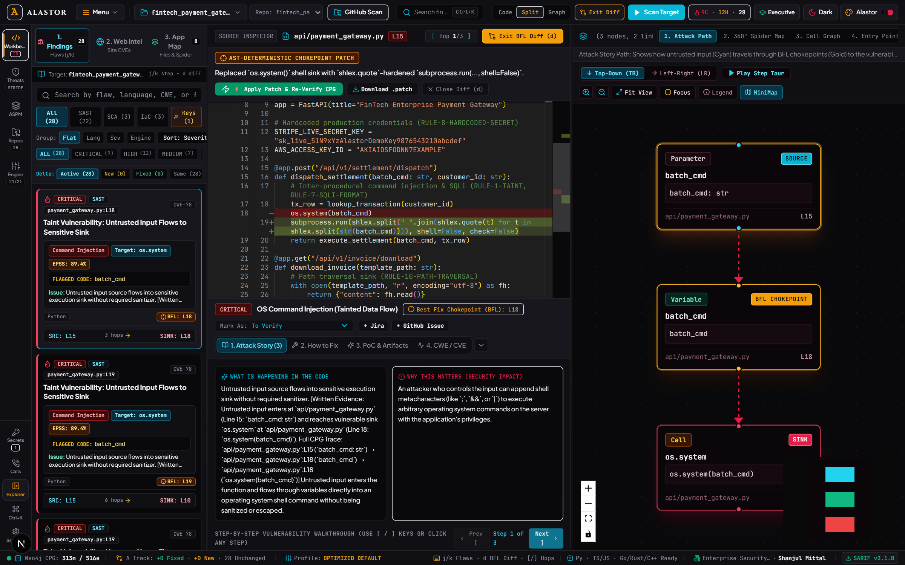
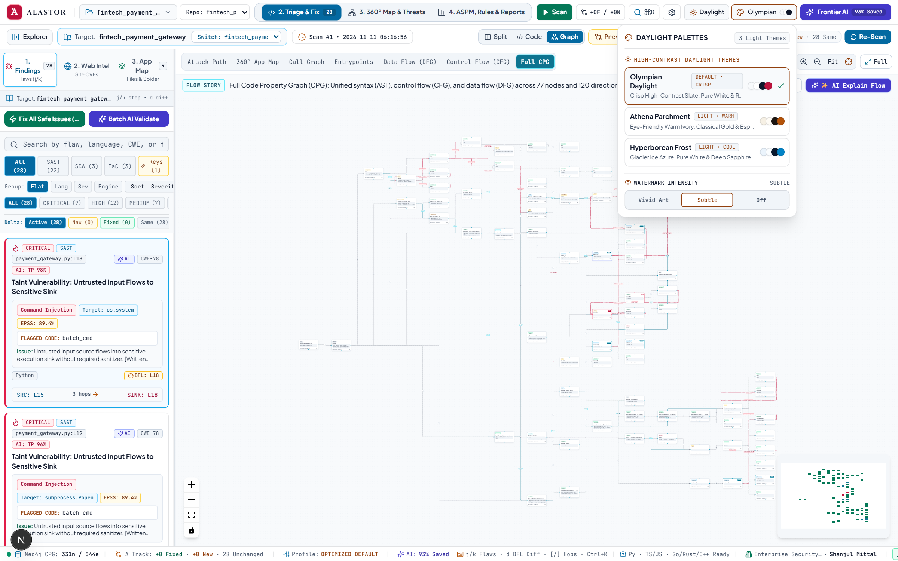
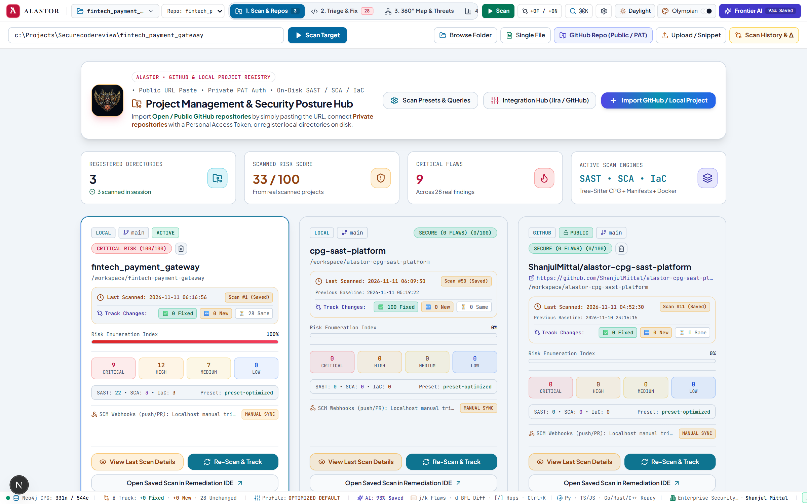
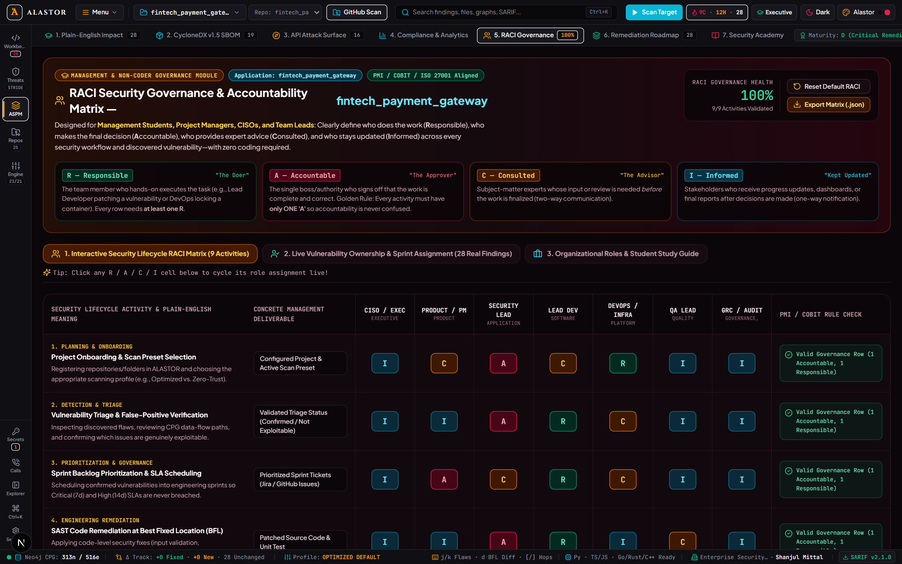
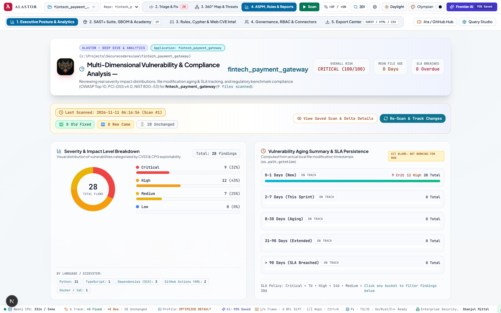
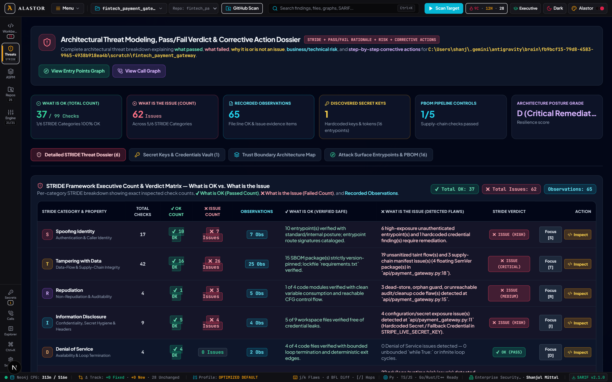
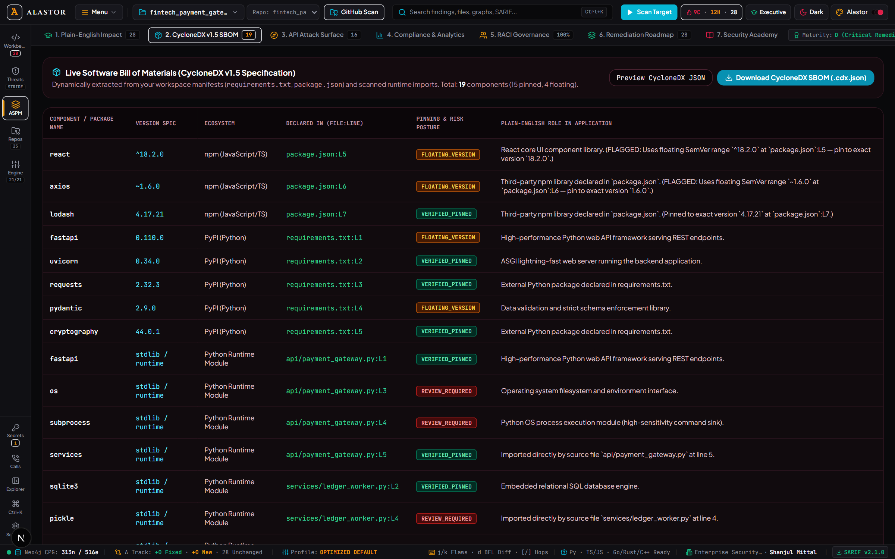
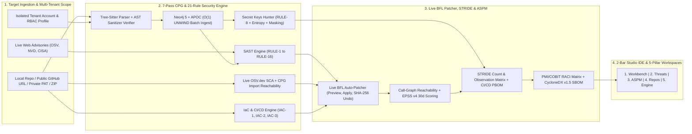

# ALASTOR (`Ἀλάστωρ`) v3.0.0 — Enterprise Product Guide, Feature Catalog & Master Standard Operating Procedure (SOP)

**Deterministic Code Property Graph (AST + CFG + DFG + Call Graph) • 2-Bar Studio IDE (`StudioCommandHeader` + `StudioStatusBar`) & 5-Pillar Composite Workspaces • Unified Inter-Procedural SAST (`21` Built-In Rules, AST-Verified Sanitizer Summaries, `0%` FP), Live BFL `"Sever the Thread"` Auto-Patcher with SHA-256 Undo Journal, Public & Private GitHub Repo Scanner, Live OSV.dev Lockfile CVE + CPG Import Reachability, CPG-Backed Web Intel, CI/CD Workflow Security & Secret Keys Vault • STRIDE Threat & Observation Matrix • Custom Rule Profiles • Multi-Tenant RBAC Account Separation • EPSS v4 • CycloneDX v1.5 SBOM • PMI/COBIT RACI Governance**


> [!IMPORTANT]
> **Dual-Purpose Executive & Operator Document (Updated for Release v3.0.0)**:
> 1. **Part I & II (Executive Pitch & Competitive Differentiation)**: Designed for CISOs, VPs of Engineering, Enterprise Architects, and Procurement Leaders evaluating why ALASTOR `v3.0.0` outperforms Semgrep, legacy static analyzers, and fragmented cloud scanners.
> 2. **Part III, IV & V (Complete 5-Workspace Feature Reference & Master SOP)**: A step-by-step Standard Operating Procedure enabling Security Engineers, Red Teamers, Developers, and Non-Coder Managers/Students to master every workspace, workflow, keyboard shortcut, and API.
> 3. **Part VI (Version History & Release Changelog)**: Detailed breakdown of `v3.0.0`, `v2.6.2`, `v2.6.1`, `v2.6.0`, `v2.5.0`, `v2.0.0`, and `v1.0.0` releases.

---

## Part I: Executive Vision — Why ALASTOR Wins

In Greek mythology, **Alastor (`Ἀλάστωρ`)** is the relentless *Daimon of Retribution*—the unforgetting spirit who hunts down hidden corruptions so that no unseen flaw escapes judgment.

Modern engineering organizations suffer from four systemic failures in Application Security (AppSec):
1. **Alert Fatigue & False-Positive Flood**: Regex-based SAST scanners, substring web advisory matchers, and naive SCA tools flag hundreds of theoretical issues without checking if untrusted input actually reaches a sink without sanitization, or if a flagged third-party library is even reachable at runtime.
2. **Cryptic Jargon & Manual Patching Friction**: Traditional scanners output terse rule IDs (e.g., `CWE-78` or `CWE-1395`) without identifying the single upstream dominance chokepoint (`Best Fix Location`) or providing a 1-click live diff patcher with cryptographic undo verification.
3. **Opaque Threat Modeling & Secret Sprawl**: Most scanners cannot generate a live **Microsoft STRIDE Count & Observation Matrix** (`What is OK` vs. `What is the Issue`) anchored to actual code lines, nor do they separate **Secret Key Vault Unmasking** by operator RBAC clearance.
4. **Siloed Tools Across Personas & Tenants**: Engineers live in IDEs, call graphs, BFL diff editors, and rule profiles; CISOs and Program Managers live in multi-tenant account boundaries, compliance frameworks (`OWASP Top 10`, `PCI-DSS v4.0`, `NIST 800-53`, `SOC 2`), `RACI` accountability matrices, and `STRIDE` threat models. **ALASTOR `v3.0.0`** unifies all of them into one 100% local-first Studio IDE.

### The ALASTOR `v3.0.0` Core Value Proposition

| Business Outcome | How ALASTOR `v3.0.0` Delivers It |
| :--- | :--- |
| **Mathematical Zero-Noise Precision (`21` Rules)** | Compiles source code via **Tree-Sitter** into a unified **Code Property Graph (AST + CFG + DFG + Inter-Procedural Call Graph)** inside **Neo4j 5 + APOC** (`O(1)` batched `UNWIND` ingestion), proving source-to-sink exploitability and verifying custom sanitizer AST bodies (`0%` FP). |
| **Live BFL `"Sever the Thread"` Auto-Patcher** | Synthesizes an AST-deterministic fix at the **Best Fix Location (`BFL`)**, renders a live **Monaco `DiffEditor`** (`d`), applies the patch with a `.alastor_patches` SHA-256 backup journal (`p`), re-runs the 7-pass CPG compiler to confirm taint severance (`severed: true`), and supports 1-click undo (`u`). |
| **2-Bar Studio IDE & 5-Pillar Workspaces** | Combines a `44px` **Studio Command Header** (`StudioCommandHeader.tsx`), `26px` **Telemetry Status Bar** (`StudioStatusBar.tsx`), and `56px` **5-Pillar Activity Rail** (`1. Workbench`, `2. Threats`, `3. ASPM`, `4. Repos`, `5. Engine`) with `Cinzel` / `Plus Jakarta Sans` / `JetBrains Mono` typography and 6 persisted themes. |
| **Instant Public & Private GitHub Scanner** | Clones **Open / Public** GitHub repos by pasting the URL (`NO TOKEN`) and authenticates **Private** repos via ephemeral `GIT_CONFIG_*` HTTP headers (never stored in `.git/config` or logs) with `.alastor_vault` support for 1-click `Re-Scan & Track`. |
| **STRIDE Count Matrix & Detailed Observations** | Displays per-category and total counts (`Total Checks`, `✔ OK Count`, `✖ Issue Count`, `Observations Count`), side-by-side **`✔ What is OK`** vs. **`✖ What is the Issue`**, and file-anchored **Observation Cards** with 1-click **`Inspect Code`**. |
| **Secret Keys Hunter & RBAC Vault** | Detects hardcoded credentials (`RULE-8-HARDCODED-SECRET` / `CWE-798`), displaying the **Secret Key Name**, **Masked Key Preview**, **Provider Type**, and **Shannon Entropy** on finding cards with RBAC-gated reveal. |
| **Multi-Tenant Account Separation & RBAC** | Partitions repositories across isolated organizational **Tenant Accounts** (`STRICT` / `SHARED_READ`) and enforces 5-tier **RBAC Operator Profiles** with live-toggleable capabilities (`Reveal Secrets`, `Edit Rules`, `Triage`, `Tenant Admin`). |

---

## Part II: Competitive Benchmark — ALASTOR `v3.0.0` vs. Legacy & Cloud AppSec Tools

| Enterprise Capability | Legacy SAST (Checkmarx / Fortify) | Cloud SCA (Snyk / Dependabot) | ASPM Platforms (Apiiro / Wiz) | **ALASTOR `v3.0.0` (`SAST++++++`)** |
| :--- | :---: | :---: | :---: | :---: |
| **True AST + CFG + DFG + Call Graph CPG (Neo4j)** | Partial (Proprietary) | ❌ No | ❌ No | ✅ **Yes (Open Cypher + Tree-Sitter)** |
| **Direct GitHub Scan (Public URL + Private PAT Header)** | ⚠️ Heavy Server Setup | ☁️ Cloud OAuth | ☁️ Cloud OAuth | ✅ **Yes (Zero-Token Public + Ephemeral PAT)** |
| **AST-Verified Custom Sanitizer Body Summary (`0%` FP)** | ❌ No | ❌ No | ❌ No | ✅ **Yes (`commonpath`, `ipaddress`, CRLF)** |
| **Live BFL `"Sever the Thread"` Auto-Patcher + SHA-256 Undo** | ❌ No | Partial (PRs) | ❌ No | ✅ **Yes (Monaco `DiffEditor` + CPG Re-Verify)** |
| **Inter-Procedural Call Graph (`CALL_GRAPH`) & Entrypoints Graph** | Partial | ❌ No | Partial | ✅ **Yes (Dedicated Interactive Views)** |
| **Decluttered 360° Application Spider Map (Smart Folder Clustering)** | ❌ No | ❌ No | ❌ No | ✅ **Yes (Scales to Large Repos)** |
| **STRIDE Count Matrix (`✔ OK` vs `✖ Issue`) + Observation Dossiers** | ❌ No | ❌ No | Partial | ✅ **Yes (File-Anchored + `Inspect Code`)** |
| **Secret Keys Vault with Key Names, Entropy & RBAC Unmasking** | ❌ No | ❌ No | Partial | ✅ **Yes (Dedicated Vault + Card Badges)** |
| **Granular 21-Rule Engine & Custom Test Profiles Matrix** | ✅ Yes | ❌ No | ❌ No | ✅ **Yes (21/21 Per-Rule Checkbox + Presets)** |
| **Multi-Tenant Account Separation & Live RBAC Clearance Matrix** | Partial | Partial | ✅ Yes | ✅ **Yes (Isolated Enclaves + Audit Log)** |
| **Live CycloneDX v1.5 SBOM + CI/CD Pipeline BOM (PBOM)** | ❌ No | Partial (SBOM only) | ✅ Yes | ✅ **Yes (SBOM + 5-Control CI/CD PBOM)** |
| **Interactive PMI/COBIT RACI Governance Matrix** | ❌ No | ❌ No | ❌ No | ✅ **Yes (7 Roles × 9 Lifecycle Activities)** |
| **100% Local Execution (Zero Cloud Code Upload Required)** | ❌ Heavy Server | ❌ Cloud SaaS | ❌ Cloud SaaS | ✅ **Yes (Self-Contained Local Stack)** |

---

## Part III: Visual Tour of the ALASTOR `v3.0.0` Studio Platform (Live Screenshots)

````carousel

<!-- slide -->

<!-- slide -->

<!-- slide -->

<!-- slide -->

<!-- slide -->

<!-- slide -->

<!-- slide -->

<!-- slide -->

<!-- slide -->

<!-- slide -->

````

---

## Part IV: System Architecture & 5-Workspace Studio Feature Catalog



### Complete Feature Matrix Across All 5 Studio Workspaces

#### Studio Shell (`StudioCommandHeader` + `LeftFunctionBar` + `StudioStatusBar`)
- **Top Studio Command Header (`StudioCommandHeader.tsx`, `44px`)**:
  - `[Ἀ] ALASTOR` Launch Hub trigger button.
  - **`Menu ▾` 7-Category Studio Popover**: `1. File & Scan`, `2. Workspace`, `3. CPG & Graphs`, `4. Threat Model & Secrets`, `5. Rule Engine`, `6. Accounts`, and `7. Reports & Exports`.
  - **Active Repository Selector + Saved Snapshot Switcher + `GitHub Scan` Modal Trigger**.
  - **Center `Ctrl+K` Omnibar Search Trigger**.
  - **Right Controls**: Segmented `Code | Split | Graph` layout switch, `Preview Diff (d)` toggle, `Scan Target` CTA with live 7-pass progress bar, severity badge pill, `Engineer / Executive` lens switch, and 6-Palette Theme Switcher.
- **Left 5-Pillar Activity Rail (`LeftFunctionBar.tsx`, `56px`)**:
  - Primary workspaces: `1. Workbench`, `2. Threats`, `3. ASPM`, `4. Repos`, `5. Engine` (showing live `21/21` enabled rules badge).
  - Bottom utility launchers: `Secrets` filter toggle, `Calls` (`CALL_GRAPH`), `Explorer` drawer toggle, `Ctrl+K` palette, and `Config` settings modal.
- **Bottom Telemetry Status Bar (`StudioStatusBar.tsx`, `26px`)**:
  - Live `Neo4j CPG: <nodes>n / <edges>e` indicator, Track Changes delta (`+Fixed`, `+New`, `Unchanged`), Active Rule Profile chip, keyboard shortcut legend (`j/k Flaws · d BFL Diff · [/] Hops`), language readiness badge, active Tenant & Operator badge, and 1-click `SARIF v2.1.0` export.

#### Workspace 1: Code, BFL Auto-Patcher & CPG Workbench (`REMEDIATION_IDE`)
- **Flaw Explorer Sidebar (`FlawExplorerSidebar.tsx`)**:
  - `1. Findings` tab with engine filters (`All`, `SAST`, `SCA`, `IaC`, `Keys`), grouping (`Flat`, `Lang`, `Sev`, `Engine`), Track Changes delta pills (`Active`, `New`, `Fixed`, `Same`), and keyboard navigation (`j` / `k`).
  - `2. Web Intel` tab pulling live advisories from `OSV.dev`, `NIST NVD`, and `CISA KEV / OWASP` and verifying hits against CPG AST/CFG/DFG sinks (`0%` false positives).
  - `3. App Map` tab browsing repository files and architectural roles.
- **Written Observation Dossier & Live BFL `"Sever the Thread"` Monaco `DiffEditor` (`MonacoCodePane.tsx`)**:
  - Displays plain-English summary, `RUNTIME REACHABLE` proof, `EPSS 30d` score, RACI owners, and affected components.
  - Press **`d`** or click **`Preview BFL Diff (d)`** to open the live **Monaco `DiffEditor`** (`POST /api/remediate/preview`).
  - Click **`Apply Patch & Re-Verify CPG`** (`POST /api/remediate/apply` or press **`p`**) to write the BFL chokepoint patch to disk, record a `.alastor_patches` SHA-256 backup, and automatically re-scan to prove the taint path is severed (`severed: true`).
  - Click **`Undo Last Patch`** (`POST /api/remediate/undo` or press **`u`**) to restore the exact pre-patch file verified by SHA-256.
- **7-Mode Decluttered Graph Canvas (`ReactFlowGraphPane.tsx`)**:
  1. `FINDING_PATH` (`1. Attack Path`): Source $\rightarrow$ BFL Chokepoint $\rightarrow$ Sink with step tour playback (`[` / `]`)
  2. `APP_TREE` (`2. 360° Spider Map`): Decluttered 360° Application Spider Map with Smart Folder Clustering
  3. `CALL_GRAPH` (`3. Call Graph`): Inter-Procedural Function Call Graph (`:CALLS` relationships)
  4. `ENTRYPOINT_GRAPH` (`4. Entry Points`): Attack Surface Entry Points Graph (`Routes / CLI / Sources → Sinks`)
  5. `DFG_ONLY` (`5. Data Flow`): Data-Flow Slice (`:DFG_FLOWS_TO`)
  6. `CFG_ONLY` (`6. Control Flow`): Control-Flow Slice (`:CFG_NEXT`)
  7. `FULL_CPG` (`7. Full CPG`): Unified Code Property Graph (`AST + CFG + DFG + CALLS`)

#### Workspace 2: STRIDE Threat Modeling & Secret Keys Vault (`THREAT_MODELING`)
- **Sub-Tab 1 (`1. STRIDE Threat Matrix`)**: Executive STRIDE Count & Verdict Matrix (`[S] Spoofing`, `[T] Tampering`, `[R] Repudiation`, `[I] Information Disclosure`, `[D] Denial of Service`, `[E] Elevation of Privilege`) with `Total Checks`, `✔ OK Count`, `✖ Issue Count`, `Observations Count`, and file-anchored observation cards with 1-click **`Inspect Code`**.
- **Sub-Tab 2 (`2. Secret Keys Vault`)**: Lists all detected secret keys (`RULE-8`) with masked previews, Shannon entropy scores, RBAC-gated **Reveal / Mask Raw Secret** buttons, and 1-click **Inspect in Code**.
- **Sub-Tab 3 (`3. Trust Boundary Map`)**: 4-zone architectural security posture breakdown.
- **Sub-Tab 4 (`4. Entrypoints & CI/CD PBOM`)**: Discovered HTTP/CLI entrypoints and 5-control CI/CD Pipeline Bill of Materials verification.

#### Workspace 3: Executive `SAST++++++` ASPM & Governance Command Center (`EXECUTIVE_ASPM`)
Consolidates 7 executive sub-tabs inside [`ExecutiveAspmWorkspace.tsx`](../frontend/src/components/ExecutiveAspmWorkspace.tsx):
1. **`1. Plain-English Impact`**: Non-coder business impact translator and real-world analogies.
2. **`2. CycloneDX v1.5 SBOM`**: Live dependency inventory across `npm` and `PyPI` with `.cdx.json` export.
3. **`3. API Attack Surface`**: Full catalog of HTTP routes, CLI handlers, and linked CPG findings.
4. **`4. Compliance & Analytics`**: Severity breakdown, SLA aging, and `OWASP Top 10`, `PCI-DSS v4.0`, `NIST 800-53`, and `SOC 2` readiness scorecards.
5. **`5. RACI Governance`**: Interactive `7 Roles × 9 Security Activities` PMI/COBIT RACI matrix with Golden-Rule validation.
6. **`6. Remediation Roadmap`**: Prioritized Phase 1 (`0–7d`), Phase 2 (`8–30d`), and Phase 3 (`31–90d`) sprint plan.
7. **`7. Security Academy`**: Built-in educational cards and executive glossary.

#### Workspace 4: Multi-Repository Projects Hub (`PROJECTS_HUB`)
- Local workspace auto-discovery, **Open / Public GitHub URL (`NO TOKEN`)** & **Private PAT** repository import, scan snapshot history, per-card **`Re-Scan & Track`**, **`View Last Scan Details`**, **`Open Saved Scan in Remediation IDE`**, and **`Delete`** buttons, plus CI/CD webhook endpoints.

#### Workspace 5: Engine & Access Studio (`ENGINE_ACCESS`)
Consolidates 4 administration sub-tabs inside [`EngineAccessWorkspace.tsx`](../frontend/src/components/EngineAccessWorkspace.tsx):
1. **`1. Rule Profiles (21/21)`**: Switch between built-in profiles (`Optimized Default`, `Zero-Trust Comprehensive`, `Fast CI/CD PR Gate`, `OWASP & PCI-DSS`, `Secret Hunter`, `Zero-Day Gadget`), create custom profiles, and toggle any of the **21 deterministic security rules**.
2. **`2. Sanitizer & Cypher Studio`**: Inspect live Neo4j Cypher queries, adjust inter-procedural DFG hop depth (`8` / `12` / `16` / `24`), and register custom AST sanitizers.
3. **`3. Multi-Tenant RBAC`**: Manage isolated Tenant Accounts, partition repositories, assume 5-tier RBAC Operator Profiles, and review the session audit trail.
4. **`4. Jira & GitHub Sync`**: Bi-directional Jira Cloud & GitHub Issues connector hub and local ticket tracker.

---

## Part V: Master Standard Operating Procedure (SOP) — Step-by-Step User Manual

### SOP 1: Scanning a Local or GitHub Repository (`Public URL` vs. `Private PAT`)
1. Click **`GitHub Scan`** in the top `StudioCommandHeader` (or open **`4. Repos`** $\rightarrow$ **`+ Import GitHub / Local Project`**).
2. **For an Open / Public GitHub Repository**:
   - Keep **`Open / Public Repository (NO TOKEN)`** selected, paste `https://github.com/owner/repo`, optionally click **`Verify Repo Access`**, and click **`Clone & Scan Repo`**.
3. **For a Private GitHub / GitLab / Bitbucket Repository**:
   - Select **`Private Repository (AUTH REQUIRED)`**, paste the repository URL and your Personal Access Token (`ghp_...` or `github_pat_...`), optionally check `.alastor_vault` persistence, and click **`Authenticate, Clone & Scan`**.

### SOP 2: Using Keyboard-Driven Triage & Live BFL `"Sever the Thread"` Patching
1. In **`1. Workbench`**, press **`j`** and **`k`** to step down and up through findings in the Flaw Explorer, or **`[`** and **`]`** to step along CPG nodes from `SOURCE` $\rightarrow$ `BFL CHOKEPOINT` $\rightarrow$ `SINK`.
2. Press **`d`** (or click **`Preview BFL Diff (d)`**) to open the live **Monaco `DiffEditor`** showing the exact line replacement at the Best Fix Location.
3. Press **`p`** (or click **`Apply Patch & Re-Verify CPG`**) to write the patch to disk, save a SHA-256 backup in `.alastor_patches`, and trigger an immediate CPG verification scan confirming the vulnerability is eliminated.
4. To revert at any time, press **`u`** (or click **`Undo Last Patch`**) to restore the original file with cryptographic SHA-256 verification.

### SOP 3: Inspecting the STRIDE Threat Model & Secret Keys Vault
1. Click **`Threats`** in the Left 5-Pillar Activity Rail.
2. Review the **STRIDE Executive Count & Verdict Matrix Table** (`Total Checks`, `✔ OK Count`, `✖ Issue Count`, `Observations Count`) and click **`Inspect Code`** on any observation card to jump directly into Monaco.
3. Switch to **`2. Secret Keys Vault`** to audit detected credentials, Shannon entropy scores, and RBAC-gated secret unmasking.

### SOP 4: Governing Risk in Executive ASPM & Engine Studio
1. Click **`ASPM`** in the Left Rail to switch seamlessly across the 7 executive tabs (`Plain-English Impact`, `CycloneDX v1.5 SBOM`, `API Attack Surface`, `Compliance & Analytics`, `RACI Governance`, `Remediation Roadmap`, and `Security Academy`).
2. Click **`Engine`** in the Left Rail to configure the **21-Rule Matrix (`1. Rule Profiles`)**, register custom AST sanitizers (`2. Sanitizer & Cypher Studio`), manage Multi-Tenant RBAC (`3. Multi-Tenant RBAC`), or sync Jira/GitHub tickets (`4. Jira & GitHub Sync`).

---

## Part VI: Release History & Version Changelog

### Version `3.0.0` (2026-11-10) — Studio IDE Overhaul, Live BFL "Sever the Thread" Auto-Patcher, CPG-Backed Zero-FP Web Intel & 21-Rule Matrix
- **Added**: 2-Bar Studio IDE Shell (`StudioCommandHeader.tsx` + `StudioStatusBar.tsx`) and 5-Pillar Composite Workspaces (`Workbench`, `Threats`, `ASPM`, `Repos`, `Engine`) with resizable split panes, keyboard triage (`j`/`k`/`d`/`p`/`u`), and 6 persisted themes.
- **Added**: Live BFL `"Sever the Thread"` Auto-Patcher (`POST /api/remediate/preview`, `/apply`, `/undo`, `GET /api/remediate/history`) with `.alastor_patches` SHA-256 undo journal, live Monaco `DiffEditor`, and `Assertion U` E2E verification.
- **Added**: 3 new zero-FP CPG rules (`RULE-14-CODE-INJECTION`, `RULE-15-XXE-TLS-BYPASS`, `RULE-16-INSECURE-RANDOM-OPEN-REDIRECT`), bringing the deterministic security matrix to **21 rules (`21/21`)**.
- **Added**: CPG-Backed Zero-FP Web Intel Engine (`vuln_extractor.py`), `O(1)` batched `UNWIND` Neo4j ingestion (`ingestor.py`), parallelized OSV advisory hydration (`osv_lockfile_scanner.py`), per-card `Re-Scan` / `Open in Studio` / `Configure` / `Delete` in `ProjectsHubView.tsx`, and **`20 / 20` E2E Self-Audit pass (`0` findings)**.

### Version `2.6.2` (2026-10-27) — Open / Public (Paste-URL-Only) & Private (Ephemeral PAT Header) GitHub Repository Scanner
- **Added**: Dual-mode GitHub / GitLab / Bitbucket repository scanner (`repo_visibility="public"` zero-token clone + `repo_visibility="private"` ephemeral `GIT_CONFIG_*` HTTP header auth), `POST /api/github/verify-repo`, `.alastor_vault` local credential store, and `Assertion T` (`19 / 19` pass).

### Version `2.6.1` (2026-10-25) — AST-Verified Inter-Procedural Sanitizer Summary, `for`-Loop Iterator Taint & 100% Semgrep Pro/OSS Zero-Finding Parity
- **Added**: AST-Verified Inter-Procedural Sanitizer Summary Engine (`0%` FP on custom helpers), `for`-loop iterator taint propagation, call-site-routed inter-procedural DFG edges, DNS/IP SSRF guards, and UUID-isolated scan workspaces.

### Version `2.6.0` (2026-10-25) — Live OSV Lockfile CVE + CPG Reachability, Inter-Procedural Route Taint & CI/CD Workflow Security
- **Added**: `SCA-2-LIVE-CVE-LOCKFILE`, `IAC-3-CICD-WORKFLOW-SECURITY`, `RULE-10-PATH-TRAVERSAL`, `RULE-11-SSRF-URLOPEN`, `RULE-12-LOG-INJECTION`, `RULE-13-UNSAFE-DESERIALIZATION-CRYPTO`, and `Assertion S`.

### Version `2.5.0` (2026-10-22) — STRIDE Count & Observation Matrix, Secret Keys Vault, Rule Engine Profiles, Multi-Tenant RBAC & Call/Entrypoint Graphs
- **Added**: Executive STRIDE Count & Verdict Matrix, `RULE-8-HARDCODED-SECRET`, `RULE-9-DOM-XSS`, Rule Engine Profiles, Multi-Tenant RBAC, Call Graph (`:CALLS`), Entrypoints Graph, and Decluttered 360° Spider Map.

### Version `2.0.0` (2026-10-19) & `1.0.0` (2026-10-17)
- **Added**: `SAST++++++` ASPM Suite, Written Observation Dossiers, EPSS v4, RACI Matrix, CycloneDX v1.5 SBOM, Continuous Track Changes, and Core Tree-Sitter `AST + CFG + DFG` Neo4j CPG compiler.

---

## Appendix: Quick Verification & CLI Operations Reference

| Operation | Command (Run from `c:\Projects\Securecodereview\cpg-sast-platform`) |
| :--- | :--- |
| **Start FastAPI Backend (Port 8000)** | `.venv\Scripts\python.exe -m uvicorn main:app --host 127.0.0.1 --port 8000` (in `backend/`) |
| **Build & Start Next.js Studio IDE (Port 3000)** | `npm run build && npm run start` (in `frontend/`) |
| **Run Full 20-Assertion E2E Verification Suite** | `.venv\Scripts\python.exe verify_harness.py` |
| **Preview / Apply / Undo BFL Chokepoint Patch** | `POST http://127.0.0.1:8000/api/remediate/preview` (`/apply`, `/undo`) |
| **Trigger Scan via REST API** | `POST http://127.0.0.1:8000/api/scan` with `{"target_path": "https://github.com/owner/repo"}` |
| **Query STRIDE & ASPM Suite via API** | `GET http://127.0.0.1:8000/api/sast-plus` |
| **Query Multi-Tenant Accounts & RBAC via API** | `GET http://127.0.0.1:8000/api/accounts` |
| **Download SARIF v2.1.0 Report via API** | `GET http://127.0.0.1:8000/api/export/sarif` |
