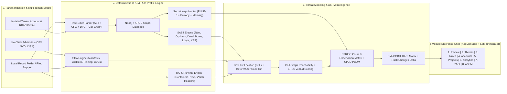

# ALASTOR (`Ἀλάστωρ`) v2.6.0 — Enterprise Product Guide, Feature Catalog & Master Standard Operating Procedure (SOP)

**Deterministic Code Property Graph (AST + CFG + DFG + Call Graph) • Unified Inter-Procedural SAST (`18` Built-In Rules, `0%` FP), Live OSV.dev Lockfile CVE + CPG Import Reachability, CI/CD Workflow Security & Secret Keys Vault • STRIDE Threat & Observation Matrix • Custom Rule Profiles • Multi-Tenant RBAC Account Separation • EPSS v4 • CycloneDX v1.5 SBOM • PMI/COBIT RACI Governance**


> [!IMPORTANT]
> **Dual-Purpose Executive & Operator Document (Updated for Release v2.6.0)**:
> 1. **Part I & II (Executive Pitch & Competitive Differentiation)**: Designed for CISOs, VPs of Engineering, Enterprise Architects, and Procurement Leaders evaluating why ALASTOR outperforms Semgrep, legacy static analyzers, and fragmented cloud scanners.
> 2. **Part III, IV & V (Complete 8-Module Feature Reference & 10-Step Master SOP)**: A step-by-step Standard Operating Procedure enabling Security Engineers, Red Teamers, Developers, and Non-Coder Managers/Students to master every workspace, workflow, and API.
> 3. **Part VI (Version History & Release Changelog)**: Detailed breakdown of `v2.6.0`, `v2.5.0`, `v2.0.0`, and `v1.0.0` releases.

---

## Part I: Executive Vision — Why ALASTOR Wins

In Greek mythology, **Alastor (`Ἀλάστωρ`)** is the relentless *Daimon of Retribution*—the unforgetting spirit who hunts down hidden corruptions so that no unseen flaw escapes judgment.

Modern engineering organizations suffer from four systemic failures in Application Security (AppSec):
1. **Alert Fatigue & False-Positive Flood**: Regex-based SAST scanners and naive SCA tools flag hundreds of theoretical issues without checking if untrusted input actually reaches a sink without sanitization, or if a flagged third-party library is even reachable at runtime.
2. **Cryptic Jargon & Zero Written Context**: Traditional scanners output terse rule IDs (e.g., `CWE-1395: Vulnerable Component`) without naming the exact third-party packages, line numbers, lockfile-resolved versions, business impact, or copy-pasteable code replacements.
3. **Opaque Threat Modeling & Secret Sprawl**: Most scanners cannot generate a live **Microsoft STRIDE Count & Observation Matrix** (`What is OK` vs. `What is the Issue`) anchored to actual code lines, nor do they separate **Secret Key Vault Unmasking** by operator RBAC clearance.
4. **Siloed Tools Across Personas & Tenants**: Engineers live in IDEs, call graphs, and rule profiles; CISOs and Program Managers live in multi-tenant account boundaries, compliance frameworks (`OWASP Top 10`, `PCI-DSS v4.0`, `NIST 800-53`), `RACI` accountability matrices, and `STRIDE` threat models. **ALASTOR v2.5.0** unifies all of them into one 100% local-first platform.

### The ALASTOR v2.5.0 Core Value Proposition

| Business Outcome | How ALASTOR v2.5.0 Delivers It |
| :--- | :--- |
| **Mathematical Zero-Noise Precision** | Compiles source code via **Tree-Sitter** into a unified **Code Property Graph (AST + CFG + DFG + Inter-Procedural Call Graph)** inside **Neo4j + APOC**, proving source-to-sink exploitability and filtering out sanitized flows automatically. |
| **Streamlined Enterprise Navigation Shell** | Combines a **7-Dropdown Top Application Menu Bar** (`File & Scan`, `Workspace`, `CPG & Graphs`, `Threat Model & Secrets`, `Rule Engine & Profiles`, `Accounts & Users`, `Reports & Connectors`) with a **Vertical Left Side Function Bar** for 1-click access to all 8 modules. |
| **STRIDE Count Matrix & Detailed Observations** | Displays per-category and total counts (`Total Checks`, `✔ OK Count`, `✖ Issue Count`, `Observations Count`), side-by-side **`✔ What is OK`** vs. **`✖ What is the Issue`**, and file-anchored **Observation Cards** with 1-click **`Inspect Code`**. |
| **Secret Keys Hunter & RBAC Vault** | Detects hardcoded credentials (`RULE-8-HARDCODED-SECRET` / `CWE-798`), displaying the **Secret Key Name**, **Masked Key Preview**, **Provider Type**, and **Shannon Entropy** on finding cards instead of generic reachability badges. |
| **Rule Engine & Custom Test Profiles** | Lets teams choose or create custom **Test Profiles** and check/uncheck individual security rules (`SAST`, `SCA`, `IaC`, `Secret Hunter`) with instant live rescanning. |
| **Multi-Tenant Account Separation & RBAC** | Partitions repositories across isolated organizational **Tenant Accounts** (`STRICT` / `SHARED_READ`) and enforces 5-tier **RBAC Operator Profiles** with live-toggleable capabilities (`Reveal Secrets`, `Edit Rules`, `Triage`, `Tenant Admin`). |

---

## Part II: Competitive Benchmark — ALASTOR v2.5.0 vs. Legacy & Cloud AppSec Tools

| Enterprise Capability | Legacy SAST (Checkmarx / Fortify) | Cloud SCA (Snyk / Dependabot) | ASPM Platforms (Apiiro / Wiz) | **ALASTOR v2.5.0 (`SAST++++++`)** |
| :--- | :---: | :---: | :---: | :---: |
| **True AST + CFG + DFG + Call Graph CPG (Neo4j)** | Partial (Proprietary) | ❌ No | ❌ No | ✅ **Yes (Open Cypher + Tree-Sitter)** |
| **Inter-Procedural Call Graph (`CALL_GRAPH`) & Entrypoints Graph** | Partial | ❌ No | Partial | ✅ **Yes (Dedicated Interactive Views)** |
| **Decluttered 360° Application Spider Map (Smart Folder Clustering)** | ❌ No | ❌ No | ❌ No | ✅ **Yes (Scales to Large Repos)** |
| **STRIDE Count Matrix (`✔ OK` vs `✖ Issue`) + Observation Dossiers** | ❌ No | ❌ No | Partial | ✅ **Yes (File-Anchored + `Inspect Code`)** |
| **Secret Keys Vault with Key Names, Entropy & RBAC Unmasking** | ❌ No | ❌ No | Partial | ✅ **Yes (Dedicated Vault + Card Badges)** |
| **Granular Rule Engine & Custom Test Profiles Matrix** | ✅ Yes | ❌ No | ❌ No | ✅ **Yes (Per-Rule Checkbox + Presets)** |
| **Multi-Tenant Account Separation & Live RBAC Clearance Matrix** | Partial | Partial | ✅ Yes | ✅ **Yes (Isolated Enclaves + Audit Log)** |
| **Best Fix Location (BFL) + Side-by-Side Before/After Code Diff** | Partial | Partial | ❌ No | ✅ **Yes (1-Click Copy Fixed Code)** |
| **Continuous Track Changes (`Fixed` / `New` / `Unchanged` Delta)** | Partial | Partial | ✅ Yes | ✅ **Yes (Persistent Snapshot History)** |
| **Live CycloneDX v1.5 SBOM + CI/CD Pipeline BOM (PBOM)** | ❌ No | Partial (SBOM only) | ✅ Yes | ✅ **Yes (SBOM + 5-Control CI/CD PBOM)** |
| **Interactive PMI/COBIT RACI Governance Matrix** | ❌ No | ❌ No | ❌ No | ✅ **Yes (7 Roles × 9 Lifecycle Activities)** |
| **100% Local Execution (Zero Cloud Code Upload Required)** | ❌ Heavy Server | ❌ Cloud SaaS | ❌ Cloud SaaS | ✅ **Yes (Self-Contained Local Stack)** |

---

## Part III: Visual Tour of the ALASTOR Platform (Live Screenshots)

````carousel

<!-- slide -->

<!-- slide -->

<!-- slide -->

<!-- slide -->

<!-- slide -->

<!-- slide -->

<!-- slide -->

<!-- slide -->

<!-- slide -->

<!-- slide -->

````

---

## Part IV: System Architecture & 8-Module Feature Catalog



### Complete Feature Matrix Across All 8 Enterprise Modules

#### Module 0: Enterprise Navigation Shell (`AppMenuBar` + `LeftFunctionBar` + `ActiveApplicationBanner`)
- **Top Application Menu Bar (`AppMenuBar.tsx`)**:
  - `File & Scan`: Run Full CPG + Secret Scan, Open Projects Hub, Pull Live Web Advisories, Open Command Palette (`Ctrl+K`), Return to Alastor Portal Gate.
  - `Workspace`: Direct switcher across all 8 Enterprise Modules + Workbench Panel Layout (`Split Code+Graph`, `Code Only`, `Graph Only`).
  - `CPG & Graphs`: Switch between all 7 Graph Visualizations (`1. Attack Path`, `2. 360° Spider Map`, `3. Call Graph`, `4. Entrypoints Graph`, `5. Data-Flow DFG`, `6. Control-Flow CFG`, `7. Full CPG`) + Fullscreen Presentation launch.
  - `Threat Model & Secrets`: Open STRIDE Threat Modeling Workspace, Filter Detected Secret Keys, Inspect Entrypoints Graph, Inspect Call Graph.
  - `Rule Engine & Profiles`: Open Rule Engine & Test Profiles Matrix, Quick-Switch Active Test Profile, Toggle `SAST` / `SCA` / `IaC` engines.
  - `Accounts & Users`: Open User Profiling & Account Separation, Quick-Switch Isolated Tenant Account, Assume RBAC User Profile.
  - `Reports & Connectors`: Export Markdown (`.md`), JSON (`.json`), OASIS SARIF v2.1.0 (`.sarif.json`), CycloneDX v1.5 SBOM (`.cdx.json`), RACI Matrix (`.json`), and open Jira/GitHub Issues Connectors.
- **Left Side Function Bar (`LeftFunctionBar.tsx`)**:
  - Vertical activity rail with live count badges for `Review`, `Threats (STRIDE)`, `Rules (Enabled/Total)`, `Accounts`, `Projects`, `Analytics`, `RACI`, and `ASPM`, plus 1-click launchers for `Secrets`, `Call Graph`, and `Entrypoints`.

#### Module 1: Code & CPG Review Workbench (`REMEDIATION_IDE`)
- **Flaw Explorer Sidebar**: Filter by engine (`SAST`, `SCA`, `IaC`), **Secret Keys Only (`🔑 Secrets`)**, or **Track Changes Delta** (`Active`, `🆕 New`, `✅ Fixed`, `⏳ Same`).
- **Secret Key Finding Cards**: For hardcoded credentials (`RULE-8-HARDCODED-SECRET` / `CWE-798`), displays the **Secret Key Name** (e.g., `AWS_SECRET_ACCESS_KEY`, `JWT_SIGNING_SECRET`), **Masked Key Value**, **Secret Provider Type**, and **Shannon Entropy** instead of generic runtime reachability badges.
- **Always-Visible Written Observation Dossier & Side-by-Side Code Diff**: Positioned directly above Monaco Editor with clickable affected-package pills, reachability proof, and **Side-by-Side Before (`-`) vs. After (`+`) Code Diff**.
- **7-Mode Decluttered Graph Canvas (`ReactFlowGraphPane.tsx`)**:
  1. `FINDING_PATH`: Vulnerability Attack Path (`Source → Sanitizer/Propagation → Sink`)
  2. `APP_TREE`: Decluttered 360° Application Spider Map with **Smart Folder Clustering** (`<= 35` top-level nodes) and click-to-expand directory inspection
  3. `CALL_GRAPH`: Inter-Procedural Function Call Graph (`:CALLS` relationships)
  4. `ENTRYPOINT_GRAPH`: Attack Surface Entry Points Graph (`Routes / CLI / Sources → Sinks`)
  5. `DFG_ONLY`: Data-Flow Slice (`:DFG_FLOWS_TO`)
  6. `CFG_ONLY`: Control-Flow Slice (`:CFG_NEXT`)
  7. `FULL_CPG`: Unified Code Property Graph (`AST + CFG + DFG + CALLS`)

#### Module 2: STRIDE Threat Modeling & Secret Keys Vault (`THREAT_MODELING`)
- **STRIDE Framework Executive Count & Verdict Matrix Table**:
  - Displays all 6 Microsoft STRIDE categories (`[S] Spoofing`, `[T] Tampering`, `[R] Repudiation`, `[I] Information Disclosure`, `[D] Denial of Service`, `[E] Elevation of Privilege`) with exact counts:
    - `Total Checks` (`total_checks_count`)
    - `✔ OK Count` (`ok_count` — passed security controls)
    - `✖ Issue Count` (`issue_count` — active vulnerabilities/gaps)
    - `Observations Count` (`observations_count` — total itemized observations)
    - `✔ What is OK (Summary)` & `✖ What is the Issue (Summary)`
    - `STRIDE Verdict` (`PASS` / `FAIL`) + `TOTAL ACROSS ALL 6 STRIDE DOMAINS` footer row.
- **Per-STRIDE Category Cards**:
  - Side-by-side **`✔ What is OK — Passed Controls`** vs. **`✖ What is the Issue — Detected Gaps`** panels.
  - **`Detailed STRIDE Observations Breakdown`**: Itemizes every individual `ISSUE` and `OK` observation (`StrideObservationItem`) with `filepath:line`, live code snippet, *Why It Is an Issue / Why It Is OK*, *Risk & Business Impact*, *Corrective Action*, and a working **`Inspect Code`** button.
- **Tab 2 — Secret Keys & Credentials Vault**: Lists all detected secret keys with masked previews, entropy scores, RBAC-gated **Reveal / Mask Raw Secret** buttons, and 1-click **Inspect in Code**.
- **Tab 3 — Attack Surface Entrypoints & Trust Boundaries**: Maps discovered HTTP routes, CLI handlers, and trust zones with working **Inspect Code** buttons.
- **Tab 4 — CI/CD Pipeline BOM (PBOM) Verification**: Audits 5 supply-chain controls (`PASS` / `WARNING` / `FAIL`) with file-anchored evidence.

#### Module 3: Rule Engine & Test Profiles Matrix (`RULE_ENGINE_PROFILES`)
- **Built-In & Custom Test Profiles**:
  - Switch between `Checkmarx-Style Optimized`, `Strict Zero-Trust Enterprise`, `Secret & Credential Hunter`, and `Fast CI/CD PR Gate`, or create a new custom Test Profile (`+ New Test Profile`).
- **Interactive Rule Selection Matrix**:
  - Filter across all 12 rules (`RULE-1-TAINT` through `RULE-9-DOM-XSS`, `SCA-1-MANIFEST-AUDIT`, `IAC-1-COMPOSE-SECRET`, `IAC-2-CONTAINER-ROOT`), check/uncheck individual rules, click **Apply Selection & Re-Evaluate**, or add custom Cypher/Sanitizer rules.

#### Module 4: User Profiling, RBAC & Multi-Tenant Account Separation (`USER_PROFILES`)
- **Isolated Organizational Tenant Accounts**:
  - Built-in enclaves (`Enterprise Security HQ`, `CISO & Executive Governance Division`, `Threat Intelligence & SecOps Division`) plus custom tenant creation (`+ New Tenant Account`) with `STRICT` or `SHARED_READ` isolation.
  - **Interactive Repository Partitioning**: Move any discovered repository (`cpg-sast-platform`, `NewsLetter`, `FRR`, `MISP`, etc.) into any Tenant Account via the card dropdown, or launch **Code** / **STRIDE** directly from the tenant card.
- **RBAC User Profiles & Interactive Clearance Matrix**:
  - 5 operator tiers (`APPSEC_ARCHITECT`, `CISO_EXEC`, `SECURITY_AUDITOR`, `DEVSECOPS_ENG`, `DEVELOPER`) plus custom user creation (`+ New User Profile`).
  - Click any capability badge (`Secrets: Reveal/Masked`, `Rules: Write/Read-Only`, `Triage: Allowed/View`, `Tenants: Admin/Scoped`) to toggle permissions live, or click **Assume Operator Profile**.
- **Multi-Tenant Security Audit Log**: Tracks every account switch, profile assumption, permission change, and repository assignment with timestamps.

#### Module 5–8: Projects Hub (`PROJECTS_HUB`), Deep Dive Analytics (`DEEP_DIVE`), RACI Matrix (`RACI_GOVERNANCE`), and SAST++++++ ASPM Suite (`SAST_PLUS_SUITE`)
- All synchronized with the active application, cached scan snapshots, and STRIDE Count & Observation Matrix.

---

## Part V: Master Standard Operating Procedure (SOP) — Step-by-Step User Manual

### SOP 1: Navigating via the Top Menu Bar & Left Side Function Bar
1. Use the **Left Side Function Bar** (`68px` vertical rail on the far left) to switch between `Review`, `Threats`, `Rules`, `Accounts`, `Projects`, `Analytics`, `RACI`, and `ASPM` in 1 click, or click the direct `Secrets`, `Call Graph`, or `Entrypoints` shortcuts.
2. Use the **Top Application Menu Bar (`ALASTOR MENU`)** at the very top of the screen for dropdown access to scan actions, graph modes, active test profile switching, tenant/user switching, and report exports.

### SOP 2: Inspecting the STRIDE Threat Model (`✔ What is OK` vs `✖ What is the Issue`) & Secret Keys Vault
1. Click **`Threats`** in the Left Side Function Bar (or `Threat Modeling` in the top bar, or `ASPM` $\rightarrow$ `5. STRIDE Threat Model & PBOM`).
2. **Review the Top STRIDE Executive Count & Verdict Matrix Table**:
   - Check the per-domain counts for `[S] Spoofing`, `[T] Tampering`, `[R] Repudiation`, `[I] Information Disclosure`, `[D] Denial of Service`, and `[E] Elevation of Privilege`:
     - `Total Checks`: Total security checks evaluated in that domain.
     - `✔ OK Count`: Number of verified passing controls.
     - `✖ Issue Count`: Number of active vulnerabilities/gaps.
     - `Observations Count`: Total detailed observation cards below.
   - Click any row in the matrix (or use the filter pills `All 6 STRIDE Domains`, `✖ Issues Only`, `✔ OK / Passed Only`) to focus on a specific category.
3. **Inspect Individual STRIDE Observations & Jump to Code**:
   - Inside each STRIDE card, compare the green **`✔ What is OK — Passed Controls`** box against the red **`✖ What is the Issue — Detected Gaps`** box.
   - Scroll to **`Detailed STRIDE Observations Breakdown`** inside the card to inspect every individual `ISSUE` and `OK` observation, including its `filepath:line`, code snippet, *Why It Is an Issue / Why It Is OK*, *Risk & Impact*, and *Corrective Action*.
   - Click **`Inspect Code`** on any observation card (or category header) to jump directly to that file and line in the Monaco Code & Dossier workbench.
4. **Audit Detected Secret Keys (`Secret Keys Vault` Tab)**:
   - Click **`2. Secret Keys Vault`** inside Threat Modeling (or click `Secrets` on the Left Side Function Bar) to inspect hardcoded keys, their Shannon entropy, and click **Reveal Raw** (if your active RBAC profile has `can_reveal_secrets: true`) or **Inspect in Code**.

### SOP 3: Configuring the Rule Engine & Custom Test Profiles (`Rules`)
1. Click **`Rules`** in the Left Side Function Bar (or `Rule Engine & Profiles` in the Top Menu Bar).
2. **Select or Create a Test Profile**:
   - Click any Test Profile card (`Checkmarx-Style Optimized`, `Strict Zero-Trust Enterprise`, `Secret & Credential Hunter`, `Fast CI/CD PR Gate`) to activate its rule set, or click **`+ New Test Profile`** to define your own custom profile.
3. **Check / Uncheck Individual Rules**:
   - In the **Rule Selection Matrix**, filter by engine (`SAST`, `SCA`, `IaC`) or search by CWE/name.
   - Check or uncheck any rule checkbox (`RULE-1-TAINT` through `RULE-9-DOM-XSS`, `SCA-1`, `IAC-1`, `IAC-2`) and click **`Apply Selection & Re-Evaluate`** to immediately re-filter and recompute findings.

### SOP 4: Managing Multi-Tenant Accounts & RBAC User Profiles (`Accounts`)
1. Click **`Accounts`** in the Left Side Function Bar (or `Accounts & Users` in the Top Menu Bar).
2. **Switch or Create Isolated Tenant Accounts**:
   - Use the **Tenant Boundary Filter** bar or click **`Switch to Account`** on any Tenant Account card (`Enterprise Security HQ`, `CISO & Executive Governance Division`, `Threat Intelligence & SecOps Division`), or click **`+ New Tenant Account`** to provision a new isolated enclave.
   - Use the **`+ Assign repository to <Account>...`** dropdown inside any Tenant Account card to move repositories between tenant partitions, or click **`Code`** / **`STRIDE`** next to any assigned repository to open it directly.
3. **Assume RBAC User Profiles & Toggle Clearance Capabilities**:
   - Click **`Assume Operator Profile`** on any user card (`Shanjul Mittal`, `Vikram Rathore (CISO)`, `Elena Rostova`, `Marcus Vance`, `Aarav Sharma`) or create a new profile via **`+ New User Profile`**.
   - Click any of the 4 capability badges (`Secrets: Reveal/Masked`, `Rules: Write/Read-Only`, `Triage: Allowed/View`, `Tenants: Admin/Scoped`) on a user card to live-toggle that user's RBAC clearance.
4. **Review the Operator Audit Trail**:
   - Scroll to **Section 3 (`Account Separation & Operator Audit Trail`)** to verify every logged session switch, permission update, and repository assignment.

### SOP 5: Exploring the Call Graph, Entrypoints Graph & Decluttered 360° Spider Map
1. From the Left Side Function Bar, click **`Call Graph`** or **`Entrypoints`** (or open the **`CPG & Graphs`** menu in the Top Menu Bar).
2. **7 Graph Modes**:
   - **`1. Attack Path`**: Source-to-sink taint flow with step-by-step tour playback.
   - **`2. 360° Spider Map`**: Decluttered folder-first radial architecture map. Click any folder cluster node to expand/collapse its files on demand.
   - **`3. Call Graph`**: Inter-procedural `:CALLS` graph connecting caller functions to callee functions across modules.
   - **`4. Entrypoints`**: Attack surface ingress map highlighting HTTP routes, CLI entrypoints, and taint sources flowing into sinks.
   - **`5. DFG` / `6. CFG` / `7. Full CPG`**: Low-level compiler slices.

---

## Part VI: Release History & Version Changelog

### Version `2.6.0` (2026-10-25) — Semgrep-Superiority Multi-Engine Release: Live OSV Lockfile CVE + CPG Reachability, Inter-Procedural Route Taint, CI/CD Workflow Security & Zero-FP Hardening
- **Added**: Live OSV.dev Lockfile CVE & CPG Import Reachability Engine (`SCA-2-LIVE-CVE-LOCKFILE`) auditing all direct & transitive locked npm/PyPI packages and mapping AST `import`/`require` reachability (`REACHABLE`, `CONDITIONALLY_REACHABLE`, `UNREACHABLE_DORMANT`).
- **Added**: CI/CD GitHub Actions Workflow Security Scanner (`IAC-3-CICD-WORKFLOW-SECURITY`) detecting mutable action tags (`@vX` instead of 40-char SHA), untrusted `${{ github.event.* }}` shell injection, and `pull_request_target` checkouts.
- **Added**: Automatic FastAPI/Flask HTTP route parameter taint source recognition, Python `self`/`cls` method DFG parameter alignment fix, and 4 new zero-false-positive Cypher CPG rules: `RULE-10-PATH-TRAVERSAL` (`CWE-22`), `RULE-11-SSRF-URLOPEN` (`CWE-918`), `RULE-12-LOG-INJECTION` (`CWE-117`), and `RULE-13-UNSAFE-DESERIALIZATION-CRYPTO` (`CWE-502` / `CWE-327`).
- **Added**: Sanitizer-aware `RULE-7-SQLI-FORMAT` (suppressing `int()`-coerced SQL IDs that trip Semgrep), SDK/DB driver credential checks (`GraphDatabase.driver`, `psycopg2.connect`, `jwt.encode`), Tier-1 Cloud/API Token regex hunter (`AKIA...`, `ghp_...`, `sk-live-...`, `AIza...`, PEM keys), and `Assertion S` in `verify_harness.py`.
- **Remediated**: Upgraded `next` (`15.5.28`), `postcss` (`8.5.31`), `postcss-selector-parser` (`7.1.7`), `requests` (`2.34.2`), hardened all backend filesystem/URL/logging/Neo4j paths, pinned `.github/workflows/semgrep.yml` to a 40-char commit SHA, and achieved `0` findings across all `18` rules on self-audit.

### Version `2.5.0` (2026-10-22) — Enterprise Shell, STRIDE Count & Observation Matrix, Secret Keys Vault, Rule Engine Profiles, Multi-Tenant RBAC & Call/Entrypoint Graphs
- **Added**: Top Application Menu Bar (`AppMenuBar.tsx`) and Left Side Function Bar (`LeftFunctionBar.tsx`) across all 8 enterprise modules.
- **Added**: Executive STRIDE Count & Verdict Matrix Table (`Total Checks`, `✔ OK Count`, `✖ Issue Count`, `Observations Count`) and itemized `StrideObservationItem` cards (`✔ What is OK` vs `✖ What is the Issue`) across both `ThreatModelingView.tsx` and `SastPlusSuiteView.tsx`.
- **Added**: Secret Keys Hunter (`RULE-8-HARDCODED-SECRET`), DOM XSS rule (`RULE-9-DOM-XSS`), Shannon entropy calculation, and RBAC-gated Secret Keys Vault.
- **Added**: Dedicated `RuleEngineProfilesView.tsx` for custom test profiles and per-rule checkbox selection.
- **Added**: Dedicated `UserAccountProfileView.tsx` for multi-tenant account separation, interactive repository partitioning, and live RBAC permission toggles.
- **Added**: Inter-Procedural Call Graph (`CALL_GRAPH`), Attack Surface Entrypoints Graph (`ENTRYPOINT_GRAPH`), and smart-clustered 360° Spider Map (`APP_TREE`).
- **Fixed**: `Inspect Code` navigation from Threat Modeling into Monaco Editor, Accounts page `TenantAccount` / `UserProfileRecord` schema synchronization, cached SAST findings restoration on project switch, and non-blocking subprocess timeouts on large scans.

### Version `2.0.0` (2026-10-19) — SAST++++++ ASPM Suite, Written Observation Dossiers, Reachability, EPSS v4, RACI Matrix & Track Changes
- **Added**: Always-visible Written Observation Dossier, Side-by-Side Before/After Remediation Code Diff, Call-Graph Reachability badges, EPSS v4 30-day probability, interactive PMI/COBIT RACI Governance Matrix, CycloneDX v1.5 SBOM, and Continuous Track Changes Mode.

### Version `1.0.0` (2026-10-17) — Core Deterministic CPG Engine & Neo4j APOC Foundation
- **Added**: Tree-Sitter multi-language AST normalizer, CFG/DFG builders, Neo4j 5 + APOC batch ingestion, deterministic CPG taint & structural queries, Best Fix Location (`BFL`), and OASIS SARIF v2.1.0 export.

---

## Appendix: Quick Verification & CLI Operations Reference

| Operation | Command (Run from `c:\Projects\Securecodereview\cpg-sast-platform`) |
| :--- | :--- |
| **Start FastAPI Backend (Port 8000)** | `.venv\Scripts\python.exe -m uvicorn main:app --host 127.0.0.1 --port 8000` (in `backend/`) |
| **Build & Start Next.js Frontend (Port 3000)** | `npm run build && npm run start` (in `frontend/`) |
| **Run Full 18-Assertion E2E Verification Suite** | `.venv\Scripts\python.exe verify_harness.py` |
| **Trigger Scan via REST API** | `POST http://127.0.0.1:8000/api/scan` with `{"target_path": "C:\\Projects\\NewsLetter"}` |
| **Query STRIDE & ASPM Suite via API** | `GET http://127.0.0.1:8000/api/aspm/suite` |
| **Query Multi-Tenant Accounts & RBAC via API** | `GET http://127.0.0.1:8000/api/accounts` |
| **Download SARIF v2.1.0 Report via API** | `GET http://127.0.0.1:8000/api/export/report?format=sarif` |
