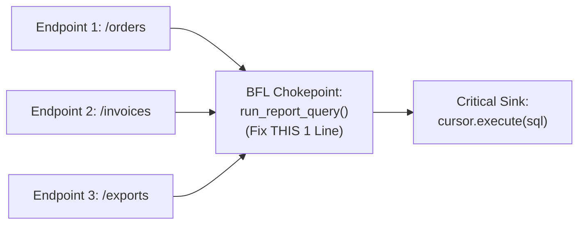
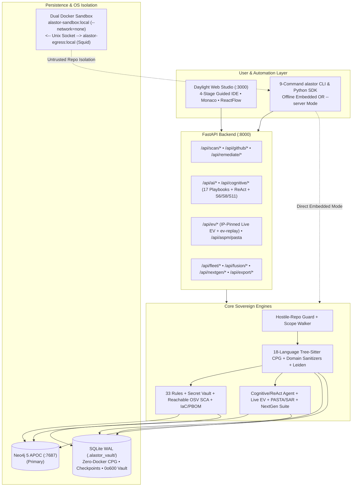
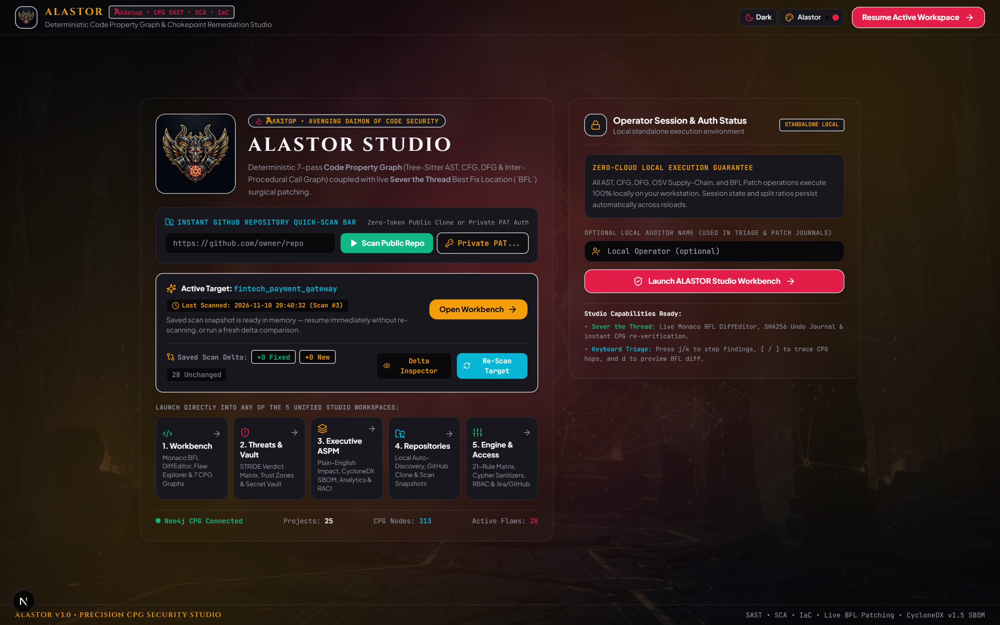
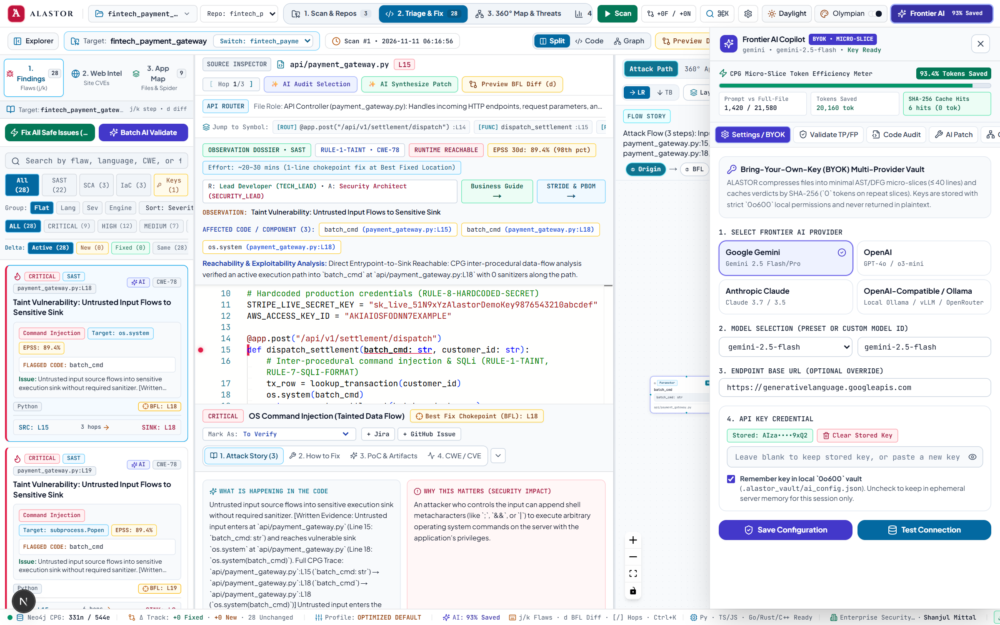
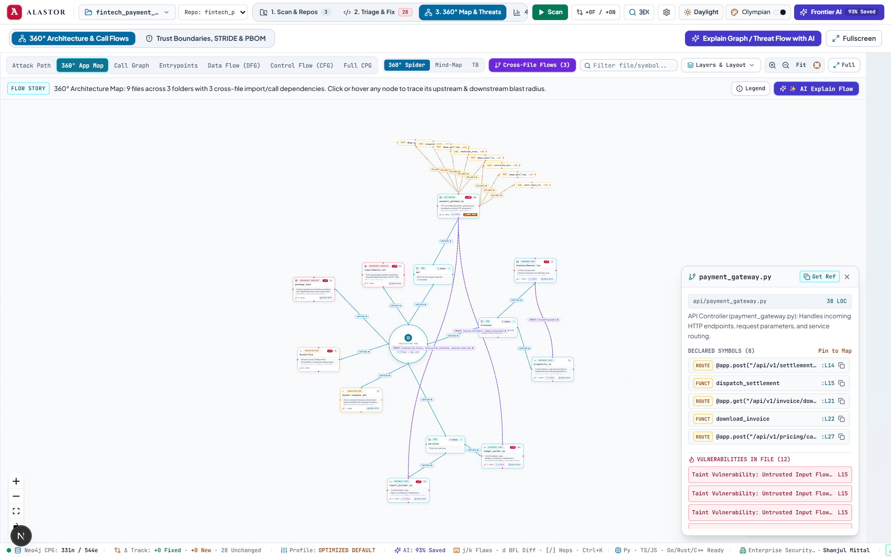
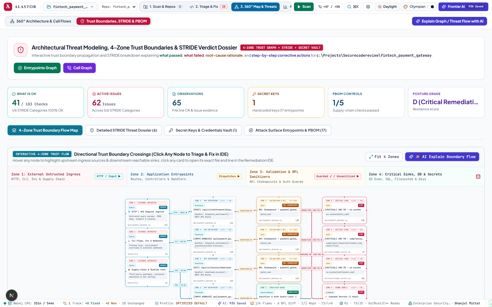
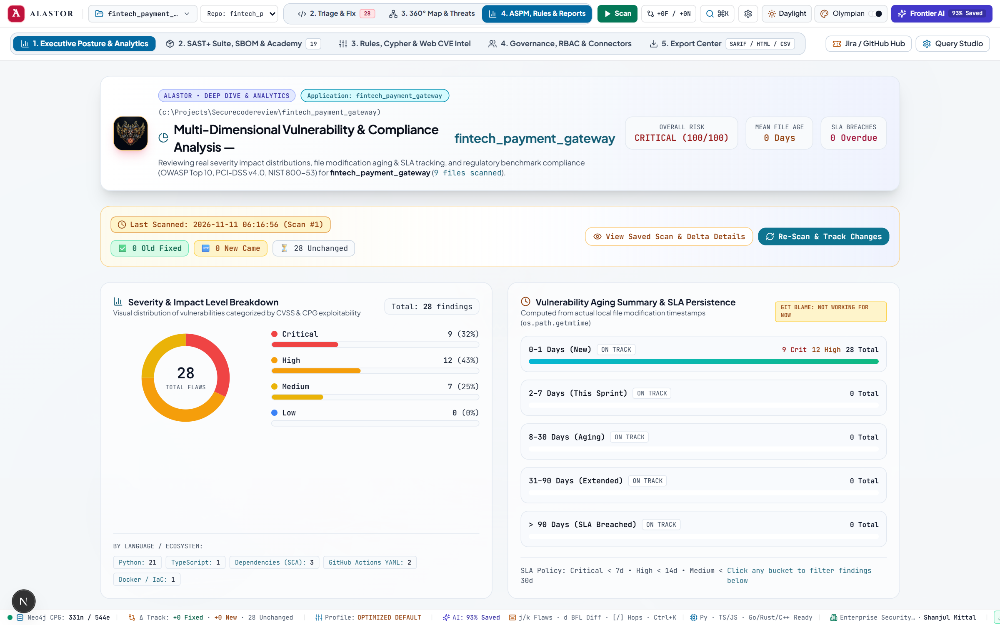
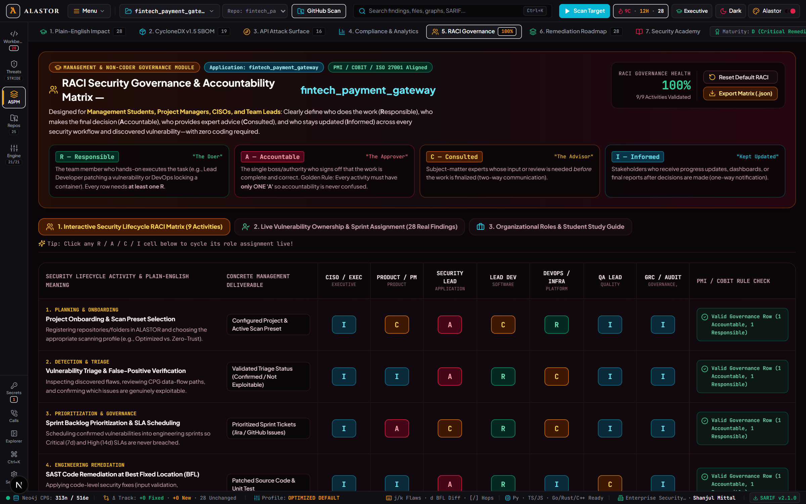

# ALASTOR (`Ἀλάστωρ`) `v5.1.0` — Master Standard Operating Procedure (SOP), Feature Encyclopedia & Complete Learning Manual

> **Document Type:** Authoritative Product Learning Manual, Feature Encyclopedia & Standard Operating Procedure (SOP)
> **Application Version:** `v5.1.0` (All 5 Enterprise Pillars + Multi-Turn ReAct CPG Agent & Dual Docker Egress-Proxy Sandbox)
> **Intended Audience:** **Both Non-Technical Stakeholders** (Executives, CISOs, Product/Release Managers, Compliance Auditors, Business Analysts) **and Technical Practitioners** (Developers, AppSec Engineers, Security Architects, DevSecOps / Platform Teams)
> **Design Goal:** By reading this single document from start to finish—or jumping directly to your role's learning track—anyone can completely understand **what every feature in ALASTOR is, what it does, why it matters, when to use it, and exactly how to operate it step-by-step**.
> **Last Updated:** 2026-11-23

<div align="center">
  
</div>

---

## 📑 Table of Contents & Role-Based Learning Tracks

### Complete Manual Structure
- **[Module 0 — Plain-English Foundations & Mental Models (Start Here)](#module-0--plain-english-foundations--mental-models)**
- **[Module 1 — Stage 1 Feature Encyclopedia: Discovery, Polyglot CPG, Fleet, Checkpoints & 6-Format Fusion](#module-1--stage-1-feature-encyclopedia-discovery-polyglot-cpg-fleet-checkpoints--scanner-fusion)**
- **[Module 2 — Detection Engine Encyclopedia: 33+ Deterministic Rules, Secret Vault, Reachable SCA & CI/CD IaC](#module-2--detection-engine-encyclopedia-33-rules-secrets-reachable-sca--cicd-iac)**
- **[Module 3 — Stage 2 Feature Encyclopedia: Triage Studio, Batch Auto-Fix, BYOK Frontier AI, S11 Panel & Regression TestGen](#module-3--stage-2-feature-encyclopedia-triage-studio-batch-auto-fix-byok-ai-s11-panel--testgen)**
- **[Module 4 — Stage 3 Feature Encyclopedia: 360° Graphs, Trust Boundaries, Cognitive/ReAct Agent, Live EV & 7-Stage PASTA](#module-4--stage-3-feature-encyclopedia-360-graphs-trust-boundaries-cognitivereact-live-ev--pasta)**
- **[Module 5 — Stage 4 Feature Encyclopedia: PR Delta Gate, 5-Framework Compliance, Custom Rules, Microservice Stitching & Executive ASPM](#module-5--stage-4-feature-encyclopedia-pr-delta-gate-compliance-custom-rules-microservice-stitching--aspm)**
- **[Module 6 — Automation & Hardened Isolation Encyclopedia: 9-Command CLI, Python SDK, REST APIs & Dual Docker Egress Sandbox](#module-6--automation--isolation-encyclopedia-cli-sdk-rest-apis--dual-docker-egress-sandbox)**
- **[Module 7 — Step-by-Step Operational Playbooks (`SOP-01` through `SOP-14`) & Worked Learning Labs](#module-7--step-by-step-operational-playbooks-sop-01-through-sop-14--worked-learning-labs)**
- **[Module 8 — Visual Reference, Shortcuts, Glossary, Troubleshooting & Enterprise Governance SLAs](#module-8--visual-reference-shortcuts-glossary-troubleshooting--governance-slas)**

### Recommended Self-Paced Learning Tracks by Role

| Your Role | Recommended Reading Order | Learning Outcome |
| :--- | :--- | :--- |
| **Non-Technical Executive / CISO / Product Manager** | **Module 0** → **Module 4 (Features 4.2, 4.6, 4.7)** → **Module 5 (Features 5.1, 5.2, 5.5, 5.6)** → **Worked Lab A (Module 7)** → **Module 8** | Completely understand how ALASTOR prevents breaches, how to read Go-Live Gates (`GO_LIVE_APPROVED` / `NO_GO_HOLD_RELEASE`), how to interpret `.docx`/`.pdf` SAR dossiers, RACI ownership, and compliance scorecards—without needing to write code. |
| **Compliance Officer / Internal or External Auditor** | **Module 0** → **Module 2 (Features 2.3–2.5)** → **Module 4 (Features 4.6–4.7)** → **Module 5 (Features 5.2, 5.5, 5.6)** → **SOP-11 & SOP-13** | Understand how code findings, SBOMs, runtime exploit proofs, and time-bound waivers map into verifiable audit evidence for PCI-DSS 4.0, SOC 2, ISO 27001, HIPAA, and OWASP ASVS 5.0. |
| **Software Developer** | **Module 0** → **Module 1 (1.1–1.6)** → **Module 2** → **Module 3 (All)** → **Module 5 (5.1)** → **Worked Lab B & SOP-01/02/05/07/12** | Master scanning repos, reading directional attack paths, applying AST-verified single/batch fixes with SHA-256 undo, generating regression unit tests, and passing `alastor pr-gate` cleanly. |
| **AppSec Engineer / Security Architect** | **All Modules (0 through 8)**, with deep focus on **Modules 2, 3, 4, 5 & Worked Lab C** | Master 18-language CPG analysis, domain sanitizers, 17-lens Cognitive Hunts, 7-tool ReAct CPG Agent, S6/S8/S11 verification, IP-pinned Live EV + `ev-replay`, ReDoS-safe custom rules, and cross-repo microservice attack graphs. |
| **DevSecOps / Platform / SecOps Engineer** | **Module 1 (1.2, 1.3, 1.7, 1.8, 1.9)** → **Module 5 (5.1)** → **Module 6 (All)** → **SOP-01/03/04/12/14** | Deploy Zero-Docker SQLite or Neo4j APOC topologies, wire `alastor pr-gate` and CSV Fleet pipelines, fuse 6 external scanners, and isolate untrusted codebases inside the Dual Docker Egress-Proxy Sandbox. |

---

# Module 0 — Plain-English Foundations & Mental Models

*(Start here if you are new to ALASTOR or Application Security. Everything in this module is written in plain English before introducing technical details.)*

## 0.1 What Is Application Security—And Why Do Most Scanners Fail?

Every modern software product is made of four layers, and attackers target all four:
1. **Your Own Source Code (SAST — Static Application Security Testing):** Mistakes developers write, such as inserting user input directly into a database query (SQL Injection) or system command (Command Injection).
2. **Third-Party Open-Source Libraries (SCA — Software Composition Analysis):** Ready-made packages your team installs (`npm`, `pip`, `Maven`, `Go modules`) that may contain publicly known flaws (CVEs).
3. **Secrets & Credentials:** Passwords, API keys, cloud access tokens, or private encryption keys accidentally typed into code or left behind in Git commit history.
4. **Cloud, Containers & Build Pipelines (IaC & CI/CD):** Configuration files (`Dockerfile`, `docker-compose.yml`, Kubernetes manifests, GitHub Actions workflows) that run the app as `root`, expose secrets, or execute untrusted build scripts.
5. **Running Application Logic & Authorization (DAST / Live EV & Threat Modeling):** Bugs that only show up when the app is actually running—such as User A changing an invoice number in the URL to read User B's confidential record (IDOR/BOLA).

### Why Simple Security Scanners Frustrate Teams
Traditional lightweight scanners work like **`Ctrl+F` keyword search** (regular expressions). If they see the word `execute(` or `open(`, they fire an alarm—even if:
- The input is a hard-coded safe constant, not user input;
- A security check three functions earlier already cleaned ("sanitized") the input; or
- That code sits inside a test file or unreachable dead function.

The result is **alert fatigue**: teams receive 500 alarms, 400 are false positives, developers stop trusting the tool, and the 5 real breaches get buried in the noise.

---

## 0.2 How ALASTOR Thinks Differently: The "3D Architectural Blueprint" (Code Property Graph)

**ALASTOR (`Ἀλάστωρ`)** does **not** guess with blind keyword searches. Instead, ALASTOR reads your code the same way a compiler does and builds a mathematical **Code Property Graph (CPG)**—a unified 3D blueprint combining four connected maps:

| Graph Layer | Plain-English Analogy | Technical Meaning |
| :--- | :--- | :--- |
| **1. AST** *(Abstract Syntax Tree)* | **The Grammar & Parts List** — knows every room, door, pipe, and label in the building. | Exact syntactic structure of every statement, variable, parameter, literal, and function call across 18 languages. |
| **2. CFG** *(Control Flow Graph)* | **The Hallways & Doors** — knows which rooms can actually be walked into, which doors are locked, and where loops repeat forever. | Execution order across `if/else` branches, `try/except`, loops, and `return` statements. |
| **3. DFG** *(Data Flow Graph)* | **The Plumbing & Water Pipes** — tracks contaminated water from the street inlet through every pipe and valve to the kitchen tap. | Taint propagation showing how untrusted input flows from a **Source** (e.g., HTTP request) into variables and eventually into a dangerous **Sink** (e.g., SQL query, OS shell, file open). |
| **4. Call Graph (`:CALLS` & `:IMPORTS`)** | **The Inter-Building Tunnels** — tracks pipes crossing from File A into Helper File B and Service C. | Cross-file and inter-procedural function invocations and module imports. |

### Worked Plain-English Example: Why a CPG Prevents False Alarms
Imagine an e-commerce app has a route `/download?file=invoice.pdf`:
- **Scenario 1 (Vulnerable):** The user types `file=../../etc/passwd`. The value enters `download_route()`, gets passed into `storage.read_file(path)`, and goes straight into `open(path)`. **ALASTOR traces the exact path across both files (`① HTTP Source ──▶ ② storage.read_file ──▶ ③ open() Sink`), finds zero security guard along the path, and raises a proven `RULE-10-PATH-TRAVERSAL` finding.**
- **Scenario 2 (Safe):** The developer adds a helper `safe_join()` that checks `os.path.commonpath([BASE_DIR, target]) == BASE_DIR`. **ALASTOR inspects the helper function's AST body, mathematically verifies that `commonpath` genuinely blocks path traversal, marks that node as a verified domain sanitizer, and suppresses the false positive (`0` noise).**
- **Scenario 3 (Wrong Sanitizer Caught!):** Suppose the developer used `html.escape()` (an HTML sanitizer) before calling `open(path)`. Because ALASTOR uses **Domain-Aware Sanitizer Tracking**, it knows HTML escaping does **not** stop `../../` path traversal—so it **still catches the vulnerability**.

---

## 0.3 The Concept of BFL ("Best Fix Location")

In real codebases, 8 different API endpoints might all pass untrusted input into the same shared helper function `run_report_query()`.
- A naive scanner creates 8 separate tickets telling developers to patch 8 different endpoints.
- **ALASTOR calculates the Best Fix Location (BFL)**—the single mathematical chokepoint node in the graph where fixing **one line** simultaneously severs all 8 attack paths.



---

## 0.4 Sovereign, `$0` Offline Core vs. Optional BYOK AI

A critical principle to understand before operating ALASTOR:
- **100% Local & Sovereign:** ALASTOR runs entirely on your laptop, private server, or CI runner. Your source code is never uploaded to a vendor SaaS cloud.
- **`$0` Complete Core Baseline:** Every deterministic rule (`RULE-1`–`RULE-33`), Secret Scanner, OSV SCA, IaC scanner, `COG-1..5` cognitive playbooks, ReAct `$0` fallback, S6 Verifier, S8 Chains, IP-pinned Live EV, `ev-replay`, 7-Stage PASTA, Word/PDF SAR dossiers, PR Delta Gate, Regression Test Generator, 5-Framework Compliance, Custom Rule Studio, Microservice Stitcher, 6-Format Fusion, and CSV Fleet Runner work at **`$0` LLM cost with no API key**.
- **Optional BYOK AI Enhancement:** Whenever a team *chooses* to connect **Google Gemini**, **OpenAI**, **Anthropic Claude**, or a **100% private local Ollama / vLLM model**, ALASTOR slices only the exact `<= 40` CPG lines needed (saving **`90–95%`** of prompt tokens), strips prompt injections, scrubs secrets/PEM keys before sending, and caches identical slices via SHA-256 (`0` tokens on repeats).

---

## 0.5 How the Application Is Organized: The Guided 4-Stage Daylight Studio

Whether you use the **Web IDE (`http://localhost:3000`)**, the **9-Command `alastor` CLI**, or the **Typed Python SDK**, every workflow follows **4 sequential stages** visible across the top `44px` command header:

1. **`1. Scan & Repos`** — Bring code in (local folder, Public/Private GitHub repo, CSV Fleet, or 6 external scanner formats), estimate scope at `$0`, check system health (`doctor`), manage resumable checkpoints, and configure Docker sandbox plans.
2. **`2. Triage & Fix`** — Inspect every finding in a synchronized 3-pane workspace (Flaw Explorer + Light Monaco Code Editor/Diff + Directional Flow Graph), apply single or one-click batch auto-fixes with SHA-256 undo, validate patches via S11/ReAct, and generate automated security regression unit tests.
3. **`3. 360° Map & Threats`** — Understand system-wide architecture (360° Spider Map, Cross-File Call Graph, Blast Radius, Leiden Communities), inspect 4-Zone Trust Boundaries & STRIDE, run 17-lens Cognitive & Multi-Turn ReAct CPG deep hunts, execute safe IP-pinned Live Exploit Verification (`EV`) + post-fix `ev-replay`, and complete 7-Stage PASTA Threat Modeling & Go-Live Gates.
4. **`4. ASPM, Rules & Reports`** — Enforce PR Delta Security Gates, run 5-Framework Compliance Autopilot, author ReDoS-safe Custom Rules, stitch Cross-Repo Microservice Attack Graphs, manage RACI/RBAC/Jira/GitHub governance, and export board-ready **Word (`.docx`)**, **PDF (`.pdf`)**, **HTML**, **CSV**, **SARIF**, and **CycloneDX SBOM** reports.

All views render in **WCAG AA (`>= 4.5:1`) High-Contrast Daylight Palettes** (*Olympian Daylight*, *Athena Parchment*, *Hyperborean Frost*) with zero dark-mode eye strain, making screens immediately readable in both engineering reviews and executive presentations.

---

# Module 1 — Stage 1 Feature Encyclopedia: Discovery, Polyglot CPG, Fleet, Checkpoints & Scanner Fusion

*(Every feature below includes **What It Is**, **What It Does**, **Why It Is Important**, and **When & How to Use It**.)*

## Feature 1.1: 18-Language Polyglot CPG Compiler (Zero-JVM Tree-Sitter)
- **What It Is:** ALASTOR's core multi-language static compiler (`backend/compiler/language_registry.py`, `scanner.py`, `cpg_builder.py`), powered by native `tree-sitter==0.26.1` and `tree-sitter-language-pack==0.13.0` with **zero Java/JVM installation required**.
- **What It Does:** Automatically detects and compiles **18 programming languages** — `Python`, `JavaScript`, `TypeScript`, `TSX`, `Java`, `Go`, `Rust`, `C`, `C++`, `C#`, `PHP`, `Ruby`, `Kotlin`, `Swift`, `Scala`, `Dart`, `Solidity`, and `SQL` — through 4 passes: (1) AST parsing, (2) CFG/DFG intra-procedural taint construction, (3) cross-file `:CALLS` / `:IMPORTS` linking & domain-aware sanitizer summarization, and (4) rule evaluation, BFL scoring, and Leiden community clustering.
- **Why It Is Important:** Modern enterprises rarely run a single language—a typical product has a TypeScript frontend, Python/Go/Java microservices, SQL migrations, and Rust or Solidity components. Compiling all 18 languages into **one unified graph schema** lets teams analyze polyglot repositories and cross-language risk with a single tool and zero heavy JVM memory overhead.
- **Context & Usage:** Runs automatically on every scan in Stage 1, CLI `alastor scan`, `alastor pr-gate`, and SDK `scan()`.

## Feature 1.2: Dual-Engine `GraphStore` (`Neo4j 5 APOC` + Zero-Docker `SQLite WAL`)
- **What It Is:** ALASTOR's pluggable graph persistence layer (`backend/database/graph_store.py`) supporting two interchangeable backends.
- **What It Does:**
  - **Primary (`NEO4J_APOC`):** When Neo4j 5 + APOC is running (`docker compose up -d neo4j`), ingests nodes/edges using `O(1)` `UNWIND` batch Cypher queries and unlocks interactive live Cypher querying in Stage 4.
  - **Zero-Docker Fallback (`EMBEDDED_SQLITE_WAL`):** When Neo4j is stopped or unavailable (laptops, air-gapped networks, GitHub Actions, sandbox containers), automatically initializes `.alastor_vault/cpg_embedded.db` with Write-Ahead Logging (`WAL`) and indexed adjacency tables supporting identical CPG traversals and Leiden clustering.
- **Why It Is Important:** Most graph-based SAST platforms require complex database clusters before a developer can run a single scan. Dual `GraphStore` gives individuals and CI pipelines **instant zero-Docker portability** while letting security teams scale up to full Neo4j graph databases whenever needed.
- **Context & Usage:** Automatic! Verify which backend is active via `alastor doctor` or the header telemetry pill.

## Feature 1.3: Hostile-Repo `.gitignore` Scope Walker & Isolation Guard
- **What It Is:** A defensive security boundary (`backend/engine/hostile_repo_guard.py` + `PolyglotScopeWalker`) protecting the analyst's machine when scanning untrusted third-party, open-source, or M&A diligence repositories.
- **What It Does:**
  - Respects `.gitignore` and skips noisy build/vendor folders (`node_modules`, `.venv`, `dist`, `target`).
  - **Blocks sensitive & hostile files from ever entering the scanner or AI context:** `.env*`, private keys (`*.pem`, `*.key`, `id_rsa`), `.git/`, and untrusted AI instruction files (`AGENTS.md`, `CLAUDE.md`, `.cursorrules`, etc.) that attackers plant to hijack AI code reviewers.
  - **Hardens all `git` commands** via `GIT_CONFIG_COUNT` (disabling `core.hooksPath`, `core.fsmonitor`, `diff.external`, and smudge/clean filters so cloning/diffing a malicious repo cannot execute arbitrary code on your laptop).
  - **Fails closed on `url.*.insteadOf`** inside repo-local `.git/config` (preventing credential exfiltration) and prevents symlink/NTFS-junction traversal escapes during reads and workspace cleanup.
- **Why It Is Important:** Attackers increasingly weaponize repositories with malicious Git hooks, symlink escapes to `~/.ssh`, and hidden prompt-injection instructions aimed at compromising security reviewers' workstations. ALASTOR treats every scanned repo as potentially hostile by default.
- **Context & Usage:** Always active automatically across Web UI, CLI, SDK, Fleet Runner, and PR Gate.

## Feature 1.4: Local Folder & 1-Click GitHub Repository Scanner (Public URL vs. Private PAT)
- **What It Is:** Multi-mode target ingestion in Stage 1 (`ProjectsHubView` + Target Picker) supporting local directories, single files, uploaded archives, public GitHub URLs, and private GitHub/GitLab/Bitbucket repositories.
- **What It Does:**
  - **Public Mode (`NO TOKEN`):** Paste `https://github.com/owner/repo` (or `owner/repo`) to pre-verify reachability (`POST /api/github/verify-repo`), shallow-clone securely, and scan immediately with zero credentials.
  - **Private Mode (`AUTH REQUIRED`):** Accepts a Personal Access Token (`ghp_...` / `github_pat_...`), passes it solely via **ephemeral `GIT_CONFIG_*` HTTP `Authorization: Basic` environment headers** (never embedded in clone URLs, `.git/config`, or logs), and optionally stores encrypted/restricted credentials inside `.alastor_vault`.
- **Why It Is Important:** Eliminates manual `git clone` friction during rapid security assessments while ensuring private access tokens never leak into shell history, Git config files, or crash logs.
- **Context & Usage:** Use Stage 1 Quick-Scan bar or **`GitHub Repo (Public / PAT)`** modal whenever onboarding a new repository.

## Feature 1.5: System Doctor (`alastor doctor`) & `$0` Scope Estimator (`alastor estimate`)
- **What It Is:** Pre-flight diagnostic and planning tools available in both Stage 1 (`FleetCommandWorkbench.tsx`) and the CLI/SDK.
- **What It Does:**
  - **`System Doctor`:** Verifies Python version, all `18/18` Tree-Sitter parsers, active `GraphStore`, Git hardening flags, and Docker sandbox image presence + version drift (`org.alastor.version=5.1.0`).
  - **`$0 Scope Estimator`:** Walks the target repository in seconds without running heavy analysis or spending LLM tokens, reporting exact scannable file count, ignored/blocked file count, lines of code (LOC), language breakdown, estimated deterministic scan time, and optional AI token estimate.
- **Why It Is Important:** Prevents unpleasant surprises on massive monorepos—teams know exact scope, runtime, and cost *before* launching an audit, and immediately spot misconfigured environments or outdated sandbox containers.
- **Context & Usage:** Always run `doctor` after setup/upgrade and `estimate` before scanning an unfamiliar large codebase.

## Feature 1.6: Continuous Track Changes (`+Fixed` / `+New` / `Unchanged` Snapshot Diffing)
- **What It Is:** Built-in historical scan snapshot comparison (`+F / +N` toggle in the top header and Launch Portal).
- **What It Does:** Compares the latest scan against the previous saved snapshot for the same repository, categorizing every finding as **Fixed** (remediated since last scan), **New** (introduced since last scan), or **Unchanged** (still open).
- **Why It Is Important:** Gives both developers and engineering managers concrete proof of progress across sprints—confirming that remediation work actually reduced risk and did not introduce regressions.
- **Context & Usage:** Automatically computed after your second scan of any project; click the **`+F / +N`** pill in the command header to filter by delta.

## Feature 1.7: CSV Multi-Repo Fleet Batch Runner (`--repo-file`, `--group-by-app`)
- **What It Is:** Portfolio-scale batch orchestration (`backend/engine/fleet_runner.py` & Stage 1 `FleetCommandWorkbench.tsx`).
- **What It Does:** Reads a CSV manifest listing multiple repositories (`repo_path,app_group,branch`), scans each repository with per-repo fault isolation (one broken repo never crashes the batch), persists individual checkpoints, and rolls findings up into **Application-Group (`--group-by-app`) posture and Go-Live summaries**.
- **Why It Is Important:** Real products consist of 5 to 50+ repositories (web, mobile, API gateway, billing, worker, infra). Fleet Runner lets AppSec and Engineering leaders assess an entire business application portfolio in a single repeatable run.
- **Context & Usage:** Ideal for weekly scheduled security sweeps, M&A due diligence, or quarterly portfolio audits.

## Feature 1.8: SQLite WAL Stage Checkpoints (`--resume`), Host Scan Provenance & Vault `GC`
- **What It Is:** Crash-resilient execution persistence and integrity enforcement (`backend/database/checkpoint_store.py`).
- **What It Does:**
  - Records each pipeline stage output in SQLite WAL with a **SHA-256 tamper-detection digest**. Passing `--resume` (or clicking **`Resume`** in Stage 1) validates checksums and resumes from the last completed stage.
  - Records **Host Scan Provenance** (`host_produced` vs. untrusted/sandbox origin). `alastor remediate --mode fix` refuses to write patches to host disk unless provenance proves the scan was legitimately produced on the host.
  - **`alastor gc`** safely deletes expired checkpoints and temp scan workspaces older than `--older-than-days N` (supporting `--dry-run` preview first).
- **Why It Is Important:** Long enterprise fleet scans survive network drops or laptop reboots cleanly, tamper checks prevent malicious artifact injection into remediation workflows, and `gc` keeps disk usage tidy.
- **Context & Usage:** Enable `--resume` on large repos/fleets; schedule `alastor gc` monthly.

## Feature 1.9: Universal 6-Format External Scanner Fusion
- **What It Is:** Multi-tool ingestion and CPG correlation engine (`backend/engine/scanner_fusion_engine.py`).
- **What It Does:** Auto-detects and parses reports from **6 industry formats** — **SARIF 2.1.0**, **CodeQL**, **Semgrep JSON**, **Trivy JSON**, **Gitleaks JSON** (with automatic raw-secret scrubbing before storage), and **Checkov JSON** — maps every external finding onto ALASTOR's CPG `CodeNode` by file/line/symbol, deduplicates overlaps, and stamps matching alerts with **`corroborated_by`** multi-engine agreement tags.
- **Why It Is Important:** Organizations often run multiple specialized scanners in CI, creating 6 fragmented silos and duplicate Jira tickets. Fusion unifies all findings onto one CPG, increases confidence when 2+ engines agree on a flaw, and feeds unified evidence into PASTA, Compliance, and SAR dossiers.
- **Context & Usage:** Upload external CI JSON/SARIF artifacts in Stage 1 → **`6-Format Scanner Fusion`** or pass `--fusion-report <file>` to `alastor scan`.

---

# Module 2 — Detection Engine Encyclopedia: 33+ Rules, Secrets, Reachable SCA & CI/CD IaC

*(This module teaches **what each security vulnerability actually is in plain English**, how attackers exploit it, how ALASTOR detects it deterministically, and how developers properly fix it.)*

## Feature 2.1: Core CPG SAST Rules (`RULE-1`–`RULE-16`) & Domain-Aware Sanitizer Tracking

| Rule ID | Plain-English Meaning & Why It Matters | Technical Trigger in ALASTOR | Verified Fix / Sanitizer ALASTOR Recognizes |
| :--- | :--- | :--- | :--- |
| **`RULE-1-TAINT`** *(Critical, CWE-78/94)* | **OS Command & Code Injection:** Attacker input runs arbitrary system commands on your server (full server takeover). | Multi-hop `DFG_FLOWS_TO` path from untrusted source to `os.system`, `eval`, `exec`, `child_process.exec` with `0` domain sanitizers. | Replace shell string execution with argument arrays (`subprocess.run([...], shell=False)`) or strict allowlists. |
| **`RULE-2-ORPHAN`** *(High, CWE-561)* | **Dormant Zero-Day Gadget:** Hidden/uncalled sensitive functions containing dangerous sinks that can be abused later or via dynamic dispatch. | Uncalled function containing a dangerous sink without a legitimate route/CLI entrypoint decorator. | Remove unused debug/admin functions or restrict behind explicit authorization and safe APIs. |
| **`RULE-3-DEADSTORE`** *(Medium, CWE-563)* | **Unread Security/Audit Variable:** Code assigns a validation result, error flag, or audit status and forgets to check it—silently bypassing a control. | AST/DFG variable assignment with zero downstream read edges. | Check the returned security status/boolean or remove dead code. |
| **`RULE-4-INFINITE-LOOP`** *(High, CWE-835)* | **Denial of Service (DoS) Hang:** A loop with no reachable exit freezes worker threads and crashes availability. | `CFG_NEXT` loop back-edge with no reachable `break` or `return`. | Add bounded iteration limits or guaranteed termination conditions. |
| **`RULE-5-UNREACHABLE`** *(Medium, CWE-561)* | **Unreachable Dead Code:** Cleanup, lock release, or security check placed after an unconditional `return`/`raise`—meaning it never runs! | CFG statements dominated by an unconditional exit. | Move cleanup/checks into `finally:` blocks or before the `return`. |
| **`RULE-6-SHELL-INJECTION`** *(Critical, CWE-78)* | **Unsafe Subprocess Shell:** Invoking the OS shell (`shell=True`) lets characters like `;`, `&&`, or `|` hijack the command. | AST argument audit of `subprocess.run/Popen/call(..., shell=True)`. | Use `shell=False` with a list of discrete string arguments. |
| **`RULE-7-SQLI-FORMAT`** *(Critical, CWE-89)* | **SQL & Cypher Injection:** Gluing user text into a database query lets attackers read, alter, or delete the entire database. | Dynamic `f"..."`, `.format()`, `+`, or `%` formatting inside `.execute()` / query sinks without integer coercion or bind parameters. | Use parameterized queries (`cursor.execute("SELECT ... WHERE id = %s", (user_id,))`) or ORM bindings. |
| **`RULE-8-HARDCODED-SECRET`** *(High, CWE-798)* | **Hardcoded Credentials:** API keys, DB passwords, or JWT signing secrets written into source code leak to anyone with repo access. | AST literal inspection + SDK auth driver matching + Shannon entropy + placeholder filtering. | Move credentials to environment variables or a secret manager (`Vault`, AWS/GCP Secret Manager) and rotate leaked keys immediately. |
| **`RULE-9-DOM-XSS`** *(High, CWE-79)* | **Cross-Site Scripting (DOM XSS):** Untrusted input written as raw HTML executes attacker JavaScript inside victims' browsers (stealing sessions). | Dynamic expression flowing to `innerHTML`, `outerHTML`, `document.write`, `dangerouslySetInnerHTML`. | Use `textContent`, framework auto-escaping, or vetted HTML sanitization (`DOMPurify`). |
| **`RULE-10-PATH-TRAVERSAL`** *(High, CWE-22)* | **Arbitrary File Read/Write (`../../`):** Attacker supplies `../../etc/passwd` or `..\config.ini` to escape the upload folder and read/overwrite system files. | Inter-procedural taint into `open`, `Path.read_text`, `shutil.rmtree`, `fs.readFile/writeFile`. | Canonicalize and confine with `os.path.commonpath`, `Path.is_relative_to`, or `os.path.basename` (AST-verified by ALASTOR). |
| **`RULE-11-SSRF-URLOPEN`** *(High/Med, CWE-918)* | **Server-Side Request Forgery (SSRF):** Attacker tricks your backend into fetching internal URLs (like AWS/GCP metadata `169.254.169.254` to steal cloud IAM keys). | Tainted URL flowing into `urlopen`, `requests.*`, `httpx.*`, `axios.*`, `fetch`. | Restrict to constant HTTPS origins or validate resolved IPs with `ipaddress` rejecting private/loopback/link-local ranges (AST-verified). |
| **`RULE-12-LOG-INJECTION`** *(Low, CWE-117)* | **Log Forging (CRLF Injection):** Injecting newline (`\r\n`) characters fakes audit log entries or breaks SIEM parsers. | Unsanitized taint flowing into `logger.info/warning/error`. | Strip `\r` and `\n` via dedicated sanitizer helper or structured JSON logging. |
| **`RULE-13-UNSAFE-DESERIALIZATION-CRYPTO`** *(High/Med, CWE-502/328)* | **Unsafe Deserialization & Weak Crypto:** `pickle.loads`/`yaml.load` executes arbitrary attacker code on parse; unverified JWTs allow admin forgery; MD5/SHA1 break password/signature integrity. | AST inspection of `pickle`, `marshal`, `shelve.open`, `yaml.load`, JWT `verify_signature=False`, `hashlib.md5/sha1`. | Use `json.loads`, `yaml.safe_load`, `verify_signature=True`, SHA-256/Argon2, or explicit `usedforsecurity=False` for non-crypto checksums. |
| **`RULE-14-CODE-INJECTION`** *(Critical, CWE-94)* | **Dynamic Code & Template Injection (SSTI):** Passing user strings into `eval`, `exec`, `render_template_string`, or `vm.runInNewContext` gives instant Remote Code Execution (RCE). | Non-constant expression reaching dynamic code/template evaluation sink. | Replace `eval` with `ast.literal_eval` / `json.loads` and pass variables as template context, never inside template source strings. |
| **`RULE-15-XXE-TLS-BYPASS`** *(High, CWE-611/295)* | **XML External Entity (XXE) & Disabled TLS:** Malicious XML reads server files; `verify=False` lets attackers intercept encrypted HTTPS traffic (Man-in-the-Middle). | Unsafe XML parser calls or `verify=False` / `_create_unverified_context`. | Use `defusedxml` (or `resolve_entities=False`) and keep TLS certificate verification enabled (`verify=True`). |
| **`RULE-16-INSECURE-RANDOM-OPEN-REDIRECT`** *(Med/High, CWE-330/601)* | **Predictable Security Tokens & Phishing Redirects:** Using `random`/`Math.random` for reset tokens lets attackers guess tokens; unvalidated redirects send users to phishing domains. | Weak PRNG assigned to security/token variables, or tainted URL passed to HTTP redirect response. | Use `secrets.token_urlsafe` / `crypto.randomBytes` and allowlist relative/approved redirect paths. |

## Feature 2.2: 12 Polyglot Language Rule Packs (`RULE-22`–`RULE-33`)
- **What It Is:** Language-specific deterministic CPG rule packs (`backend/engine/polyglot_rules.py`) extending full semantic precision across all non-Python/JS languages compiled by ALASTOR.
- **What It Does:** Audits **Java / Kotlin / Scala** (`Runtime.exec`, `ProcessBuilder`, JDBC SQL concatenation, `ObjectInputStream`/JNDI deserialization, XXE), **Go** (`exec.Command`, `database/sql` string formatting, unsafe `html/template`), **Rust** (`unsafe` blocks, raw pointer FFI hazards, command injection), **C / C++** (`strcpy`, `gets`, `sprintf`, `system`, format-string bugs), **C#** (`SqlCommand` concat, `BinaryFormatter`), **PHP** (`eval`, `unserialize`, SQL/command injection), **Ruby** (`Kernel.eval`, `Marshal.load`), **Swift / Dart** (mobile insecure storage/TLS/injection), **Solidity** (smart-contract reentrancy, `delegatecall`, `tx.origin` auth bypass), and **SQL** (dangerous dynamic execution/privilege patterns).
- **Why It Is Important:** Ensures polyglot engineering organizations get the same low-noise, CPG-grounded protection across backend systems, mobile apps, systems code, and Web3 contracts—not just Python and JavaScript.
- **Context & Usage:** Enabled automatically whenever matching source files are discovered during any scan.

## Feature 2.3: Native Secret Scanner, Git-History Hunter & Secret Keys Vault
- **What It Is:** Dedicated credential discovery and redaction subsystem (`backend/engine/secret_validator_engine.py` + Stage 3 `Secret Keys Vault`).
- **What It Does:** Scans both the active working tree and Git commit history for cloud keys (`AKIA...`), GitHub/GitLab PATs, payment keys, JWT signing secrets, database connection strings, and PEM private keys using pattern matching, SDK driver context, Shannon entropy scoring, and placeholder suppression. All discovered secrets are **automatically masked and scrubbed** (`scrub_raw_secrets_text`) before entering UI logs, AI prompts, checkpoints, or exported dossiers.
- **Why It Is Important:** Even if a developer deletes a leaked key in commit #2, attackers continuously scrape Git commit #1. Finding credentials in both live files and Git history—while never re-leaking them in security reports—prevents cloud account takeovers.
- **Context & Usage:** Runs automatically in every scan; filter **`Keys`** in Stage 2 or inspect the dedicated **Secret Keys Vault** in Stage 3.

## Feature 2.4: Reachable Software Composition Analysis (`SCA-1`, `SCA-2`), Live `OSV.dev` & `CycloneDX v1.5` SBOM
- **What It Is:** Supply-chain dependency auditor and SBOM generator (`SCA-1-MANIFEST-AUDIT`, `SCA-2-LIVE-CVE-LOCKFILE`, Stage 4 `Live CycloneDX SBOM`).
- **What It Does:**
  - **`SCA-1`:** Flags floating/unpinned version ranges (`^`, `~`, `*`, `>=`) in `package.json` and `requirements.txt` that allow surprise breaking or malicious minor updates.
  - **`SCA-2`:** Parses exact locked versions from lockfiles, queries live **OSV.dev** vulnerability advisories (including patched target versions), and **cross-references every vulnerable package against ALASTOR's CPG `Import` AST nodes** to determine whether your code actually imports and reaches that package!
  - **`CycloneDX v1.5` SBOM:** Generates a machine-readable Software Bill of Materials listing every component, version, license, and vulnerability status.
- **Why It Is Important:** Traditional SCA tools flood teams with hundreds of transitive CVEs in libraries the app never even imports. **CPG Reachability** focuses urgent patching on CVEs your code genuinely invokes, while `CycloneDX v1.5` satisfies federal/enterprise supply-chain compliance (e.g., Executive Order 14028).
- **Context & Usage:** Runs automatically whenever dependency manifests/lockfiles exist; inspect in Stage 2 (`SCA` filter) and Stage 4 → **`SAST+ Suite & SBOM`**.

## Feature 2.5: Infrastructure-as-Code (`IAC-1`, `IAC-2`) & CI/CD Pipeline Security (`IAC-3` & PBOM)
- **What It Is:** Container, orchestration, and build-pipeline security auditing (`IAC-1`–`IAC-3` + Stage 3 `CI/CD PBOM`).
- **What It Does:**
  - **`IAC-1-COMPOSE-SECRET`:** Detects plaintext database/service passwords in `docker-compose.yml` and Kubernetes manifests.
  - **`IAC-2-CONTAINER-ROOT`:** Detects `Dockerfile` builds running as privileged `root` (missing non-root `USER`) and missing HTTP security headers (`CSP`, `X-Frame-Options`).
  - **`IAC-3-CICD-WORKFLOW-SECURITY`:** Audits `.github/workflows/*.yml` for mutable action tags (`@v4` instead of immutable 40-char commit SHAs), untrusted `${{ github.event.* }}` shell interpolation, and dangerous `pull_request_target` triggers, building a complete **Pipeline Bill of Materials (PBOM)**.
- **Why It Is Important:** Compromising a CI/CD pipeline or running a container as `root` lets an attacker tamper with production releases or break out onto the host kernel even if the application source code is spotless.
- **Context & Usage:** Automatic on any repo containing Docker, K8s, or GitHub Actions files; view PBOM in Stage 3 → **`Entrypoints & PBOM`**.

## Feature 2.6: CPG-Backed Live Web CVE & Advisory Extractor
- **What It Is:** An interactive threat-intelligence lookup tool in Stage 4 (`Rules, Cypher & Web CVE Intel`).
- **What It Does:** Extracts CVE/advisory details for packages or technologies and immediately checks your compiled CPG to tell you whether the affected library is present and actively imported in your codebase.
- **Why It Is Important:** When a zero-day CVE hits the news (like Log4Shell or a new OpenSSL/FastAPI flaw), leadership asks *"Are we affected?"* within 10 minutes. This feature answers with mathematical CPG proof instead of guesswork.
- **Context & Usage:** Use Stage 4 → **`3. Rules, Cypher & Web CVE Intel`** during incident response or security bulletins.

---

# Module 3 — Stage 2 Feature Encyclopedia: Triage Studio, Batch Auto-Fix, BYOK AI, S11 Panel & TestGen

*(Stage 2 — **`2. Triage & Fix`** — is where developers and AppSec engineers turn scan results into verified, regression-tested code fixes.)*

## Feature 3.1: Split Light Monaco Inspector, Written Observation Dossier & Directional Attack Storyboard
- **What It Is:** A synchronized 3-pane developer triage workspace (`FlawExplorerSidebar.tsx`, `MonacoCodePane.tsx`, `ReactFlowGraphPane.tsx`).
- **What It Does:** Selecting any finding (by click or `j`/`k` keys) instantly synchronizes:
  1. **Flaw Explorer Sidebar:** Severity, CWE, CVSS/EPSS badges, corroboration chips (from 6-format fusion), AI verdict chips (`AI: TP 98%`), and quick filters (`All`, `Critical`, `Keys`, `SCA`, `IaC`, `Corroborated`).
  2. **Written Observation Dossier:** Structured plain-English and technical explanation of *what the flaw is*, *how data reached the sink*, *business impact*, and *recommended remediation*.
  3. **Light Monaco Code Inspector:** Full syntax-highlighted source viewer jumping directly to the exact line of the current hop (`①`, `②`, `③`) with inline selection actions.
  4. **Directional Attack Path & Flow Story Bar:** Interactive ReactFlow diagram with perimeter-docked `18×18` outer-border arrowheads, numbered step badges, edge labels (`TAINT ▶`, `CALLS ▶`, `IMPORTS ▶`), and a 1-sentence plain-English **Flow Story Bar** explaining the entire path. *(Even single-node SCA, IaC, and Secret findings are automatically synthesized into a clear 3-step `① Origin ──▶ ② BFL Chokepoint ──▶ ③ Security Impact` visual chain.)*
- **Why It Is Important:** Developers waste most triage time jumping across 5 files trying to figure out where a variable came from. Synchronized hop-by-hop navigation (`[` / `]`) cuts triage time from 20–30 minutes down to under 60 seconds.
- **Context & Usage:** Primary daily workspace for Developers and AppSec Reviewers in **Stage 2**.

## Feature 3.2: Single-Finding Live BFL `"Sever the Thread"` Monaco `DiffEditor` & SHA-256 Undo
- **What It Is:** Interactive single-finding surgical auto-remediation engine (`POST /api/remediate/preview`, `/apply`, `/undo`).
- **What It Does:** Pressing **`d`** (or clicking **`Preview BFL Diff`**) renders a side-by-side light **Monaco `DiffEditor`** showing the exact before/after code change at the Best Fix Location. Clicking **`Apply Fix`** validates syntax (Python `ast.parse` or JS/TS delimiter checks), records an exact SHA-256 backup inside `.alastor_patches`, writes the fix to disk, and re-verifies the CPG. Clicking **`Undo`** restores the original file byte-for-byte.
- **Why It Is Important:** Gives developers 100% visibility and zero-fear reversibility before touching a single line of production code.
- **Context & Usage:** Use whenever fixing individual high-complexity or high-risk findings in **Stage 2**.

## Feature 3.3: One-Click `"Fix All Safe Issues"` Atomic Batch Auto-Patcher & Unified `.patch` Export
- **What It Is:** Multi-file deterministic batch remediation engine (`POST /api/remediate/batch-apply`).
- **What It Does:** Collects all non-overlapping deterministic fixes across the workspace, sorts them bottom-up (`target_line DESC`) so line numbers never shift out of sync, validates every modified file's syntax before committing, rolls back **atomically** if any conflict occurs, saves `.alastor_patches` SHA-256 undo backups, exports a `git apply`-compatible unified `.patch` file, and immediately re-scans the CPG to report `verified_severed_count`.
- **Why It Is Important:** Eliminates tedious repetitive manual edits across dozens of files (for example, adding `shell=False`, `yaml.safe_load`, or parameterized queries across a service) while guaranteeing syntactic safety and instant CPG proof.
- **Context & Usage:** Click **`Fix All Safe Issues (N)`** at the top of the Stage 2 Flaw Explorer after reviewing deterministic findings.

## Feature 3.4: Token-Efficient Multi-Provider BYOK Frontier AI Copilot (`90–95%` Savings)
- **What It Is:** Optional, zero-SDK Bring-Your-Own-Key AI copilot (`backend/engine/frontier_ai_engine.py`, `FrontierAiCopilotDrawer.tsx`) supporting **Google Gemini**, **OpenAI**, **Anthropic Claude**, and **OpenAI-Compatible / OpenRouter / 100% Private Local Ollama or vLLM**.
- **What It Does:**
  - **CPG Micro-Slicing (`build_cpg_micro_slice`):** Instead of uploading 1,000-line source files, extracts only `<= 40` lines covering the exact taint source, BFL chokepoint, sink, and 1-line cross-file signatures—reducing prompt tokens by **`90–95%`**.
  - **SHA-256 Slice Caching:** Identical slices return cached verdicts at **`0` tokens** (tracked live in the **Token Efficiency Meter**).
  - **Zero-Leak Local Vault (`0o600`):** Stores keys locally per `(provider, host)` in `.alastor_vault/ai_config.json`, masks secrets in UI responses, scrubs secrets from error strings, and blocks DNS/IP and `30x` redirect SSRF.
  - **4 Interactive AI Actions:** (1) **`Batch AI Validate`** (TP/FP/Needs-Review verdicts across up to 10 findings per prompt with `AI: TP 98%` chips), (2) **`✨ AI Audit Selection (LX–LY)`** right inside Monaco Editor, (3) **`AI Patch Synthesis`** streamed directly into the Monaco `DiffEditor`, and (4) **`✨ AI Explain Flow`** generating plain-English narratives of any CPG or Trust Boundary graph.
- **Why It Is Important:** Organizations want AI-assisted triage and explanations without leaking full proprietary repositories, paying runaway token bills, or getting locked into one AI vendor. Local Ollama support even enables **100% air-gapped AI**.
- **Context & Usage:** Completely optional; open **`✨ Frontier AI`** in the top-right header whenever you want AI-augmented validation or explanations.

## Feature 3.5: S11 Dual-Verified 3-Persona Patch Panel & Iterative ReAct S10→S11 Auto-Patcher (`v5.1.0`)
- **What It Is:** An adversarial patch quality-assurance gate (`POST /api/cognitive/validate-patch` & `POST /api/cognitive/agentic-patch`) located in the Copilot Drawer's **`PATCH`** tab and CLI/SDK.
- **What It Does:**
  - **4-Layer S11 Verification Gate:** Every proposed patch must pass:
    1. **AST Syntax Gate:** Confirms the patched file compiles cleanly with zero syntax errors.
    2. **Hostile-Patch Post-Gate:** Blocks any patch that accidentally (or adversarially) introduces a new dangerous sink, backdoor, disabled check, or `verify=False`.
    3. **CPG Taint-Severance Proof:** Confirms the original taint path is genuinely broken in the Code Property Graph.
    4. **3 Adversarial Reviewer Personas:** Independently critiques the diff as a **Security Architect** (defense-in-depth), **AppSec Reviewer** (bypass vectors/edge cases), and **Reliability Engineer** (functional regressions/error handling).
  - **Iterative ReAct S10→S11 Auto-Patcher (`v5.1.0`):** If S11 rejects a candidate patch, ALASTOR's confined 7-tool ReAct agent inspects callers/callees and iteratively refines the patch using S11's critique feedback for **up to 5 rounds** (or runs a `$0` deterministic fallback trace when no API key is configured).
- **Why It Is Important:** Unchecked AI code fixes frequently break production logic or leave subtle bypasses open (for example, blacklisting `../` instead of canonicalizing paths). S11 + iterative refinement ensures only rock-solid, security-verified patches reach pull requests.
- **Context & Usage:** Run inside **`✨ Frontier AI` → `PATCH` Tab** or via `alastor_sdk.agentic_patch()` on complex Critical/High vulnerabilities before committing fixes.

## Feature 3.6: Automated Security Regression Unit-Test Generator (`pytest`, `jest`, `vitest`, `go test`)
- **What It Is:** Deterministic security test synthesis engine (`backend/engine/security_test_generator.py`, `POST /api/nextgen/generate-test`) integrated into both the Stage 2 **`PATCH`** tab and Stage 4 **`Next-Gen AppSec (v5)`**.
- **What It Does:** Generates runnable, AST-verified unit tests tailored to the finding's language, framework, and CWE—verifying that attack payloads (SQLi, path traversal, XSS, SSRF, command injection, IDOR, etc.) are rejected or neutralized—across **`pytest`**, **`jest`**, **`vitest`**, and **`go test`**. Operators can preview the code or safely write it into `tests/security/`.
- **Why It Is Important:** Fixing a vulnerability once isn't enough; a future refactor 6 months later can quietly reintroduce the exact same flaw. Automated regression tests turn every security fix into a permanent CI safeguard.
- **Context & Usage:** Run immediately after applying any Critical/High patch so every security fix ships alongside a permanent regression test.

---

# Module 4 — Stage 3 Feature Encyclopedia: 360° Graphs, Trust Boundaries, Cognitive/ReAct, Live EV & PASTA

*(Stage 3 — **`3. 360° Map & Threats`** — gives architects, AppSec engineers, and executives system-wide visibility, deep semantic hunting, live runtime exploit proof, and formal threat modeling.)*

## Feature 4.1: 100% Directional Architecture & CPG Graphs (7 Interactive Views + BFS Blast Radius)
- **What It Is:** Full-width interactive ReactFlow architectural and graph visualization suite (`ReactFlowGraphPane.tsx`, `app_tree.py`, `community_detector.py`).
- **What It Does:** Offers **7 specialized views**, all rendered with perimeter-docked `18×18` outer-border arrowheads, numbered steps, directional edge pills, and click-to-lock **BFS Upstream & Downstream Blast Radius** highlighting:
  1. **`360° App Map (Spider Map)`:** Groups every file by architectural role (`API_ROUTER`, `BUSINESS_LOGIC`, `FRONTEND_VIEW`, `DEPENDENCY_MANIFEST`, `INFRASTRUCTURE`) with toggleable purple **`IMPORTS ▶`** and blue **`CALLS ▶`** cross-file arcs.
  2. **`Inter-Procedural Call Graph (:CALLS)`:** Traces cross-module function invocations across the entire repository.
  3. **`Attack Surface Entrypoints`:** Maps every external ingress point (HTTP routes, CLI parsers, event handlers, webhooks) exposed to untrusted input.
  4. **`DFG Only`:** Isolates pure data-flow taint chains (`TAINT ▶`) from source to sink.
  5. **`CFG Only`:** Visualizes execution control flow (`TRUE ▶`, `FALSE ▶`, `LOOP ↺`) to spot unreachable handlers and infinite loops.
  6. **`Full CPG`:** Combines AST, CFG, and DFG edges in one deep forensic canvas.
  7. **`Leiden Communities (COMMUNITY_MAP)`:** Automatically clusters tightly coupled files/functions into logical bounded contexts/subsystems using deterministic Leiden community detection.
- **Why It Is Important:** Neither non-technical leaders nor newly onboarded engineers can understand a 100-file repository from folder names alone. Visual blast-radius graphs answer *"If this one file is breached, what else is exposed?"* in seconds.
- **Context & Usage:** Use during architecture reviews, onboarding, threat modeling, and change-impact analysis in **Stage 3**.

## Feature 4.2: Interactive 4-Zone Directional Trust Boundary Map & Microsoft STRIDE Verdict Matrix
- **What It Is:** Automated trust-boundary visualizer and threat-classification dossier (`ThreatModelingView.tsx`).
- **What It Does:**
  - **4-Zone Trust Boundary Flow Map:** Organizes your application automatically across four architectural trust zones:
    - **Zone 1 — External Ingress** (Untrusted Internet, Users, Third-Party Webhooks)
    - **Zone 2 — API & CLI Entrypoints** (Web Routers, Controllers, GraphQL, CLI Args)
    - **Zone 3 — Validation & BFL Chokepoints** (Auth Middleware, Input Sanitizers, Business Logic)
    - **Zone 4 — Critical Sinks & Crown-Jewel Secrets** (Databases, OS Shell, File Storage, API Keys)
    - Draws red **`UNSANITIZED ▶`** arrows where untrusted input crosses zones unguarded and green **`GUARDED ✓`** arrows where verified sanitizers protect the boundary. Clicking any node jumps directly to its code line in Stage 2.
  - **Microsoft STRIDE Verdict Matrix:** Automatically categorizes real codebase evidence across all 6 STRIDE threat classes: **S**poofing, **T**ampering, **R**epudiation, **I**nformation Disclosure, **D**enial of Service, and **E**levation of Privilege—with count badges and plain-English observations.
- **Why It Is Important:** Traditional threat modeling happens once a year on stale whiteboards that quickly fall out of sync with real code. ALASTOR generates live, code-backed trust boundaries and STRIDE dossiers directly from the compiled CPG on every scan.
- **Context & Usage:** Essential for Security Architecture Reviews (SAR), SOC 2 / ISO 27001 threat-modeling evidence, and explaining system risk to executives.

## Feature 4.3: 17-Lens Cognitive Security Playbooks & 6 Repo-Kind Auto-Baselines
- **What It Is:** Domain-specialized semantic security hunter (`backend/engine/security_playbooks.py`, `CognitiveSecurityWorkbench.tsx`).
- **What It Does:** Automatically classifies the repository into one of **6 Repo-Kind Profiles** (Web API, Frontend SPA, Microservice, Smart Contract, CLI/Library, Infrastructure) and selects relevant lenses from **17 Specialist Security Playbooks** (Authentication/Session, Authorization/Multi-Tenancy/IDOR, Business Logic & Race Conditions, SQL/NoSQL Injection, Command/Code Injection, SSRF & Network Boundaries, File/Path Handling, Deserialization, Cryptography, Secrets & Key Handling, Supply Chain, API Exposure, Cloud/IaC, Smart Contracts, etc.). Runs a **`$0` deterministic cognitive baseline (`COG-1`–`COG-5`) + CPG sibling sweeps** (finding similar unguarded siblings of any confirmed flaw) and optionally escalates to BYOK LLM semantic hunting with prompt-injection stripping and raw-secret/PEM scrubbing.
- **Why It Is Important:** Static rules excel at known dangerous sinks, but high-severity breaches often stem from subtle authorization gaps, forgotten sibling endpoints, or domain-specific misuse. Playbooks codify senior AppSec pentester checklists into repeatable automated hunts.
- **Context & Usage:** Run in **Stage 3 → `Cognitive Hunt & Chains`** during deep AppSec reviews and pre-release audits.

## Feature 4.4: Opt-In Multi-Turn ReAct CPG-Tool-Calling Agent (`v5.1.0`)
- **What It Is:** An autonomous, strictly sandboxed multi-turn investigator (`backend/engine/agentic_react_loop.py`) that reasons and inspects code iteratively using read-only CPG tools rather than making a single blind guess.
- **What It Does:**
  - Operates in a bounded multi-turn loop (*Reason → Call Read-Only Tool → Observe Result → Next Turn → Submit*) using **7 strictly confined read-only tools**:
    1. `list_repo_files` — lists only `PolyglotScopeWalker`-approved clean files (`.env*`, keys, `.git/`, hostile instruction files, and escaping symlinks are invisible).
    2. `read_code_slice` — reads bounded source slices capped at **120 lines** per call with prompt-injection stripping and centralized secret/PEM redaction.
    3. `search_code_regex` — searches clean files with **AST-ReDoS validation** blocking catastrophic regexes.
    4. `query_cpg_callers` — asks ALASTOR's CPG who calls a function (upstream ingress trace).
    5. `query_cpg_callees` — asks ALASTOR's CPG what sinks/helpers a function invokes (downstream impact trace).
    6. `get_function_context` — retrieves function signature, decorators, routes, and surrounding context.
    7. Terminal `submit_findings` / `submit_patch` — finalizes grounded results.
  - Enforces **duplicate-call loop detection (`LOOP_DETECTED`)**, **hallucination filtering** (rejects any finding citing non-existent files or out-of-range lines), **S6 verification**, and provides a complete **`$0` deterministic fallback trace** when no BYOK API key is configured. Every tool call is recorded in an auditable redacted trace panel in the UI.
- **Why It Is Important:** Gives teams true multi-step "virtual security researcher" depth across complex cross-file codebases while maintaining ironclad confinement (no shell execution, no secret leakage, no infinite token loops, and full auditability).
- **Context & Usage:** Launch from **Stage 3 → `Cognitive Hunt & Chains` → `Multi-Turn ReAct Deep Hunt`**, `POST /api/cognitive/agentic-hunt`, or `alastor_sdk.agentic_hunt()`.

## Feature 4.5: S6 Adversarial Verifier (`Exclusion Rules A–F` + `FIRST CVSS 3.1`) & S8 Multi-Hop Exploit Chains
- **What It Is:** Deterministic false-positive elimination, severity standardization, and composite attack-chain correlation (`adversarial_verifier.py`, `exploit_chain_engine.py`).
- **What It Does:**
  - **S6 Adversarial Verifier:** Evaluates every candidate finding against **6 deterministic Exclusion Rules (A–F)** — filtering out unit test/mock fixtures, unreachable dead paths, verified domain sanitizers, constant-only sinks, safe framework defaults, and redundant duplicates — then calculates a standardized **FIRST CVSS 3.1** vector string and numeric score (`0.0–10.0`).
  - **S8 Multi-Hop Exploit Chains:** Correlates isolated flaws into realistic attacker narratives (e.g., *Unauthenticated Info Leak* → *Forged/Weak Token* → *Internal SSRF / SQLi* → *Database or Server Compromise*) ranked by chained blast radius.
- **Why It Is Important:** A Medium info-leak combined with a Medium auth flaw equals a Critical breach. S6 strips away noise so engineers focus on real risk, while S8 shows leadership how seemingly minor bugs chain into catastrophic attacks.
- **Context & Usage:** Run via **`CognitiveSecurityWorkbench.tsx`** in Stage 3 or CLI `alastor validate --repo <path>`.

## Feature 4.6: IP-Pinned Native `httpx` Live Exploit Verification (`EV`), Multi-Role IDOR & Post-Fix `ev-replay`
- **What It Is:** Safe, non-destructive runtime proof engine (`backend/engine/exploit_verification_engine.py`, `LiveExploitVerificationConsole.tsx`).
- **What It Does:**
  - **Zero-Collection Auto-Discovery + Spec Import:** Automatically extracts live API routes, HTTP methods, and parameters directly from ALASTOR's CPG (`api_operations_engine.py`), or imports **OpenAPI 3.x**, **Swagger 2.0**, and **Postman v2.1** specs.
  - **Hard Safety Guardrails:** Resolves DNS once and **pins the target IP** in `httpx` (eliminating DNS-rebinding SSRF); restricts targets to **loopback (`127.0.0.1`/`::1`) by default** with explicit opt-in for RFC1918/ULA staging networks; and **permanently blocks** public internet IPs, cloud metadata (`169.254.169.254`), cross-origin redirects, and ALASTOR's own `:8000` port.
  - **6 Non-Destructive Probe Families:**
    1. `EV-IDOR-BOLA` — Cross-tenant **Multi-Role IDOR/BOLA Matrix** testing whether Role A's token can read/modify Role B's resource IDs.
    2. `EV-SQLI-ERROR-DIFF` — Safe differential syntax/error probes confirming live SQL injection without modifying database rows.
    3. `EV-XSS-REFLECTED-CANARY` — Unique harmless canary probes confirming unescaped HTML/script reflection.
    4. `EV-CORS-CREDENTIAL-REFLECT` — Verifies whether `Access-Control-Allow-Origin` unsafely reflects untrusted origins alongside `Access-Control-Allow-Credentials: true`.
    5. `EV-OPEN-REDIRECT` — Confirms unvalidated `Location:` redirects to external origins.
    6. `EV-PATH-TRAVERSAL-HEADERS` — Non-destructive traversal boundary & sensitive header probes.
  - **Audit-Grade Lifecycle:** Always previews a zero-traffic **`DRY_RUN_PLAN`** first → runs armed probes → emits runnable **credential-free `curl` & `pytest` PoCs** → **auto-promotes** any `RUNTIME_EXPLOIT_CONFIRMED` hit to a **PASTA Stage VII Mandatory Pre-Go-Live Blocker** → and lets teams run fail-closed **Post-Fix `ev-replay`** (`FIXED_VERIFIED` vs. `STILL_VULNERABLE`) after deploying the patch.
- **Why It Is Important:** Ends the endless developer-vs-security debate (*"Is this static finding actually exploitable in practice?"*) with undeniable runtime proof—and proves mathematically that a fix genuinely closed the hole before production Go-Live.
- **Context & Usage:** Run against local dev instances or authorized private staging servers in **Stage 3 → `Live EV & Replay Console`** or CLI `alastor ev-replay`.

## Feature 4.7: 7-Stage PASTA Threat Modeling Workbench, Go-Live Release Gates, Waivers & Native `.docx`/`.pdf` SAR Dossiers
- **What It Is:** Complete risk-centric governance and executive reporting workbench (`pasta_threat_engine.py`, `sar_report_generator.py`, `PastaThreatWorkbench.tsx`).
- **What It Does:** Guides both business stakeholders and security architects through all **7 official PASTA stages** pre-populated from real CPG & EV evidence:
  - **Stage I — Define Business Objectives:** Captures app criticality, data classification (`Public` / `Internal` / `Confidential` / `PCI / PHI`), and regulatory obligations.
  - **Stage II — Define Technical Scope:** Inventories languages, frameworks, APIs, dependencies, containers, and CI/CD pipelines from the CPG.
  - **Stage III — Application Decomposition:** Maps entrypoints, actors, trust zones, and data stores automatically.
  - **Stage IV — Threat Analysis:** Correlates STRIDE threats, threat actors, and web CVE intel.
  - **Stage V — Vulnerability & Weakness Analysis:** Aggregates CPG SAST, Secrets, Reachable SCA, IaC, Fused External Scanners, and Cognitive/ReAct findings.
  - **Stage VI — Attack Modeling & Trees:** Renders visual **Attack Trees** and S8 multi-hop exploit chains.
  - **Stage VII — Risk & Impact Analysis + Go-Live Release Gate:** Computes the formal release decision (**`GO_LIVE_APPROVED`**, **`CONDITIONAL_GO_LIVE`**, or **`NO_GO_HOLD_RELEASE`**), enforces Mandatory Pre-Go-Live Blockers (including auto-promoted Live EV exploits), records **Auditable Time-Bound Waivers** (Approver, Justification, Compensating Control, Expiry), and exports formatted **Word (`.docx`) & PDF (`.pdf`) Security Assessment Reports (SAR)**.
- **Why It Is Important:** Bridges the communication gap between engineering and the boardroom—giving CISOs, Product Managers, and external auditors a single formal sign-off artifact backed by mathematical code and runtime proofs.
- **Context & Usage:** Complete before every major production release or compliance audit in **Stage 3 → `PASTA 7-Stage & Attack Trees`**.

---

# Module 5 — Stage 4 Feature Encyclopedia: PR Delta Gate, Compliance, Custom Rules, Microservice Stitching & ASPM

*(Stage 4 — **`4. ASPM, Rules & Reports`** — powers CI/CD release gating, continuous compliance, custom enterprise policies, multi-service architecture risk, and executive reporting.)*

## Feature 5.1: PR / Git-Diff Incremental Security Gate (`alastor pr-gate`)
- **What It Is:** Diff-aware pull-request security gate (`backend/engine/pr_delta_gate.py`, `POST /api/nextgen/pr-gate`, CLI `alastor pr-gate`, Stage 4 `NextGenAppSecStudio.tsx`).
- **What It Does:** Compares `base_ref..head_ref` (or uncommitted `WORKTREE` changes), maps modified line hunks onto the CPG, and partitions every finding into three buckets:
  1. **`NEWLY_INTRODUCED`:** Vulnerability introduced directly on lines added or edited in this PR.
  2. **`MODIFIED_CONTEXT`:** Existing vulnerability within a **1-hop CPG call/data-flow neighbor** of changed code (so refactoring a helper that weakens a downstream call is never missed!).
  3. **`PRE_EXISTING`:** Unchanged legacy backlog elsewhere in the repo.
  Returns deterministic pass/fail CI exit codes based on configurable severity thresholds (`--fail-on CRITICAL|HIGH|MEDIUM`) and generates formatted **PR Review Markdown** ready to post on GitHub/GitLab PRs.
- **Why It Is Important:** Blocking a developer's 20-line feature PR because of 50 unrelated legacy bugs kills security adoption overnight. `pr-gate` stops *all new risk* at merge time cleanly and fairly.
- **Context & Usage:** Wire into GitHub Actions / GitLab CI on every Pull Request, or preview locally before pushing via **Stage 4 → `Next-Gen AppSec (v5)` → `PR Delta Gate`**.

## Feature 5.2: 5-Framework Continuous Compliance Autopilot
- **What It Is:** Automated regulatory control evaluator (`backend/engine/compliance_and_rules_engine.py`, `POST /api/nextgen/compliance/evaluate`, Stage 4 `NextGenAppSecStudio.tsx`).
- **What It Does:** Maps live CPG findings, Secret Vault scans, Reachable SCA/SBOMs, IaC/CI-CD audits, and Live EV runtime attestations automatically onto control requirements across **5 major frameworks**:
  - **PCI-DSS v4.0** (Payment Card Industry Data Security Standard — Req. 6 secure coding, Req. 3/4 crypto/secrets, Req. 11 testing)
  - **SOC 2 Trust Services Criteria** (Security, Availability, Confidentiality controls for SaaS enterprises)
  - **ISO/IEC 27001:2022** (Annex A secure development, vulnerability management, cryptography, supply-chain controls)
  - **HIPAA Security Rule** (Healthcare ePHI access control, transmission security, audit integrity)
  - **OWASP ASVS v5.0** (Application Security Verification Standard technical controls)
  Outputs an overall compliance percentage plus control-by-control **`PASS` / `WARNING` / `FAIL`** status with direct links to the underlying code/runtime evidence.
- **Why It Is Important:** Turns annual, stressful, spreadsheet-driven audits into continuous, live, evidence-backed compliance visibility—giving auditors and executives real-time posture at any moment.
- **Context & Usage:** Open **Stage 4 → `Next-Gen AppSec (v5)` → `Compliance Autopilot`** prior to releases, customer security questionnaires, and compliance audits.

## Feature 5.3: AST-ReDoS-Safe Custom Rule Studio & Live Cypher / Custom Sanitizer Studio
- **What It Is:** Extensibility studios in Stage 4 allowing organizations to codify internal security policies and proprietary sanitizers without touching ALASTOR's source code (`compliance_and_rules_engine.py` + `Rules, Cypher & Web CVE Intel`).
- **What It Does:**
  - **AST-ReDoS-Safe Custom Rule Studio:** Create, live-test in an inline sandbox, and persist declarative custom rules in `.alastor_vault/custom_rules.json` (`0o600`). Before any regex pattern is accepted or run, ALASTOR parses its internal regex AST using Python's `re._parser` and **blocks nested quantifiers / catastrophic backtracking (ReDoS)** that could hang CI runners!
  - **Custom AST Sanitizer Registry:** Register your company's internal security wrapper functions (e.g., `acme_security.sanitize_sql_id`) so ALASTOR automatically recognizes them across all scans.
  - **Live Neo4j Cypher Studio:** When connected to Neo4j APOC, lets AppSec engineers run ad-hoc graph queries directly against the compiled CPG to hunt custom patterns.
- **Why It Is Important:** Every mature company has proprietary frameworks, internal banned APIs, and custom sanitizers. These studios let security teams tailor ALASTOR to their exact stack safely in minutes.
- **Context & Usage:** Managed by AppSec Engineers in **Stage 4 → `Next-Gen AppSec (v5)` → `Custom Rules`** and **Stage 4 → `3. Rules, Cypher & Web CVE Intel`**.

## Feature 5.4: Cross-Repo Microservice Attack-Graph Stitcher
- **What It Is:** Multi-repository distributed attack-path correlator (`backend/engine/microservice_stitcher.py`, `POST /api/nextgen/microservice-graph`, Stage 4 `NextGenAppSecStudio.tsx`).
- **What It Does:** Scans 2 or more repositories (e.g., `api-gateway`, `orders-service`, `payments-worker`), extracts outbound HTTP (`fetch`/`axios`/`requests`/`httpx`), gRPC, and Message Queue publisher calls alongside inbound API routes/consumers, stitches matching cross-service edges together, and renders the end-to-end **multi-repository attack graph** interactively in ReactFlow.
- **Why It Is Important:** In microservice architectures, Service A often accepts public internet input and forwards it to "internal" Service B, which trusts internal callers and runs an unsafe SQL query. Single-repo scanners miss the true external-to-sink path; ALASTOR stitches the cross-repo exploit chain visibly.
- **Context & Usage:** Run in **Stage 4 → `Next-Gen AppSec (v5)` → `Microservice Graph`** when auditing multi-repo distributed products.

## Feature 5.5: Executive ASPM Suite — Plain-English Risk Translator, Remediation Roadmap, Non-Coder Academy, RACI, RBAC & Jira/GitHub Sync
- **What It Is:** Complete Application Security Posture Management (ASPM) governance layer across Stage 4 (`ExecutiveAspmWorkspace.tsx`, `1. Executive Posture`, `2. SAST+ Suite & SBOM`, `4. Governance, RBAC & Connectors`).
- **What It Does:**
  - **Plain-English Business Impact Translator:** Converts technical CWEs into crisp business-risk statements (*"An unauthenticated visitor could download customer billing records"*).
  - **Phased Management Remediation Roadmap:** Groups findings into prioritized action phases (*Immediate 0–7d*, *Short-Term 14–30d*, *Hardening 60–90d*) based on severity, EV confirmation, BFL leverage, and EPSS exploit likelihood.
  - **Non-Coder Security Academy:** Built-in interactive glossary and plain-English explainer cards inside the app for managers and new team members.
  - **PMI/COBIT RACI Governance Matrix:** Assigns explicit **R**esponsible, **A**ccountable, **C**onsulted, and **I**nformed roles across Engineering, AppSec, DevOps, Product, and Legal/Risk.
  - **Multi-Tenant RBAC Accounts & Bi-Directional Jira / GitHub Issues Sync:** Manages role clearances and pushes/syncs verified findings into engineering issue trackers without manual copy-pasting.
- **Why It Is Important:** Finding bugs does not reduce risk—*assigning, prioritizing, tracking, and explaining them clearly across business and engineering teams* does.
- **Context & Usage:** Used weekly by Engineering Managers, AppSec Leads, and CISOs in **Stage 4**.

## Feature 5.6: Enterprise Export Center (7 Standards-Compliant Formats)
- **What It Is:** One-click multi-format artifact generator in **Stage 4 → `5. Export Center`** and `/api/export/*`.
- **What It Does:** Exports live scan and governance state into:
  1. **Native Word (`.docx`) SAR Go-Live Dossier** — Editable board/auditor report.
  2. **Native PDF (`.pdf`) SAR Go-Live Dossier** — Immutable release sign-off archive.
  3. **Executive Light HTML (`.html`)** — Standalone shareable browser report enriched with AI verdicts.
  4. **RFC-4180 CSV (`.csv`)** — Spreadsheet/BI-ready tabular inventory.
  5. **OASIS SARIF `v2.1.0` (`.sarif.json`)** — Native upload for GitHub Advanced Security & CI platforms.
  6. **CycloneDX `v1.5` SBOM (`.json`)** — Supply-chain Bill of Materials for customers and regulators.
  7. **Unified Git `.patch`** — Apply-ready deterministic remediation diff from Batch Auto-Fix.
- **Why It Is Important:** Every stakeholder consumes security data differently—executives need Word/PDF, analysts need CSV, GitHub needs SARIF, regulators need CycloneDX, and developers need `.patch`.
- **Context & Usage:** Available at any time after a scan from **Stage 4 → `5. Export Center`** or CLI flags.

---

# Module 6 — Automation & Isolation Encyclopedia: CLI, SDK, REST APIs & Dual Docker Egress Sandbox

*(Everything in ALASTOR's Web UI is also scriptable offline or in CI/CD pipelines, and untrusted targets can be isolated at the operating-system container layer.)*

## Feature 6.1: Hardened 9-Command Offline-First `alastor` CLI & Typed Python SDK
- **What It Is:** Embedded-first command-line interface (`backend/alastor_cli.py`, entry point `alastor` or `python -m alastor_cli`) and typed Python automation SDK (`backend/alastor_sdk.py`).
- **What It Does:** Runs ALASTOR's full engine directly in-process (zero running server required!) OR delegates to a remote FastAPI server via `--server http://...`:
  1. **`alastor setup [--install-agents]`** — Runs `$0` readiness initialization and optionally installs `AGENTS.md` security guardrails.
  2. **`alastor doctor [--json]`** — Checks Python runtime, `18/18` Tree-Sitter parsers, active `GraphStore`, Git hardening, and Docker sandbox image drift (`org.alastor.version`).
  3. **`alastor estimate --repo <path>`** — `$0` scope, file/LOC, language mix, and optional token estimator.
  4. **`alastor scan --repo <path> [...]`** — Single-repo or CSV fleet (`--repo-file`, `--group-by-app`), `--resume` SQLite WAL checkpoints, `--fusion-report` (6 formats), `--format json|sarif|md`, and `--sandbox --egress none|mediated --allow-llm-host ...`.
  5. **`alastor pr-gate --repo <path> --base <ref> --head <ref>`** — Diff-aware PR gate with `--fail-on` exit codes and `--out-md` PR review output.
  6. **`alastor remediate --repo <path> --mode report-only|fix`** — Synthesizes verified patches (`report-only`) or writes to disk (`fix`, protected by host-produced checkpoint provenance).
  7. **`alastor validate --repo <path>`** — Runs S6 Adversarial Verification (`CVSS 3.1`) and S8 Multi-Hop Exploit Chain correlation.
  8. **`alastor ev-replay --repo <path> --target-url <url>`** — Replays confirmed Live EV probes against a patched app to attest `FIXED_VERIFIED` vs. `STILL_VULNERABLE`.
  9. **`alastor gc --older-than-days <N> [--dry-run]`** — Prunes expired checkpoints and temporary workspaces inside `.alastor_vault`.
- **Typed Python SDK Recipes (`alastor_sdk.py`):** Exposes strongly typed functions — `doctor()`, `estimate()`, `scan(ScanOptions(...))`, `pr_gate()`, `remediate()`, `validate()`, `ev_replay()`, `fuse_reports()`, `agentic_hunt()`, `agentic_patch()`, and `build_sandbox_plan()` — for custom enterprise security pipelines and SOAR playbooks.
- **Why It Is Important:** Security only scales when it runs automatically in GitHub Actions, GitLab CI, Jenkins, nightly fleet cron jobs, and internal developer scripts—without requiring a human to click buttons in a browser.
- **Context & Usage:** Use locally in terminals, pre-commit hooks, CI/CD pipelines, and scheduled fleet jobs.

## Feature 6.2: OS-Enforced Dual Docker Egress-Proxy Sandbox (`v5.1.0`)
- **What It Is:** Hardened local-build container isolation architecture (`docker/sandbox/Dockerfile`, `docker/sandbox/egress.Dockerfile`, `backend/engine/sandbox_orchestrator.py`) for auditing untrusted, third-party, or external repositories.
- **What It Does:** Splits execution across two non-root (`USER 65534:65534`, setuid/setgid-stripped) images built locally on your host:
  - **Container 1 — `alastor-sandbox:local` (The Scanner):** Multi-stage `python:3.12-slim` image with `GIT_CONFIG_COUNT=4` + `safe.directory /workspace`, build-time rejection of any private keys inside `docker/sandbox/ca/`, `--read-only` root filesystem, `--cap-drop=ALL`, and **`--network=none`** (the scanner container has **zero network interface** and cannot open a direct TCP/UDP socket anywhere!).
  - **Container 2 — `alastor-egress:local` (Optional Mediated Egress Sidecar):** Hardened `ubuntu:24.04` image running non-root `squid` + `socat` bridged to the scanner solely over a shared Unix domain socket. Its generated `squid.conf` enforces:
    1. **Deny-by-default `CONNECT :443` FQDN allowlist** — only explicitly approved HTTPS LLM hosts (e.g., `api.openai.com`, `generativelanguage.googleapis.com`) are permitted.
    2. **Anti-DNS-rebinding `acl blocked_dst dst` CIDR blocklist** — blocks loopback, RFC1918 private LANs, link-local, cloud metadata (`169.254.169.254`), and IPv6 ULA ranges even if a malicious DNS record rebinds.
  - **Two Modes:** `egress="none"` (100% air-gapped single `--network=none` container for `$0` deterministic scans) and `egress="mediated"` (dual-container Unix-socket Squid bridge for BYOK LLM scans). `alastor doctor` checks `org.alastor.version=5.1.0` image labels automatically to prevent running stale containers.
- **Why It Is Important:** Even with application-level guardrails, auditing completely untrusted external repositories (e.g., M&A targets, vendor deliveries, security bounties) warrants OS-level kernel network and filesystem isolation so compromised dependencies or malicious build metadata can never exfiltrate host data or reach your corporate intranet.
- **Context & Usage:** Build both images once per release and invoke via `alastor scan --sandbox --egress none|mediated` or Stage 1 → **`Fleet Command` → `Dual Docker Sandbox`**.

## Feature 6.3: Complete System Architecture & REST API Map



### Complete REST API Reference (`http://127.0.0.1:8000`)

| Domain | Endpoints |
| :--- | :--- |
| **Scan, Projects & GitHub** | `POST /api/scan`, `POST /api/github/verify-repo`, `POST /api/github/scan`, `GET /api/scan/status`, `GET /api/projects`, `GET /api/findings` |
| **Remediation & Undo** | `POST /api/remediate/preview`, `POST /api/remediate/apply`, `POST /api/remediate/undo`, `POST /api/remediate/batch-apply` |
| **BYOK Frontier AI** | `GET/POST /api/ai/config`, `POST /api/ai/test-connection`, `POST /api/ai/validate-findings`, `POST /api/ai/audit-code-selection`, `POST /api/ai/synthesize-patch`, `POST /api/ai/explain-graph` |
| **Cognitive & ReAct (`v5.1`)** | `GET /api/cognitive/playbooks`, `POST /api/cognitive/hunt`, `/verify`, `/chains`, `/validate-patch`, `/agentic-hunt`, `/agentic-patch` |
| **Live EV & `ev-replay`** | `POST /api/ev/plan`, `POST /api/ev/run`, `POST /api/ev/replay`, `GET /api/ev/replays`, `DELETE /api/ev/replays/{id}` |
| **Fleet, Fusion & Sandbox** | `GET /api/fleet/doctor`, `POST /api/fleet/estimate`, `POST /api/fleet/run`, `GET /api/fleet/checkpoints`, `POST /api/fleet/gc`, `POST /api/fleet/sandbox-plan`, `POST /api/fusion/import` |
| **Next-Gen AppSec (`v5`)** | `POST /api/nextgen/pr-gate`, `POST /api/nextgen/generate-test`, `POST /api/nextgen/compliance/evaluate`, `GET/POST/DELETE /api/nextgen/custom-rules`, `POST /api/nextgen/custom-rules/test`, `POST /api/nextgen/microservice-graph` |
| **PASTA, ASPM & Exports** | `GET/POST /api/aspm/pasta`, `GET /api/sast-plus`, `GET /api/export/sarif`, `GET /api/export/sar-report?format=docx\|pdf\|json`, `GET /api/export/html`, `GET /api/export/csv` |

---

# Module 7 — Step-by-Step Operational Playbooks (`SOP-01` through `SOP-14`) & Worked Learning Labs

## Part 7A: Standard Operating Procedures (`SOP-01` – `SOP-14`)

### SOP-01: Installation, Environment Readiness & First Launch
1. Clone repository & install Python dependencies:
   ```bash
   git clone https://github.com/ShanjulMittal/alastor-cpg-sast-platform.git
   cd alastor-cpg-sast-platform
   python -m venv .venv
   source .venv/bin/activate          # Windows PowerShell: .\.venv\Scripts\Activate.ps1
   pip install -r backend/requirements.txt
   ```
2. *(Optional)* Start Neo4j 5 APOC via `docker compose up -d neo4j` — or skip Docker completely to run in **Zero-Docker Embedded SQLite WAL** mode.
3. Verify readiness: `cd backend && python -m alastor_cli doctor --json` (confirm `18/18` parsers, hardened Git, and GraphStore health).
4. Start Backend (`cd backend && python -m uvicorn main:app --host 127.0.0.1 --port 8000`) and Frontend (`cd frontend && npm ci && npm run build && npm run start`).
5. Open **`http://localhost:3000`** and verify the Launch Portal telemetry badge.

### SOP-02: Stage 1 — Local Folder, GitHub Repo Scanning & `$0` Scope Estimation
1. Open **`1. Scan & Repos`**.
2. *(Recommended for large repos)* Open **`Fleet Command` → `$0 Scope Estimator`**, enter path, and click **`Estimate Scope`** to confirm file count, LOC, language mix, and `$0` scan runtime.
3. Run scan via:
   - **Local Path:** Paste path into Quick-Scan bar → click **`Scan Target`**.
   - **Public GitHub Repo:** Click **`GitHub Repo (Public / PAT)`** → **`Open / Public Repository (NO TOKEN)`** → paste `https://github.com/owner/repo` → click **`Clone & Scan Repo`**.
   - **Private GitHub/GitLab Repo:** Switch to **`Private Repository (AUTH REQUIRED)`** → enter PAT (transmitted strictly via ephemeral `GIT_CONFIG_*` headers) → click **`Authenticate, Clone & Scan`**.

### SOP-03: Stage 1 — Multi-Repo CSV Fleet Runs, `--resume` Checkpoints & Vault `GC`
1. Create `fleet.csv` (`repo_path,app_group,branch`).
2. Launch in **Stage 1 → `Fleet Command` → `CSV Fleet Runner`** (check **`Group by Application`**) OR run:
   ```bash
   cd backend && python -m alastor_cli scan --repo-file fleet.csv --group-by-app --resume --out ./fleet_out
   ```
3. Resume interrupted scans from the **`Checkpoints`** panel (SHA-256 tamper-verified) or re-run with `--resume`.
4. Run monthly cleanup: `python -m alastor_cli gc --older-than-days 30 --dry-run` (review output), then drop `--dry-run`.

### SOP-04: Stage 1 — Universal 6-Format Scanner Fusion
1. Ensure a repo scan exists, then open **Stage 1 → `Fleet Command` → `6-Format Scanner Fusion`**.
2. Upload or paste **SARIF 2.1.0**, **CodeQL**, **Semgrep JSON**, **Trivy JSON**, **Gitleaks JSON** (auto-scrubbed), or **Checkov JSON** — OR pass `--fusion-report <path>` via CLI.
3. Verify fused alerts appear in Stage 2 mapped to CPG nodes with `corroborated_by` multi-engine tags.

### SOP-05: Stage 2 — Triage, Directional CPG Inspection & Single/Batch Auto-Fix
1. Open **`2. Triage & Fix`**. Step through findings (`j`/`k`) and directional hops (`[`/`]`), reading the **Flow Story Bar** and **Written Observation Dossier**.
2. **Single Fix:** Press **`d`** to inspect the side-by-side light **Monaco `DiffEditor`** → click **`Apply Fix`** (AST-validated + `.alastor_patches` SHA-256 undo backup). Click **`Undo`** anytime to revert.
3. **Batch Fix:** Click **`Fix All Safe Issues (N)`** to apply all non-overlapping deterministic fixes bottom-up with atomic rollback, `.patch` export, and verified `severed_count` re-scan.

### SOP-06: Stage 2 — BYOK Frontier AI Vault, S11 3-Persona Patch Panel & Iterative ReAct Auto-Patcher
1. Click **`✨ Frontier AI`** (top right) → **`BYOK Vault`** → select Gemini, OpenAI, Claude, or Local Ollama/vLLM → **`Test Connection`** → **`Save`** (`0o600`).
2. Run **`Batch AI Validate`** in Stage 2 or select code in Monaco and click **`✨ AI Audit Selection`** while tracking `90–95%` savings in the **Token Efficiency Meter**.
3. Open **`PATCH` Tab** → run **`S11 3-Persona Validation`** (AST + hostile-patch gate + CPG severance + 3 reviewer personas) or **`Iterative ReAct S10→S11 Auto-Patcher`** (up to 5 refinement rounds using 7 confined read-only CPG tools, with `$0` deterministic fallback).

### SOP-07: Stage 2 — Generating Security Regression Unit Tests
1. Select a patched finding → open **`✨ Frontier AI` → `PATCH` Tab** (or **Stage 4 → `Next-Gen AppSec (v5)` → `Test Generator`**).
2. Choose `pytest`, `jest`, `vitest`, or `go test` → click **`Generate Regression Test`** → inspect AST-verified test → click **`Write to tests/security/`** and commit alongside your fix.

### SOP-08: Stage 3 — 360° Architecture Spider Map, Blast Radius & 4-Zone Trust Boundaries
1. Open **`3. 360° Map & Threats` → `360° Architecture & Call Flows`**.
2. Toggle **`Cross-File Flows`** (`IMPORTS ▶` / `CALLS ▶`), switch among all 7 graph modes (including **Leiden Communities**), and click any node to lock its **BFS Upstream & Downstream Blast Radius**.
3. Switch to **`Trust Boundaries, STRIDE & PBOM`** to inspect red `UNSANITIZED ▶` vs. green `GUARDED ✓` arrows across Zones 1–4, audit the **STRIDE Matrix**, **Secret Keys Vault**, and **CI/CD PBOM**.

### SOP-09: Stage 3 — 17-Lens Cognitive Hunts, Multi-Turn ReAct CPG Deep Hunt, S6 & S8
1. Open **`3. 360° Map & Threats` → `Threat Modeling` → `Cognitive Hunt & Chains`**.
2. Run **`17-Lens Cognitive Hunt`** (`$0` `COG-1..5` + sibling sweeps or BYOK) and/or **`Multi-Turn ReAct CPG Deep Hunt`** (`v5.1.0`), inspecting the auditable redacted 7-tool trace.
3. Run **`S6 Adversarial Verify`** (Exclusion Rules A–F + `FIRST CVSS 3.1`) and **`S8 Exploit Chains`** to prioritize composite attack paths.

### SOP-10: Stage 3 — IP-Pinned Live Exploit Verification (`EV`), Multi-Role IDOR & Post-Fix `ev-replay`
1. Start your target app locally (`http://127.0.0.1:<port>`) or on an authorized RFC1918 staging host.
2. Open **`3. 360° Map & Threats` → `Live EV & Replay Console`**. Enter the URL (checking RFC1918 opt-in only if staging), optionally import OpenAPI/Postman or test credentials for Multi-Role IDOR.
3. Click **`Generate DRY_RUN_PLAN`** (zero network traffic) and review planned non-destructive probes across all 6 families.
4. Click **`Execute Live EV Probes`**. Any `RUNTIME_EXPLOIT_CONFIRMED` finding emits credential-free `curl`/`pytest` PoCs and auto-promotes to a **PASTA Stage VII Mandatory Blocker**.
5. After patching the app, click **`Replay EV Probe`** (or run `alastor ev-replay --repo <path> --target-url <url>`) to verify **`FIXED_VERIFIED`**.

### SOP-11: Stage 3 — 7-Stage PASTA Threat Modeling, Go-Live Gates, Waivers & Word/PDF SAR Dossiers
1. Open **`3. 360° Map & Threats` → `PASTA 7-Stage & Attack Trees`**.
2. Set the Business Profile (App Name, Data Classification, Regulatory Scope) in Stage I–II and review populated Stages III–VI (Trust Zones, STRIDE, Attack Trees).
3. Inspect Stage VII's **Go-Live Release Gate** (`GO_LIVE_APPROVED` / `CONDITIONAL_GO_LIVE` / `NO_GO_HOLD_RELEASE`) and any Mandatory Blockers. Record time-bound **Auditable Waivers** only with authorized CISO/Risk Officer sign-off.
4. Click **`Export SAR (.docx)`** and/or **`Export SAR (.pdf)`** for board sign-off and audit retention.

### SOP-12: Stage 4 — Enforcing PR Delta Security Gates (`alastor pr-gate`)
1. **CI Pipeline:**
   ```bash
   cd backend && python -m alastor_cli pr-gate --repo /path/to/repo --base origin/main --head HEAD --fail-on HIGH --out-md pr_review.md
   ```
2. **Web Studio:** Open **Stage 4 → `Next-Gen AppSec (v5)` → `PR Delta Gate`**, evaluate `base_ref..head_ref` or `WORKTREE`, verify zero `NEWLY_INTRODUCED` Critical/High findings, and copy the Markdown review into your PR.

### SOP-13: Stage 4 — 5-Framework Compliance Autopilot, ReDoS-Safe Custom Rules & Microservice Stitching
1. **Compliance:** Open **Stage 4 → `Next-Gen AppSec (v5)` → `Compliance Autopilot`** → select PCI-DSS 4.0, SOC 2, ISO 27001, HIPAA, or OWASP ASVS 5.0 → click **`Evaluate Frameworks`**.
2. **Custom Rules:** Open **`Custom Rules`** tab → author declarative pattern → test in sandbox (verified ReDoS-safe via `re._parser` AST) → save to `.alastor_vault/custom_rules.json`.
3. **Microservice Stitching:** Open **`Microservice Graph`** tab → enter 2+ repo paths → click **`Stitch Microservice Graph`** to visualize cross-repo HTTP/gRPC/Queue attack paths in ReactFlow.

### SOP-14: Security Operations — Dual Docker Egress-Proxy Sandbox
1. Build hardened non-root (`UID 65534`) local images:
   ```bash
   docker build -f docker/sandbox/Dockerfile --build-arg ALASTOR_IMAGE_VERSION=5.1.0 -t alastor-sandbox:local .
   docker build -f docker/sandbox/egress.Dockerfile --build-arg ALASTOR_IMAGE_VERSION=5.1.0 -t alastor-egress:local .
   ```
2. Confirm `org.alastor.version=5.1.0` parity via `alastor doctor --json`.
3. Generate air-gapped (`--egress none`) or mediated Squid FQDN (`--egress mediated --allow-llm-host api.openai.com`) execution plans via CLI (`alastor scan --sandbox ...`) or Stage 1 → **`Fleet Command` → `Dual Docker Sandbox`**.

---

## Part 7B: 3 End-to-End Worked Learning Labs (Practice Scenarios)

### 🎓 Worked Lab A — Non-Technical Executive / Product Manager Release Sign-Off (10 Minutes)
*Scenario: Your team is launching "Payments API v2.3" on Friday. You do not write code, and you want to verify whether it is safe to launch.*
1. Open **`http://localhost:3000`** and select the `Payments API` snapshot in the top-left Repository Picker.
2. Jump to **Stage 3 (`3. 360° Map & Threats`) → `PASTA 7-Stage & Attack Trees`**. Look directly at the **Stage VII Go-Live Release Gate**:
   - If you see **`NO_GO_HOLD_RELEASE`** with a red **`RUNTIME_EXPLOIT_CONFIRMED`** badge (for example, Live EV proved User A can read User B's invoice via `EV-IDOR-BOLA`), you immediately know why launch is paused—with proof, not guesswork.
3. Jump to **Stage 4 (`4. ASPM, Rules & Reports`) → `2. SAST+ Suite & SBOM`** and read the **Plain-English Business Impact Translator** cards and **Phased Remediation Roadmap**.
4. Open **Stage 4 → `Next-Gen AppSec (v5)` → `Compliance Autopilot`** and check **PCI-DSS 4.0** and **SOC 2** control scores.
5. Once engineering patches the blocker and `ev-replay` flips it to **`FIXED_VERIFIED`**, the gate turns **`GO_LIVE_APPROVED`**. Click **`Export SAR (.pdf)`** and **`Export CycloneDX SBOM`** to archive your signed release evidence.

### 🎓 Worked Lab B — Software Developer First-Time Triage, Patch, Regression Test & PR Gate (15 Minutes)
*Scenario: You wrote a new file-export endpoint and want to verify and fix any security issues before opening a Pull Request.*
1. Run a local scan in **Stage 1** (`1. Scan & Repos`).
2. Switch to **Stage 2 (`2. Triage & Fix`)**. Press `j`/`k` to locate `RULE-10-PATH-TRAVERSAL` on your new route.
3. Press `[` / `]` to walk the 3 directional hops (`① HTTP filename param ──▶ ② export_helper ──▶ ③ open()`), reading the **Flow Story Bar**.
4. Press `d` to inspect the **Monaco BFL `DiffEditor`** inserting `os.path.commonpath` confinement at the BFL chokepoint → click **`Apply Fix`** (ALASTOR validates AST syntax, saves SHA-256 undo, and confirms CPG taint severance!).
5. Open **`✨ Frontier AI` → `PATCH` Tab** → click **`Generate Regression Test (pytest)`** → write the generated path-traversal test to `tests/security/` and run `pytest`.
6. Open **Stage 4 → `Next-Gen AppSec (v5)` → `PR Delta Gate`** against `main..WORKTREE`, confirm **`0` `NEWLY_INTRODUCED` findings**, and open your Pull Request with confidence.

### 🎓 Worked Lab C — AppSec Engineer Deep Audit: ReAct Hunt → Live EV → S11 Patch → `ev-replay` → Microservice Graph (25 Minutes)
*Scenario: You are auditing a multi-repo checkout system ahead of a major launch.*
1. Run `alastor doctor` and `alastor estimate` on both `checkout-gateway` and `orders-service`.
2. In **Stage 1**, fuse your CI team's `semgrep.json` and `trivy.json` reports via **6-Format Scanner Fusion** to spot multi-engine `corroborated_by` hits.
3. In **Stage 3 → `Cognitive Hunt & Chains`**, run the **Multi-Turn ReAct CPG Deep Hunt** (reviewing the redacted 7-tool call trace), then execute **S6 Adversarial Verify (`CVSS 3.1`)** and **S8 Exploit Chains**.
4. Start the local staging container on `http://127.0.0.1:5000`, open **Live EV & Replay Console**, generate a `DRY_RUN_PLAN`, execute armed probes with two non-prod test accounts in the **Multi-Role IDOR Matrix**, and export the credential-free `curl`/`pytest` PoC for any `RUNTIME_EXPLOIT_CONFIRMED` hit.
5. In **Stage 2 → `PATCH` Tab**, run the **Iterative ReAct S10→S11 Auto-Patcher** until all 3 personas + AST + CPG severance approve, apply the patch, restart staging, and run **`ev-replay`** to certify **`FIXED_VERIFIED`**.
6. In **Stage 4 → `Microservice Graph`**, stitch `checkout-gateway` + `orders-service` in ReactFlow to confirm zero remaining cross-service unguarded sinks, then export the signed **`.docx` SAR Go-Live Dossier**.

---

# Module 8 — Visual Reference, Shortcuts, Glossary, Troubleshooting & Governance SLAs

## 8.1 Daylight Studio Visual Reference

| Studio Area | Live Screenshot |
| :--- | :--- |
| **Launch Portal & Guided 4-Stage Command Header** |  |
| **Stage 1 — Multi-Repo Hub, Public/Private GitHub Scanner & Fleet Command** |  |
| **Stage 2 — Split Light Monaco Inspector, Dossier, Flow Story Bar & Directional Attack Path** |  |
| **Stage 2 — One-Click Batch Auto-Fix Verification Banner & Unified `.patch`** |  |
| **BYOK Frontier AI Vault & Live CPG Micro-Slice Token Efficiency Meter** |  |
| **Stage 3 — 360° Architecture Spider Map (`IMPORTS ▶` & BFS Blast Radius)** |  |
| **Stage 3 — Interactive 4-Zone Directional Trust Boundary Map** |  |
| **Stage 4 — Executive Compliance & SLA Posture Analytics** |  |
| **Stage 4 — Plain-English Business Impact Translator & CycloneDX v1.5 SBOM** |  |
| **Stage 4 — Interactive PMI/COBIT RACI Governance Matrix** |  |

## 8.2 Keyboard Shortcuts & Accessibility Controls
- **`Ctrl+K` / `⌘K`:** Open Global Command Omnibar (jump to any stage, rule, finding, AI tool, or export).
- **`j` / `k`:** Navigate down / up through findings in Stage 2.
- **`[` / `]`:** Step backward / forward along numbered directional CPG hops (`①` → `②` → `③`).
- **`d`:** Toggle side-by-side light **Monaco BFL `DiffEditor`**.
- **Daylight Theme Switcher:** Choose *Olympian Daylight*, *Athena Parchment*, or *Hyperborean Frost* (all WCAG AA `>= 4.5:1`).

## 8.3 Complete Plain-English & Technical Glossary
| Term | Definition |
| :--- | :--- |
| **AST / CFG / DFG / CPG** | Abstract Syntax Tree (grammar) + Control Flow Graph (branches/loops) + Data Flow Graph (taint plumbing) + Call Graph (`:CALLS`) unified into a **Code Property Graph (CPG)**. |
| **BFL (Best Fix Location)** | The single highest-leverage chokepoint line in a CPG where one fix breaks multiple attack paths simultaneously. |
| **BYOK (Bring Your Own Key)** | Optional use of your organization's own AI credentials (Gemini, OpenAI, Claude, or private local Ollama/vLLM) stored in a `0o600` local vault. |
| **CPG Micro-Slicing** | Extracting only `<= 40` CPG-relevant lines (source, BFL, sink, 1-line signatures) instead of full files—cutting AI prompt tokens by `90–95%`. |
| **CVSS 3.1 / EPSS / CWE / CVE** | Severity score (`0.0–10.0`), real-world exploitation probability, weakness category ID, and published library vulnerability ID. |
| **Domain-Aware Sanitizer** | Verifying that a security guard actually matches the threat domain (e.g., `commonpath` stops path traversal, not SQL injection). |
| **Dual Docker Egress Sandbox** | Isolating untrusted scans in a `--network=none` non-root container (`alastor-sandbox:local`) optionally bridged via Unix socket to a Squid FQDN allowlist sidecar (`alastor-egress:local`). |
| **EV & `ev-replay`** | IP-pinned non-destructive **Live Exploit Verification** confirming real runtime exploitability and re-testing after patching (`FIXED_VERIFIED`). |
| **IDOR / BOLA** | Broken Object Level Authorization — accessing another tenant's data by swapping an object ID. |
| **Leiden Communities** | Graph clustering algorithm partitioning large repositories into logical functional subsystems (`COMMUNITY_MAP`). |
| **PASTA & STRIDE** | 7-Stage Risk-Centric Threat Modeling (**PASTA**) and 6-category technical threat taxonomy (**STRIDE**). |
| **PBOM & SBOM** | Pipeline Bill of Materials (CI/CD workflows) and Software Bill of Materials (`CycloneDX v1.5` dependencies). |
| **ReAct Agent** | *Reasoning + Acting* multi-turn loop inspecting code via strictly confined read-only CPG tools rather than guessing blindly. |
| **ReDoS** | Regular Expression Denial of Service — catastrophic backtracking regexes blocked at save time by ALASTOR's `re._parser` AST checker. |
| **SAR & SARIF** | Security Assessment Report (`.docx`/`.pdf` executive Go-Live dossier) and OASIS `SARIF v2.1.0` machine-readable CI alert format. |

## 8.4 Operational Troubleshooting & FAQ
| Issue / Question | Explanation & Resolution |
| :--- | :--- |
| **Can I run ALASTOR without Docker or Neo4j?** | **Yes.** ALASTOR automatically activates Zero-Docker Embedded SQLite WAL (`.alastor_vault/cpg_embedded.db`) with full 18-language CPG, rules, ReAct, Live EV, PASTA, and compliance support. |
| **Can I run ALASTOR with `$0` AI spend and no API keys?** | **Yes.** Every deterministic engine, `COG-1..5`, ReAct `$0` fallback, S6/S8, Live EV, PASTA/SAR, PR Gate, TestGen, Compliance, and Microservice Stitching works completely offline at `$0`. |
| **Why did Live EV block my target URL?** | Loopback (`127.0.0.1`/`::1`) is allowed by default; RFC1918 staging requires explicit opt-in. Public internet IPs, cloud metadata (`169.254.169.254`), cross-origin redirects, and port `:8000` are permanently blocked. |
| **`alastor doctor` warns about Docker Sandbox image drift.** | Rebuild `alastor-sandbox:local` and `alastor-egress:local` with `--build-arg ALASTOR_IMAGE_VERSION=5.1.0` (see **SOP-14**). |
| **Custom Rule Studio rejected my regex pattern.** | `re._parser` AST analysis detected catastrophic backtracking (ReDoS). Simplify nested quantifiers and test again in the live sandbox. |
| **`alastor remediate --mode fix` refused to write files.** | Host disk writes require host-produced SQLite checkpoint provenance to prevent untrusted/sandbox artifacts from modifying host code. Re-scan on host or use `--mode report-only`. |

## 8.5 Enterprise Remediation SLAs & Governance Cadence

| Severity / Blocker Class | Target SLA | Merge & Go-Live Gate Impact |
| :--- | :---: | :--- |
| **Live EV `RUNTIME_EXPLOIT_CONFIRMED`** | **24–72 Hours** | **Mandatory `NO_GO_HOLD_RELEASE` Blocker** until `ev-replay` = `FIXED_VERIFIED`. |
| **`CRITICAL` (Injection, RCE, Active Secret)** | **7 Days** | **Blocks PR merge (`pr-gate`) & Production Go-Live.** |
| **`HIGH` (SSRF, Path Traversal, IDOR, Reachable High CVE)** | **14–30 Days** | Blocks PR merge for `NEWLY_INTRODUCED`; requires fix or CISO waiver for Go-Live. |
| **`MEDIUM` (Weak PRNG, Missing Headers, Floating SemVer)** | **60 Days** | Tracked in Phased Remediation Roadmap; eligible for `CONDITIONAL_GO_LIVE`. |
| **`LOW` (Log Injection, Dead Code / Hygiene)** | **90 Days** | Tracked in normal sprint hygiene. |

**Recommended Program Cadence:**
- **Every Pull Request:** Enforce `alastor pr-gate` in CI + ship AST-verified security regression tests (`SOP-07`, `SOP-12`).
- **Weekly / Sprint:** Run CSV Fleet scans (`--group-by-app`, `--resume`) with 6-format external scanner fusion (`SOP-03`, `SOP-04`); prune vault via `alastor gc` monthly.
- **Every Production Release:** Execute IP-pinned Live EV + `ev-replay` on staging (`SOP-10`) and complete the 7-Stage PASTA Go-Live Gate + export signed **Word (`.docx`) / PDF (`.pdf`) SAR Dossier** & **CycloneDX v1.5 SBOM** (`SOP-11`).
- **Quarterly Audit & Governance:** Run **5-Framework Compliance Autopilot** (`SOP-13`), review time-bound waivers & RACI matrix, refresh Docker sandbox images (`SOP-14`), and verify `alastor doctor` parity.
